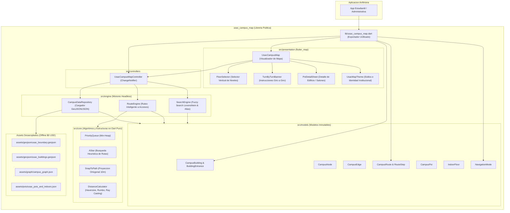

# Hoja de Ruta Tecnica de Desarrollo - usac_campus_map

Documento confidencial e interno de planificacion de ingenieria para la libreria modular `usac_campus_map` de Trebol4Devop.

---

## 1. Vision del Producto y Proposito

Consolidar `usac_campus_map` como una biblioteca de referencia para navegacion, Sistemas de Informacion Geografica (GIS) y ruteo sobre grafos para el Campus Central de la Universidad de San Carlos de Guatemala (Zona 12), operando al 100% en modo offline, con presupuesto cero ($0 USD), sin dependencias de servicios de pago o backends obligatorios.

---

## 2. Arquitectura Headless Engine + Capa de Presentacion

---

## 3. Estado de Fases de Implementacion

### Fase 1: Desmantelamiento de Datos Quemados y Desacoplamiento (Completada)
- Eliminacion de estructuras de datos estaticas compiladas (`usac_campus_dataset.dart`, `usac_building_footprints.dart`, `usac_campus_walkway_graph.dart`).
- Migracion integral a archivos estandarizados en `assets/`:
  - `usac_boundary.geojson`: Perimetro oficial del campus en coordenadas [longitud, latitud].
  - `usac_buildings.geojson`: FeatureCollection de poligonos reales con id, nombre, codigo, categoria, numero de pisos y accesos formales (`BuildingEntrance`).
  - `campus_graph.json`: Red interconectada de nodos y aristas clasificadas (`walkway`, `stairs`, `roadway`, `covered`).
  - `usac_pois_and_indoors.json`: Estructura jerarquica de niveles y salones/oficinas con alias sancarlistas.

### Fase 2: Algoritmos y Estructuras Matematicas en Dart Puro (Completada)
- `PriorityQueue`: Implementacion de Min-Heap generico para ordenamiento eficiente en O(log n).
- `AStar`: Motor de busqueda A* con evaluacion admisible y adaptacion segun `NavigationMode`:
  - `pedestrian`: Caminos peatonales estandar.
  - `accessible`: Asigna peso infinito a escaleras (`stairs`), garantizando rutas aptas para movilidad reducida y rampas.
  - `covered`: Reduce el factor de costo a tramos techados (`covered`), priorizando trayectos protegidos ante lluvia.
  - `vehicle`: Restriccion estricta a calzadas vehiculares perimetrales (`roadway`).
- `SnapToPath`: Proyeccion ortogonal a la arista peatonal mas cercana en radio maximo de 10 metros para corregir imprecisiones del sensor GPS.
- `DistanceCalculator`: Formula de Haversine, calculo de rumbos iniciales (bearing) y prueba de punto en poligono (ray casting).

### Fase 3: Motores Headless Locales (Completada)
- `CampusDataRepository`: Carga autonoma desde `AssetBundle` o JSON en memoria.
- `RouteEngine`: Resolucion inteligente de rutas calculadas hacia la puerta formal (`BuildingEntrance`) mas conveniente, nunca hacia el centro geometrico. Ruteo entre edificios, coordenadas y POIs.
- `SearchEngine`: Indexacion en memoria con algoritmo de distancia de Levenshtein para tolerancia a erratas tipograficas. Integracion de diccionario de alias universitarios ("El Iglú", "Plaza de los Mártires", "T-3", "T-1", "S-12", "CUM", "El Huerto", "Los Cubos", cajeros 5B/BAC, bibliotecas).

### Fase 4: Integracion de Visualizacion Moderna sobre flutter_map (Completada)
- Eliminacion de la pintura manual sobre Canvas y sustitucion por `flutter_map` v7 y `latlong2`.
- `PolygonLayer`: Poligonos de huellas de edificios interactivos con deteccion de toque y realce visual.
- `PolylineLayer`: Trazado dinamico de ruta con estilizacion diferencial por tipo de segmento (escaleras y tramos techados).
- `MarkerLayer`: Marcadores de ubicacion del usuario, accesos de edificios seleccionados y POIs interiores del piso activo.
- `UsacCampusMapController`: Controlador expuesto con metodos publicos `loadData()`, `findRoute()`, `search()`, `selectBuilding()`, `selectFloor()`, `clearRoute()` y `centerOnUser()`.

### Fase 5: Componentes de Interfaz y Navegacion Interior (Completada)
- `FloorSelector`: Widget selector vertical flotante que permite alternar niveles arquitectonicos (1, 2, 3...) mostrando los salones y dependencias de cada piso.
- `TurnByTurnBanner`: Banner superior que muestra instrucciones de giro calculadas por angulo de rumbo, distancia y modo de transporte.
- `PoiDetailSheet`: Modal de presentacion de detalles de edificio o salon con boton de accion inmediata de ruteo.
- `UsacMapTheme`: Tema institucional configurable con colores sancarlistas (Azul #002B49, Dorado #D4AF37).

### Fase 6: Aplicacion de Ejemplo y Suite de Pruebas (Completada)
- `example/lib/main.dart`: Demostracion interactiva completa con buscador por alias, planificador de rutas multimodales y selector de pisos.
- Ingestion de Datos Cartograficos Veridicos (OpenStreetMap Ground Truth):
  - Extraccion y sustitucion de huellas arquitectonicas exactas (`usac_buildings.geojson`) con 41 edificios modelados con poligonos reales y accesos vinculados.
  - Grafo topologico veridico (`campus_graph.json`) con 1,470 nodos y 3,618 aristas conectadas siguiendo la camineria peatonal, escaleras y pasos techados reales.
  - Sincronizacion completa con niveles y POIs interiores (`usac_pois_and_indoors.json`).
- Suite de pruebas unitarias y de widgets con 100% de aprobacion:
  - `test/core_algorithms_test.dart`
  - `test/engine_test.dart`
  - `test/controller_and_widgets_test.dart`
  - `test/ground_truth_dataset_test.dart`
  - `example/test/widget_test.dart`
- Verificacion de analisis estatico `flutter analyze` con 0 errores y 0 advertencias.
- Cumplimiento estricto de cero comentarios en codigo Dart.

---

### Fase 7: Empaquetado Vectorial y Teselas Offline (Completada)
- `TileIndex`: Calculo matematico de coordenadas de teselas slippy map (x, y, zoom) a partir de coordenadas geograficas LatLng y delimitacion de rangos por bounding box.
- `OfflineTilePackage`: Definicion y validacion de paquetes de teselas offline con delimitacion estricta para el campus central de la USAC.
- `CampusOfflineTileProvider`: Proveedor de teselas para flutter_map con soporte para paquetes locales y fallback a teselas transparentes sin emisiones de red.
- Cobertura de pruebas unitarias en `test/offline_tile_test.dart`.

### Fase 8: Navegacion Giro a Giro en Tiempo Real (Completada)
- `RealtimeNavigationEngine`: Motor de seguimiento continuo del usuario sobre la ruta activa con calculo de progreso, distancia y tiempo estimado en tiempo real.
- Deteccion de desviacion de ruta (recalculo automatico cuando la distancia al camino supere el umbral de 15 metros).
- `NavigationVoiceNotifier`: Sistema de alertas habladas y notificaciones verbales en espanol con indicaciones de giro, avance y llegada.
- `NavigationTrackingState`: Estado inmutable de navegacion activo consumido por `TurnByTurnBanner` y visualizador de mapa.
- Orientacion dinamica de flecha de rumbo del usuario segun brujula en `UsacCampusMap`.
- Cobertura de pruebas unitarias en `test/realtime_navigation_test.dart`.

### Fase 9: Mapeo Tridimensional y Realidad Aumentada (Completada)
- `ArProjectionEngine`: Motor matematico de proyeccion visual en perspectiva para camara y realidad aumentada considerando rumbo, acimut, elevacion y campo de vision (FOV).
- `ArWaypoint` y `ArProjectionResult`: Modelos de objetivos espaciales proyectados y coordenadas de pantalla con indicadores de borde.
- `Building3DModel`: Extrusion volumetrica tridimensional de huellas arquitectonicas de edificios segun numero de niveles y alturas de piso.
- `ArWayfindingView`: Widget de superposicion visual para navegacion AR sobre camara.
- `Building3DViewer`: Visor interactivo 3D con rotacion, inclinacion y escala mediante gestos tactiles.
- Cobertura de pruebas unitarias y de widgets en `test/ar_and_3d_test.dart`.

