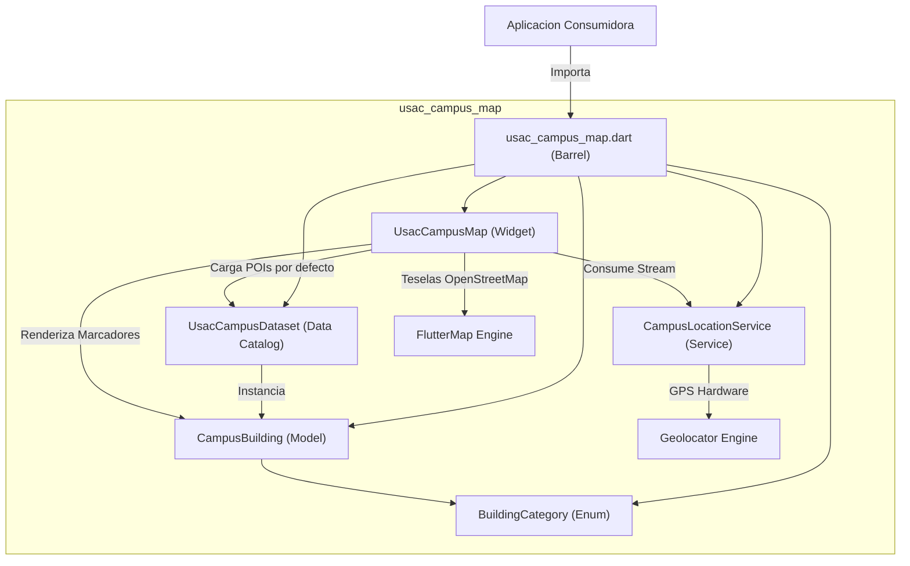
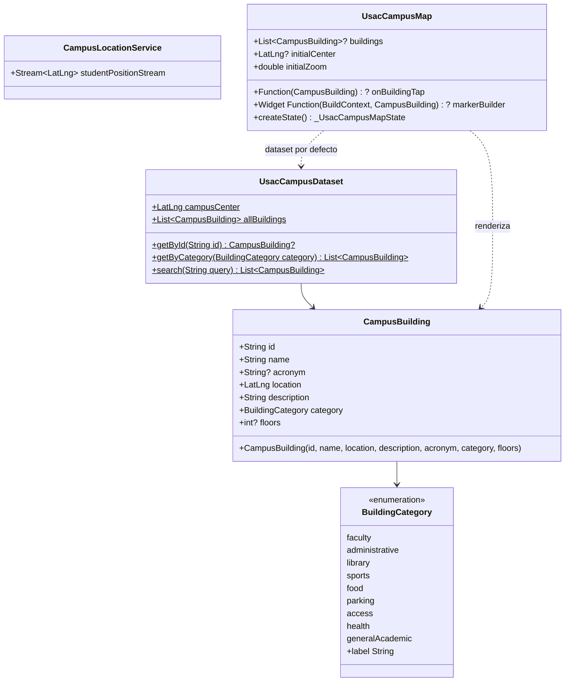

# usac_campus_map

Libreria modular y privada en Flutter para la visualizacion interactiva del mapa del Campus Central de la Universidad de San Carlos de Guatemala (USAC), consulta de puntos de interes (POIs) y seguimiento de geolocalizacion en tiempo real.

---

## Caracteristicas Principales

- **Dataset Oficial Exhaustivo (`UsacCampusDataset`):** Mas de 40 puntos estrategicos del Campus Central georreferenciados con alta precision:
  - Complejo T (T-1 a T-13: Odontologia, Farmacia, Ingenieria, ERIS, Ciencias Fisicas).
  - Complejo S (S-1 a S-12: Derecho, Economicas, Comunicacion, Trabajo Social, Ciencia Politica, EFPEM, Humanidades, Historia).
  - Complejo M (M-1 a M-5: Agronomia, Veterinaria, Hospital Veterinario).
  - Edificios Institucionales (Rectoria General, Bienestar Estudiantil, Auditorio IGLU, SUN, Registro y Estadistica, Centro de Calculo).
  - Servicios Universitarios y Cultura (Biblioteca Central Cesar Branas, CALUSAC, Editorial Universitaria).
  - Salud (Centro de Salud Universitario, Clinicas Dentales integrales).
  - Infraestructura Deportiva (Estadio Revolucion, Piscinas Olimpicas, Polideportivo Central).
  - Movilidad y Accesos (Estaciones oficiales de parqueo y garitas de control en Periferico, Petapa y San Marcos).
- **Categorizacion Estructurada (`BuildingCategory`):** Clasificacion por dominios funcionales (facultad, administracion, biblioteca, deportes, alimentacion, parqueo, acceso, salud, academico general) con estandarizacion de colores e iconos.
- **Consultas y Busqueda Integrada:** Metodos nativos de busqueda en el dataset por nombre, sigla o acronimo (ej. "T-3", "S-2", "RECT"), y filtrado reactivo por categoria.
- **Seguimiento GPS en Tiempo Real:** Servicio reactivo (`CampusLocationService`) que expone un `Stream<LatLng>` de alta precision y filtro de distancia de 3 metros.
- **Motor de Renderizado Flexible:** Widget `UsacCampusMap` basado en OpenStreetMap con marcadores configurados por defecto segun la categoria del edificio y soporte de `markerBuilder` personalizable.

---

## Arquitectura del Sistema



---

## Diagrama de Clases



---

## Instalacion y Configuracion

### Dependencia en `pubspec.yaml`
```yaml
dependencies:
  usac_campus_map:
    git:
      url: https://github.com/Trebol4Devop/usac_campus_map.git
      ref: main
```

### Permisos de Plataforma

#### Android (`android/app/src/main/AndroidManifest.xml`)
```xml
<uses-permission android:name="android.permission.INTERNET" />
<uses-permission android:name="android.permission.ACCESS_FINE_LOCATION" />
<uses-permission android:name="android.permission.ACCESS_COARSE_LOCATION" />
```

#### iOS (`ios/Runner/Info.plist`)
```xml
<key>NSLocationWhenInUseUsageDescription</key>
<string>Se requiere acceso a la ubicacion para mostrar tu posicion en el mapa del campus.</string>
```

---

## Ejemplo de Uso Basico

```dart
import 'package:flutter/material.dart';
import 'package:usac_campus_map/usac_campus_map.dart';

void main() {
  runApp(const MaterialApp(home: CampusScreen()));
}

class CampusScreen extends StatelessWidget {
  const CampusScreen({super.key});

  @override
  Widget build(BuildContext context) {
    return Scaffold(
      appBar: AppBar(
        title: const Text('Campus Central USAC'),
      ),
      body: UsacCampusMap(
        onBuildingTap: (building) {
          ScaffoldMessenger.of(context).showSnackBar(
            SnackBar(
              content: Text('${building.name} - ${building.category.label}'),
            ),
          );
        },
      ),
    );
  }
}
```

---

## Aplicacion de Demostracion (`example/`)

El repositorio incluye una aplicacion interactiva en el directorio `example/` con barra de busqueda por nombre o sigla (T-3, S-2, Rectoria, etc.), filtros por chip de categoria y modal de informacion detallada.

Para ejecutarla en su dispositivo:
```bash
cd example
flutter run
```

---

## Modelo Git Flow

- `main`: Rama de produccion y versiones estables.
- `develop`: Rama principal de integracion y desarrollo.
- `feature/*`: Ramas de soporte para nuevas funcionalidades.
- `bugfix/*` / `hotfix/*`: Correcciones controladas.
- Convencion de commits: Conventional Commits (`feat:`, `fix:`, `chore:`, `docs:`, `test:`, `refactor:`).

---

## Licencia y Confidencialidad

Propiedad privada y confidencial de Trebol4Devop. Todos los derechos reservados.
Consulte el archivo `LICENSE` para conocer las condiciones de uso comercial e interno.
