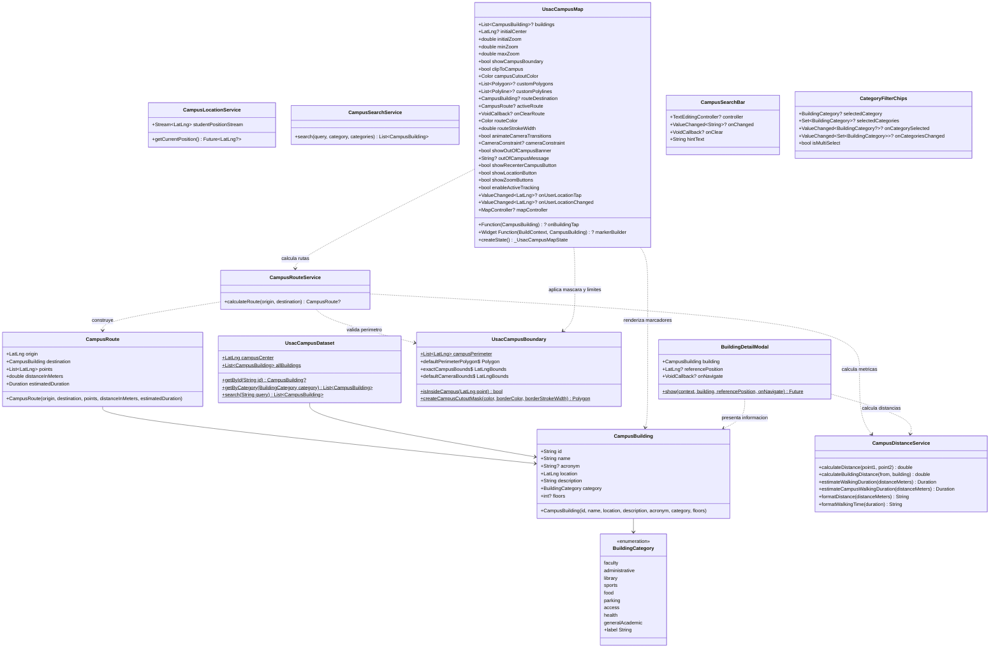
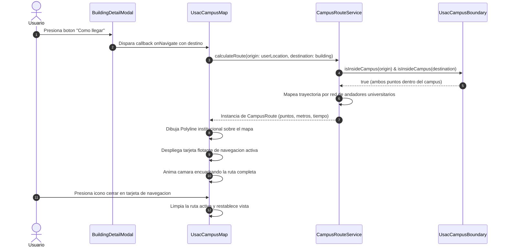

# usac_campus_map

Libreria modular y privada en Flutter para la visualizacion interactiva del mapa del Campus Central de la Universidad de San Carlos de Guatemala (USAC), delimitacion perimetral, recorte cartografico exclusivo, calculo de rutas peatonales por andadores, consulta de puntos de interes (POIs) y seguimiento de geolocalizacion en tiempo real.

---

## Caracteristicas Principales

- **Cartografia Exclusiva del Campus Central:** Capacidad de recorte visual inverso (`clipToCampus`) que enmascara el exterior del campus y proyecta unicamente el area oficial universitaria con borde institucional azul USAC (`#002B49`).
- **Navegacion y Delimitacion Espacial Estricta:** Restriccion de camara (`cameraConstraint`) y limite de descarga de teselas (`tileBounds`) a la extension exacta de la universidad (`exactCampusBounds`).
- **Catalogo Oficial Georreferenciado:** Mas de 45 puntos de interes estructurados en 9 categorias tematicas con coordenadas exactas verificadas sobre OpenStreetMap.
- **Enrutamiento Peatonal por Andadores (`CampusRouteService`):** Algoritmo de navegacion a pie guiado por la red de senderos y pasarelas internas del campus, calculando la distancia real y tiempo estimado de caminata.
- **Geolocalizacion Reactiva e Inclusiva:** Deteccion satelital en tiempo real (`CampusLocationService`) con verificacion de permanencia en el campus mediante Ray Casting (`isInsideCampus`) y deteccion pasiva sin forzar solicitudes de permisos si el hardware esta desactivado.
- **Buscador Inteligente y Filtros:** Busqueda por coincidencias difusas en nombres, siglas y facultades (`CampusSearchService`), complementado con selectores de categorias individuales o multiples.
- **Componentes Modulares Reutilizables:** Widgets independientes (`UsacCampusMap`, `CampusSearchBar`, `CategoryFilterChips`, `BuildingDetailModal`) listos para ser ensamblados en cualquier aplicacion estudiantil o administrativa.

---

## Inventario Oficial de Edificios y Puntos Georreferenciados

La libreria cuenta con mas de 45 puntos de interes georreferenciados con exactitud de centroide:

### 1. Facultad de Arquitectura (FARUSAC)
- **`T-1` (Talleres de Arquitectura):** Talleres de diseno arquitectonico, salones de dibujo tecnico, modelado y maquetas.
- **`T-2` (Sede Central FARUSAC):** Decanatura de Arquitectura, Direccion de la Escuela de Diseno Grafico, coordinacion academica y administracion.
- **`PRK-ARQ` (Estacionamiento Arquitectura):** Area de parqueo vehicular contigua a los edificios T-1 y T-2.

### 2. Facultad de Ingenieria (FIUSAC)
- **`T-3` (Sede Central FIUSAC):** Decanatura de Ingenieria, Escuelas de Ingenieria Civil e Ingenieria Mecanica, Centro de Computo y oficinas administrativas.
- **`T-4` (Ingenieria Quimica e Industrial):** Escuelas de Ingenieria Quimica e Industrial, coordinacion de Ejercicio Profesional Supervisado (EPS).
- **`T-6` (Aulas de Ingenieria):** Modulo de catedra, salones docentes y aulas para ciclos intermedios.
- **`T-7` (Talleres de Mecanica):** Talleres de manufactura, soldadura, metrologia, maquinas herramientas y fundicion.
- **`CII` (Centro de Investigaciones de Ingenieria):** Ensayos estructurales, sismologia, investigacion aplicada y desarrollo tecnologico.
- **`ERIS` (Escuela Regional de Ingenieria Sanitaria):** Posgrados en recursos hidricos, tratamiento de aguas y saneamiento ambiental.
- **`CANCHA-ING` (Cancha de Ingenieria):** Area recreativa polideportiva adyacente a T-3 y T-4.
- **`PRK-ING` (Estacionamiento Ingenieria):** Area de parqueo vehicular y de motocicletas del sector tecnologico.

### 3. Facultad de Odontologia
- **`M-1` (Sede Central Odontologia):** Decanatura de Odontologia, aulas magnas y auditorios de docencia.
- **`M-2` (Clinicas Integrales Odontologicas):** Modulo de clinicas dentales abiertas a atencion estudiantil y del publico general.
- **`M-3` (Laboratorios Odontologicos):** Laboratorios de protesis dental, radiologia, biomateriales y ortodoncia.

### 4. Facultad de Ciencias Quimicas y Farmacia
- **`T-15` (Sede Central Farmacia):** Decanatura de Ciencias Quimicas y Farmacia y Auditorio Principal.
- **`T-10` (Escuela de Biologia):** Aulas docentes, herbarios y laboratorios de investigacion biologica.
- **`T-11` (Escuela de Nutricion):** Laboratorios de bromatologia, evaluacion nutricional y aulas docentes.
- **`T-13` (Planta Piloto):** Planta de procesamiento farmaceutico, industrializacion de medicamentos y control microbiologico.
- **`T-14` (Laboratorios Especializados):** Laboratorios de analisis instrumental y control de calidad quimico.

### 5. Facultad de Agronomia (FAUSAC)
- **`T-8` (Docencia Agronomia):** Secretaria Academica de Agronomia, aulas tecnicas y coordinaciones docentes.
- **`T-9` (Sede Central FAUSAC):** Decanatura de Agronomia, administracion central y departamentos tecnicos.
- **`UVIGER` (Laboratorios Tecnicos):** Unidad de Vinculacion y Laboratorios de Suelos, Fitopatologia y Biotecnologia.
- **`CEDA` (Centro Experimental Docente):** Campos de cultivo, invernaderos, viveros y parcelas demostrativas.
- **`PRK-AGRO` (Estacionamiento Agronomia):** Aparcamiento docente y estudiantil de ciencias agropecuarias.

### 6. Facultad de Medicina Veterinaria y Zootecnia (FMVZ)
- **`M-8` (Hospital Veterinario Universitario):** Hospital Veterinario (HVAC) con atencion a especies menores y mayores, quirofanos y clinicas.

### 7. Area de Ciencias Sociales y Humanidades
- **`S-2` (Facultad de Ciencias Juridicas y Sociales):** Decanatura de Derecho, bufete popular y salas de juicios orales simulados.
- **`S-3` (Facultad de Ciencias Economicas):** Decanatura de Economicas, Escuelas de Auditoria, Economia y Administracion de Empresas.
- **`S-4` (Escuela de Ciencias de la Comunicacion):** Sede de la ECC, cabinas de grabacion de audio, radio universitaria y set de television.
- **`S-5` (Escuela de Trabajo Social):** Docencia e investigacion social comunitaria.
- **`S-8` (Posgrados Sociales):** Escuela de Estudios de Posgrado de las areas economica y social.
- **`S-9` (Escuela de Historia):** Antropologia, arqueologia, historia y archivo documental de investigaciones.
- **`S-10` (Facultad de Humanidades):** Decanatura de Humanidades, Departamentos de Pedagogia, Letras, Filosofia y Arte.
- **`S-12` y `ANEXO-S12` (EFPEM):** Escuela de Formacion de Profesores de Ensenanza Media y profesorados tecnicos.
- **`S-13` (CALUSAC):** Escuela de Ciencias Linguisticas y Centro de Aprendizaje de Lenguas.

### 8. Area Administrativa, Institucional y Cultural
- **`RECT` (Edificio de Rectoria):** Sede central del gobierno universitario y Consejo Superior Universitario (CSU).
- **`PLAZA` (Plaza de los Martires):** Plaza civica e historica de concentracion de la comunidad universitaria.
- **`BIBLIO` (Biblioteca Central Cesar Branas):** Acervo bibliografico general, hemeroteca, salas de tesis y repositorio digital.
- **`CAJA` (Caja Central):** Tesoreria, departamento de caja y gestion financiera universitaria.
- **`RyE` (Registro y Estadistica):** Matricula estudiantil, equivalencias, certificaciones de cursos y tramites de graduacion.
- **`IGLU` (Auditorio IGLU):** Auditorio de asambleas magistrales, congresos y actos de graduacion.
- **`BCIE` (Edificio USAC-BCIE):** Modulo de gestion institucional y cooperacion universitaria.
- **`EDITORIAL` (Editorial Universitaria):** Editorial, produccion y venta de textos y libros universitarios.
- **`AEU` (Sede AEU):** Asociacion de Estudiantes Universitarios Oliverio Castaneda de Leon.
- **`REY-CARLOS` (Colegio Rey Carlos II):** Centro educativo infantil para hijos de trabajadores y estudiantes USAC.
- **`CULTURA` (Casa de la Cultura de Agronomia):** Espacio cultural y extension comunitaria.

### 9. Salud y Asistencia Universitaria
- **`SALUD` (Centro de Salud y Farmacia Universitaria):** Atencion medica ambulatoria, farmacia social y atencion preventiva.
- **`M-2` (Clinicas Odontologicas):** Clinicas de atencion dental general y especializada.
- **`M-8` (Hospital Veterinario Universitario):** Atencion medica y quirurgica veterinaria.

### 10. Infraestructura Deportiva
- **`ESTADIO` (Estadio Revolucion):** Cancha de futbol reglamentaria, graderias principales y pista de atletismo.
- **`POLI` (Polideportivo Central):** Gimnasio cerrado para baloncesto, voleibol, futsal y entrenamientos.
- **`TENIS` (Canchas de Tenis USAC):** Canchas reglamentarias de tenis universitario.
- **`CANCHA-ING` (Cancha de Ingenieria):** Cancha polideportiva del sector T.

### 11. Movilidad, Garitas y Accesos Oficiales
- **`GAR-PER` (Garita Periferico):** Ingreso y egreso vehicular y peatonal del poniente (Anillo Periferico).
- **`GAR-PET` (Garita Petapa):** Acceso vehicular y pasarela peatonal del oriente (Avenida Petapa).
- **`GAR-SMR` (Garita San Marcos):** Control y acceso peatonal del sector norte.
- **`PRK-PER` (Estacionamiento Periferico):** Parqueo amplio del sector poniente.
- **`PRK-PET` (Estacionamiento Petapa):** Parqueo del sector oriente.

---

## Delimitacion Perimetral y Recorte Cartografico (`UsacCampusBoundary`)

La libreria incorpora la delimitacion espacial completa del terreno de la universidad mediante un poligono de 80 vertices georreferenciados:

- **Propiedad `campusPerimeter`:** Lista inmutable `List<LatLng>` con el perimetro oficial del campus central.
- **Metodo `isInsideCampus(LatLng point)`:** Algoritmo de punto en poligono (Ray Casting) para determinar si un dispositivo o coordenada esta dentro del territorio de la USAC.
- **Metodo `createCampusCutoutMask(...)`:** Construye un poligono de mascara inversa que cubre el cuadrante exterior completo y perfora un orificio con los vertices de `campusPerimeter`, recortando el mapa al area universitaria con borde azul `#002B49`.
- **Propiedad `defaultPerimeterPolygon`:** Poligono traslucido institucional para renderizado perimetral en `PolygonLayer`.
- **Propiedad `exactCampusBounds`:** Caja delimitadora cartografica (`LatLngBounds`) ajustada al perimetro universitario (Suroeste: `[14.5760, -90.5605]`, Noreste: `[14.5905, -90.5445]`).

---

## Arquitectura del Sistema

```drawio
<mxfile>
  <diagram id="w08KBxzEExrKkN0qXo3o" name="Page-1">
    <mxGraphModel dx="2" dy="1" grid="0" gridSize="10" guides="1" tooltips="0" connect="0" arrows="0" fold="0" page="0" pageScale="1" pageWidth="850" pageHeight="1100" math="0" shadow="0">
      <root>
        <mxCell id="Kj5DDM0SWF84uf2z0e13-0" />
        <mxCell id="Kj5DDM0SWF84uf2z0e13-1" parent="Kj5DDM0SWF84uf2z0e13-0" />
        <UserObject label="" mermaidData="{&#xa;  &quot;data&quot;: &quot;graph TD\n    ClientApp[\&quot;Aplicacion Consumidora\&quot;] --&gt;|Importa| Barrel[\&quot;usac_campus_map.dart (Barrel)\&quot;]\n    \n    subgraph usac_campus_map\n        Barrel --&gt; UsacMapWidget[\&quot;UsacCampusMap (Widget)\&quot;]\n        Barrel --&gt; SearchBarWidget[\&quot;CampusSearchBar (Widget)\&quot;]\n        Barrel --&gt; ChipsWidget[\&quot;CategoryFilterChips (Widget)\&quot;]\n        Barrel --&gt; ModalWidget[\&quot;BuildingDetailModal (Widget)\&quot;]\n        Barrel --&gt; BuildingModel[\&quot;CampusBuilding (Model)\&quot;]\n        Barrel --&gt; CategoryEnum[\&quot;BuildingCategory (Enum)\&quot;]\n        Barrel --&gt; RouteModel[\&quot;CampusRoute (Model)\&quot;]\n        Barrel --&gt; Dataset[\&quot;UsacCampusDataset (Data Catalog)\&quot;]\n        Barrel --&gt; Boundary[\&quot;UsacCampusBoundary (Delimitacion Espacial)\&quot;]\n        Barrel --&gt; LocationSvc[\&quot;CampusLocationService (Service)\&quot;]\n        Barrel --&gt; SearchSvc[\&quot;CampusSearchService (Service)\&quot;]\n        Barrel --&gt; DistanceSvc[\&quot;CampusDistanceService (Service)\&quot;]\n        Barrel --&gt; RouteSvc[\&quot;CampusRouteService (Service)\&quot;]\n        \n        UsacMapWidget --&gt;|Consume Stream GPS| LocationSvc\n        UsacMapWidget --&gt;|Carga POIs por Defecto| Dataset\n        UsacMapWidget --&gt;|Mascara de Recorte y Limites| Boundary\n        UsacMapWidget --&gt;|Calcula Ruta Peatonal| RouteSvc\n        RouteSvc --&gt;|Calcula Metros y Tiempos| DistanceSvc\n        RouteSvc --&gt;|Valida Limites de Origen/Destino| Boundary\n        Dataset --&gt;|Instancia| BuildingModel\n        BuildingModel --&gt; CategoryEnum\n        UsacMapWidget --&gt;|Renderiza Marcadores| BuildingModel\n        ModalWidget --&gt;|Calcula Metros y Tiempos| DistanceSvc\n        SearchBarWidget --&gt;|Dispara Consultas| SearchSvc\n        LocationSvc --&gt;|Verifica Pertenencia al Campus| Boundary\n        LocationSvc --&gt;|Hardware GPS| GeolocatorPlugin[\&quot;Geolocator Engine\&quot;]\n        UsacMapWidget --&gt;|Teselas OpenStreetMap| FlutterMapEngine[\&quot;FlutterMap Engine\&quot;]\n    end&quot;,&#xa;  &quot;config&quot;: null&#xa;}" id="XF4uxaG8zc1gwPSvUS0A-0">
          <mxCell connectable="0" parent="Kj5DDM0SWF84uf2z0e13-1" style="group;transparentBounds=1;editIcon=1;lockedGroup=0;groupPadding=10;" vertex="1">
            <mxGeometry as="geometry" />
          </mxCell>
        </UserObject>
        <UserObject label="usac_campus_map" mermaidId="n:usac_campus_map" mermaidBaseStyle="html=1;whiteSpace=wrap;strokeWidth=1;verticalAlign=top;fillColor=light-dark(#ffffde,#1f2020);strokeColor=light-dark(#aaaa33,#cccccc);fontColor=light-dark(#333333,#cccccc);fontFamily=Trebuchet MS,Verdana,Arial,sans-serif;fontSize=16;" mermaidBaseValue="usac_campus_map" id="Kj5DDM0SWF84uf2z0e13-2">
          <mxCell parent="XF4uxaG8zc1gwPSvUS0A-0" style="html=1;whiteSpace=wrap;strokeWidth=1;verticalAlign=top;fillColor=light-dark(#ffffde,#1f2020);strokeColor=light-dark(#aaaa33,#cccccc);fontColor=light-dark(#333333,#cccccc);fontFamily=Trebuchet MS,Verdana,Arial,sans-serif;fontSize=16;" vertex="1">
            <mxGeometry height="578" width="2958" x="10" y="113" as="geometry" />
          </mxCell>
        </UserObject>
        <UserObject label="usac_campus_map.dart (Barrel)" mermaidId="n:Barrel" mermaidBaseStyle="html=1;whiteSpace=wrap;strokeWidth=1;fillColor=light-dark(#ECECFF,#1f2020);strokeColor=light-dark(#9370DB,#cccccc);fontColor=light-dark(#333333,#cccccc);fontFamily=Trebuchet MS,Verdana,Arial,sans-serif;fontSize=16;" mermaidBaseValue="usac_campus_map.dart (Barrel)" id="Kj5DDM0SWF84uf2z0e13-3">
          <mxCell parent="Kj5DDM0SWF84uf2z0e13-2" style="html=1;whiteSpace=wrap;strokeWidth=1;fillColor=light-dark(#ECECFF,#1f2020);strokeColor=light-dark(#9370DB,#cccccc);fontColor=light-dark(#333333,#cccccc);fontFamily=Trebuchet MS,Verdana,Arial,sans-serif;fontSize=16;" vertex="1">
            <mxGeometry height="54" width="288" x="892" y="45" as="geometry" />
          </mxCell>
        </UserObject>
        <UserObject label="UsacCampusMap (Widget)" mermaidId="n:UsacMapWidget" mermaidBaseStyle="html=1;whiteSpace=wrap;strokeWidth=1;fillColor=light-dark(#ECECFF,#1f2020);strokeColor=light-dark(#9370DB,#cccccc);fontColor=light-dark(#333333,#cccccc);fontFamily=Trebuchet MS,Verdana,Arial,sans-serif;fontSize=16;" mermaidBaseValue="UsacCampusMap (Widget)" id="Kj5DDM0SWF84uf2z0e13-4">
          <mxCell parent="Kj5DDM0SWF84uf2z0e13-2" style="html=1;whiteSpace=wrap;strokeWidth=1;fillColor=light-dark(#ECECFF,#1f2020);strokeColor=light-dark(#9370DB,#cccccc);fontColor=light-dark(#333333,#cccccc);fontFamily=Trebuchet MS,Verdana,Arial,sans-serif;fontSize=16;" vertex="1">
            <mxGeometry height="54" width="244" x="1571" y="149" as="geometry" />
          </mxCell>
        </UserObject>
        <UserObject label="CampusSearchBar (Widget)" mermaidId="n:SearchBarWidget" mermaidBaseStyle="html=1;whiteSpace=wrap;strokeWidth=1;fillColor=light-dark(#ECECFF,#1f2020);strokeColor=light-dark(#9370DB,#cccccc);fontColor=light-dark(#333333,#cccccc);fontFamily=Trebuchet MS,Verdana,Arial,sans-serif;fontSize=16;" mermaidBaseValue="CampusSearchBar (Widget)" id="Kj5DDM0SWF84uf2z0e13-5">
          <mxCell parent="Kj5DDM0SWF84uf2z0e13-2" style="html=1;whiteSpace=wrap;strokeWidth=1;fillColor=light-dark(#ECECFF,#1f2020);strokeColor=light-dark(#9370DB,#cccccc);fontColor=light-dark(#333333,#cccccc);fontFamily=Trebuchet MS,Verdana,Arial,sans-serif;fontSize=16;" vertex="1">
            <mxGeometry height="54" width="253" x="751" y="149" as="geometry" />
          </mxCell>
        </UserObject>
        <UserObject label="CategoryFilterChips (Widget)" mermaidId="n:ChipsWidget" mermaidBaseStyle="html=1;whiteSpace=wrap;strokeWidth=1;fillColor=light-dark(#ECECFF,#1f2020);strokeColor=light-dark(#9370DB,#cccccc);fontColor=light-dark(#333333,#cccccc);fontFamily=Trebuchet MS,Verdana,Arial,sans-serif;fontSize=16;" mermaidBaseValue="CategoryFilterChips (Widget)" id="Kj5DDM0SWF84uf2z0e13-6">
          <mxCell parent="Kj5DDM0SWF84uf2z0e13-2" style="html=1;whiteSpace=wrap;strokeWidth=1;fillColor=light-dark(#ECECFF,#1f2020);strokeColor=light-dark(#9370DB,#cccccc);fontColor=light-dark(#333333,#cccccc);fontFamily=Trebuchet MS,Verdana,Arial,sans-serif;fontSize=16;" vertex="1">
            <mxGeometry height="54" width="268" x="145" y="149" as="geometry" />
          </mxCell>
        </UserObject>
        <UserObject label="BuildingDetailModal (Widget)" mermaidId="n:ModalWidget" mermaidBaseStyle="html=1;whiteSpace=wrap;strokeWidth=1;fillColor=light-dark(#ECECFF,#1f2020);strokeColor=light-dark(#9370DB,#cccccc);fontColor=light-dark(#333333,#cccccc);fontFamily=Trebuchet MS,Verdana,Arial,sans-serif;fontSize=16;" mermaidBaseValue="BuildingDetailModal (Widget)" id="Kj5DDM0SWF84uf2z0e13-7">
          <mxCell parent="Kj5DDM0SWF84uf2z0e13-2" style="html=1;whiteSpace=wrap;strokeWidth=1;fillColor=light-dark(#ECECFF,#1f2020);strokeColor=light-dark(#9370DB,#cccccc);fontColor=light-dark(#333333,#cccccc);fontFamily=Trebuchet MS,Verdana,Arial,sans-serif;fontSize=16;" vertex="1">
            <mxGeometry height="54" width="268" x="2128" y="272" as="geometry" />
          </mxCell>
        </UserObject>
        <UserObject label="CampusBuilding (Model)" mermaidId="n:BuildingModel" mermaidBaseStyle="html=1;whiteSpace=wrap;strokeWidth=1;fillColor=light-dark(#ECECFF,#1f2020);strokeColor=light-dark(#9370DB,#cccccc);fontColor=light-dark(#333333,#cccccc);fontFamily=Trebuchet MS,Verdana,Arial,sans-serif;fontSize=16;" mermaidBaseValue="CampusBuilding (Model)" id="Kj5DDM0SWF84uf2z0e13-8">
          <mxCell parent="Kj5DDM0SWF84uf2z0e13-2" style="html=1;whiteSpace=wrap;strokeWidth=1;fillColor=light-dark(#ECECFF,#1f2020);strokeColor=light-dark(#9370DB,#cccccc);fontColor=light-dark(#333333,#cccccc);fontFamily=Trebuchet MS,Verdana,Arial,sans-serif;fontSize=16;" vertex="1">
            <mxGeometry height="54" width="232" x="2581" y="395" as="geometry" />
          </mxCell>
        </UserObject>
        <UserObject label="BuildingCategory (Enum)" mermaidId="n:CategoryEnum" mermaidBaseStyle="html=1;whiteSpace=wrap;strokeWidth=1;fillColor=light-dark(#ECECFF,#1f2020);strokeColor=light-dark(#9370DB,#cccccc);fontColor=light-dark(#333333,#cccccc);fontFamily=Trebuchet MS,Verdana,Arial,sans-serif;fontSize=16;" mermaidBaseValue="BuildingCategory (Enum)" id="Kj5DDM0SWF84uf2z0e13-9">
          <mxCell parent="Kj5DDM0SWF84uf2z0e13-2" style="html=1;whiteSpace=wrap;strokeWidth=1;fillColor=light-dark(#ECECFF,#1f2020);strokeColor=light-dark(#9370DB,#cccccc);fontColor=light-dark(#333333,#cccccc);fontFamily=Trebuchet MS,Verdana,Arial,sans-serif;fontSize=16;" vertex="1">
            <mxGeometry height="54" width="237" x="1317" y="499" as="geometry" />
          </mxCell>
        </UserObject>
        <UserObject label="CampusRoute (Model)" mermaidId="n:RouteModel" mermaidBaseStyle="html=1;whiteSpace=wrap;strokeWidth=1;fillColor=light-dark(#ECECFF,#1f2020);strokeColor=light-dark(#9370DB,#cccccc);fontColor=light-dark(#333333,#cccccc);fontFamily=Trebuchet MS,Verdana,Arial,sans-serif;fontSize=16;" mermaidBaseValue="CampusRoute (Model)" id="Kj5DDM0SWF84uf2z0e13-10">
          <mxCell parent="Kj5DDM0SWF84uf2z0e13-2" style="html=1;whiteSpace=wrap;strokeWidth=1;fillColor=light-dark(#ECECFF,#1f2020);strokeColor=light-dark(#9370DB,#cccccc);fontColor=light-dark(#333333,#cccccc);fontFamily=Trebuchet MS,Verdana,Arial,sans-serif;fontSize=16;" vertex="1">
            <mxGeometry height="54" width="215" x="463" y="149" as="geometry" />
          </mxCell>
        </UserObject>
        <UserObject label="UsacCampusDataset (Data Catalog)" mermaidId="n:Dataset" mermaidBaseStyle="html=1;whiteSpace=wrap;strokeWidth=1;fillColor=light-dark(#ECECFF,#1f2020);strokeColor=light-dark(#9370DB,#cccccc);fontColor=light-dark(#333333,#cccccc);fontFamily=Trebuchet MS,Verdana,Arial,sans-serif;fontSize=16;" mermaidBaseValue="UsacCampusDataset (Data Catalog)" id="Kj5DDM0SWF84uf2z0e13-11">
          <mxCell parent="Kj5DDM0SWF84uf2z0e13-2" style="html=1;whiteSpace=wrap;strokeWidth=1;fillColor=light-dark(#ECECFF,#1f2020);strokeColor=light-dark(#9370DB,#cccccc);fontColor=light-dark(#333333,#cccccc);fontFamily=Trebuchet MS,Verdana,Arial,sans-serif;fontSize=16;" vertex="1">
            <mxGeometry height="54" width="312" x="2498" y="272" as="geometry" />
          </mxCell>
        </UserObject>
        <UserObject label="UsacCampusBoundary (Delimitacion Espacial)" mermaidId="n:Boundary" mermaidBaseStyle="html=1;whiteSpace=wrap;strokeWidth=1;fillColor=light-dark(#ECECFF,#1f2020);strokeColor=light-dark(#9370DB,#cccccc);fontColor=light-dark(#333333,#cccccc);fontFamily=Trebuchet MS,Verdana,Arial,sans-serif;fontSize=16;" mermaidBaseValue="UsacCampusBoundary (Delimitacion Espacial)" id="Kj5DDM0SWF84uf2z0e13-12">
          <mxCell parent="Kj5DDM0SWF84uf2z0e13-2" style="html=1;whiteSpace=wrap;strokeWidth=1;fillColor=light-dark(#ECECFF,#1f2020);strokeColor=light-dark(#9370DB,#cccccc);fontColor=light-dark(#333333,#cccccc);fontFamily=Trebuchet MS,Verdana,Arial,sans-serif;fontSize=16;" vertex="1">
            <mxGeometry height="54" width="385" x="625" y="395" as="geometry" />
          </mxCell>
        </UserObject>
        <UserObject label="CampusLocationService (Service)" mermaidId="n:LocationSvc" mermaidBaseStyle="html=1;whiteSpace=wrap;strokeWidth=1;fillColor=light-dark(#ECECFF,#1f2020);strokeColor=light-dark(#9370DB,#cccccc);fontColor=light-dark(#333333,#cccccc);fontFamily=Trebuchet MS,Verdana,Arial,sans-serif;fontSize=16;" mermaidBaseValue="CampusLocationService (Service)" id="Kj5DDM0SWF84uf2z0e13-13">
          <mxCell parent="Kj5DDM0SWF84uf2z0e13-2" style="html=1;whiteSpace=wrap;strokeWidth=1;fillColor=light-dark(#ECECFF,#1f2020);strokeColor=light-dark(#9370DB,#cccccc);fontColor=light-dark(#333333,#cccccc);fontFamily=Trebuchet MS,Verdana,Arial,sans-serif;fontSize=16;" vertex="1">
            <mxGeometry height="54" width="297" x="1781" y="272" as="geometry" />
          </mxCell>
        </UserObject>
        <UserObject label="CampusSearchService (Service)" mermaidId="n:SearchSvc" mermaidBaseStyle="html=1;whiteSpace=wrap;strokeWidth=1;fillColor=light-dark(#ECECFF,#1f2020);strokeColor=light-dark(#9370DB,#cccccc);fontColor=light-dark(#333333,#cccccc);fontFamily=Trebuchet MS,Verdana,Arial,sans-serif;fontSize=16;" mermaidBaseValue="CampusSearchService (Service)" id="Kj5DDM0SWF84uf2z0e13-14">
          <mxCell parent="Kj5DDM0SWF84uf2z0e13-2" style="html=1;whiteSpace=wrap;strokeWidth=1;fillColor=light-dark(#ECECFF,#1f2020);strokeColor=light-dark(#9370DB,#cccccc);fontColor=light-dark(#333333,#cccccc);fontFamily=Trebuchet MS,Verdana,Arial,sans-serif;fontSize=16;" vertex="1">
            <mxGeometry height="54" width="283" x="652" y="272" as="geometry" />
          </mxCell>
        </UserObject>
        <UserObject label="CampusDistanceService (Service)" mermaidId="n:DistanceSvc" mermaidBaseStyle="html=1;whiteSpace=wrap;strokeWidth=1;fillColor=light-dark(#ECECFF,#1f2020);strokeColor=light-dark(#9370DB,#cccccc);fontColor=light-dark(#333333,#cccccc);fontFamily=Trebuchet MS,Verdana,Arial,sans-serif;fontSize=16;" mermaidBaseValue="CampusDistanceService (Service)" id="Kj5DDM0SWF84uf2z0e13-15">
          <mxCell parent="Kj5DDM0SWF84uf2z0e13-2" style="html=1;whiteSpace=wrap;strokeWidth=1;fillColor=light-dark(#ECECFF,#1f2020);strokeColor=light-dark(#9370DB,#cccccc);fontColor=light-dark(#333333,#cccccc);fontFamily=Trebuchet MS,Verdana,Arial,sans-serif;fontSize=16;" vertex="1">
            <mxGeometry height="54" width="296" x="1749" y="395" as="geometry" />
          </mxCell>
        </UserObject>
        <UserObject label="CampusRouteService (Service)" mermaidId="n:RouteSvc" mermaidBaseStyle="html=1;whiteSpace=wrap;strokeWidth=1;fillColor=light-dark(#ECECFF,#1f2020);strokeColor=light-dark(#9370DB,#cccccc);fontColor=light-dark(#333333,#cccccc);fontFamily=Trebuchet MS,Verdana,Arial,sans-serif;fontSize=16;" mermaidBaseValue="CampusRouteService (Service)" id="Kj5DDM0SWF84uf2z0e13-16">
          <mxCell parent="Kj5DDM0SWF84uf2z0e13-2" style="html=1;whiteSpace=wrap;strokeWidth=1;fillColor=light-dark(#ECECFF,#1f2020);strokeColor=light-dark(#9370DB,#cccccc);fontColor=light-dark(#333333,#cccccc);fontFamily=Trebuchet MS,Verdana,Arial,sans-serif;fontSize=16;" vertex="1">
            <mxGeometry height="54" width="276" x="985" y="272" as="geometry" />
          </mxCell>
        </UserObject>
        <UserObject label="Geolocator Engine" mermaidId="n:GeolocatorPlugin" mermaidBaseStyle="html=1;whiteSpace=wrap;strokeWidth=1;fillColor=light-dark(#ECECFF,#1f2020);strokeColor=light-dark(#9370DB,#cccccc);fontColor=light-dark(#333333,#cccccc);fontFamily=Trebuchet MS,Verdana,Arial,sans-serif;fontSize=16;" mermaidBaseValue="Geolocator Engine" id="Kj5DDM0SWF84uf2z0e13-17">
          <mxCell parent="Kj5DDM0SWF84uf2z0e13-2" style="html=1;whiteSpace=wrap;strokeWidth=1;fillColor=light-dark(#ECECFF,#1f2020);strokeColor=light-dark(#9370DB,#cccccc);fontColor=light-dark(#333333,#cccccc);fontFamily=Trebuchet MS,Verdana,Arial,sans-serif;fontSize=16;" vertex="1">
            <mxGeometry height="54" width="191" x="2192" y="395" as="geometry" />
          </mxCell>
        </UserObject>
        <UserObject label="FlutterMap Engine" mermaidId="n:FlutterMapEngine" mermaidBaseStyle="html=1;whiteSpace=wrap;strokeWidth=1;fillColor=light-dark(#ECECFF,#1f2020);strokeColor=light-dark(#9370DB,#cccccc);fontColor=light-dark(#333333,#cccccc);fontFamily=Trebuchet MS,Verdana,Arial,sans-serif;fontSize=16;" mermaidBaseValue="FlutterMap Engine" id="Kj5DDM0SWF84uf2z0e13-18">
          <mxCell parent="Kj5DDM0SWF84uf2z0e13-2" style="html=1;whiteSpace=wrap;strokeWidth=1;fillColor=light-dark(#ECECFF,#1f2020);strokeColor=light-dark(#9370DB,#cccccc);fontColor=light-dark(#333333,#cccccc);fontFamily=Trebuchet MS,Verdana,Arial,sans-serif;fontSize=16;" vertex="1">
            <mxGeometry height="54" width="190" x="1311" y="272" as="geometry" />
          </mxCell>
        </UserObject>
        <UserObject label="" mermaidId="e:Barrel-&gt;UsacMapWidget#0" mermaidBaseStyle="curved=1;startArrow=none;endArrow=block;endSize=7;strokeColor=light-dark(#333333,#cccccc);exitX=1;exitY=0.7;entryX=0.5;entryY=0;" mermaidBaseValue="" id="Kj5DDM0SWF84uf2z0e13-21">
          <mxCell edge="1" parent="Kj5DDM0SWF84uf2z0e13-2" source="Kj5DDM0SWF84uf2z0e13-3" style="curved=1;startArrow=none;endArrow=block;endSize=7;strokeColor=light-dark(#333333,#cccccc);exitX=1;exitY=0.7;entryX=0.5;entryY=0;" target="Kj5DDM0SWF84uf2z0e13-4">
            <mxGeometry relative="1" as="geometry">
              <Array as="points">
                <mxPoint x="1693" y="124" />
              </Array>
            </mxGeometry>
          </mxCell>
        </UserObject>
        <UserObject label="" mermaidId="e:Barrel-&gt;SearchBarWidget#0" mermaidBaseStyle="curved=1;startArrow=none;endArrow=block;endSize=7;strokeColor=light-dark(#333333,#cccccc);exitX=0.22;exitY=1;entryX=0.5;entryY=0;" mermaidBaseValue="" id="Kj5DDM0SWF84uf2z0e13-22">
          <mxCell edge="1" parent="Kj5DDM0SWF84uf2z0e13-2" source="Kj5DDM0SWF84uf2z0e13-3" style="curved=1;startArrow=none;endArrow=block;endSize=7;strokeColor=light-dark(#333333,#cccccc);exitX=0.22;exitY=1;entryX=0.5;entryY=0;" target="Kj5DDM0SWF84uf2z0e13-5">
            <mxGeometry relative="1" as="geometry">
              <Array as="points">
                <mxPoint x="877" y="124" />
              </Array>
            </mxGeometry>
          </mxCell>
        </UserObject>
        <UserObject label="" mermaidId="e:Barrel-&gt;ChipsWidget#0" mermaidBaseStyle="curved=1;startArrow=none;endArrow=block;endSize=7;strokeColor=light-dark(#333333,#cccccc);exitX=0;exitY=0.69;entryX=0.5;entryY=0;" mermaidBaseValue="" id="Kj5DDM0SWF84uf2z0e13-23">
          <mxCell edge="1" parent="Kj5DDM0SWF84uf2z0e13-2" source="Kj5DDM0SWF84uf2z0e13-3" style="curved=1;startArrow=none;endArrow=block;endSize=7;strokeColor=light-dark(#333333,#cccccc);exitX=0;exitY=0.69;entryX=0.5;entryY=0;" target="Kj5DDM0SWF84uf2z0e13-6">
            <mxGeometry relative="1" as="geometry">
              <Array as="points">
                <mxPoint x="279" y="124" />
              </Array>
            </mxGeometry>
          </mxCell>
        </UserObject>
        <UserObject label="" mermaidId="e:Barrel-&gt;ModalWidget#0" mermaidBaseStyle="curved=1;startArrow=none;endArrow=block;endSize=7;strokeColor=light-dark(#333333,#cccccc);exitX=1;exitY=0.61;entryX=0.5;entryY=0;" mermaidBaseValue="" id="Kj5DDM0SWF84uf2z0e13-24">
          <mxCell edge="1" parent="Kj5DDM0SWF84uf2z0e13-2" source="Kj5DDM0SWF84uf2z0e13-3" style="curved=1;startArrow=none;endArrow=block;endSize=7;strokeColor=light-dark(#333333,#cccccc);exitX=1;exitY=0.61;entryX=0.5;entryY=0;" target="Kj5DDM0SWF84uf2z0e13-7">
            <mxGeometry relative="1" as="geometry">
              <Array as="points">
                <mxPoint x="2262" y="124" />
                <mxPoint x="2262" y="176" />
                <mxPoint x="2262" y="238" />
              </Array>
            </mxGeometry>
          </mxCell>
        </UserObject>
        <UserObject label="" mermaidId="e:Barrel-&gt;BuildingModel#0" mermaidBaseStyle="curved=1;startArrow=none;endArrow=block;endSize=7;strokeColor=light-dark(#333333,#cccccc);exitX=1;exitY=0.59;entryX=0.06;entryY=0;" mermaidBaseValue="" id="Kj5DDM0SWF84uf2z0e13-25">
          <mxCell edge="1" parent="Kj5DDM0SWF84uf2z0e13-2" source="Kj5DDM0SWF84uf2z0e13-3" style="curved=1;startArrow=none;endArrow=block;endSize=7;strokeColor=light-dark(#333333,#cccccc);exitX=1;exitY=0.59;entryX=0.06;entryY=0;" target="Kj5DDM0SWF84uf2z0e13-8">
            <mxGeometry relative="1" as="geometry">
              <Array as="points">
                <mxPoint x="2463" y="124" />
                <mxPoint x="2463" y="176" />
                <mxPoint x="2463" y="238" />
                <mxPoint x="2463" y="299" />
                <mxPoint x="2463" y="361" />
              </Array>
            </mxGeometry>
          </mxCell>
        </UserObject>
        <UserObject label="" mermaidId="e:Barrel-&gt;CategoryEnum#0" mermaidBaseStyle="curved=1;startArrow=none;endArrow=block;endSize=7;strokeColor=light-dark(#333333,#cccccc);exitX=0;exitY=0.65;entryX=0;entryY=0.41;" mermaidBaseValue="" id="Kj5DDM0SWF84uf2z0e13-26">
          <mxCell edge="1" parent="Kj5DDM0SWF84uf2z0e13-2" source="Kj5DDM0SWF84uf2z0e13-3" style="curved=1;startArrow=none;endArrow=block;endSize=7;strokeColor=light-dark(#333333,#cccccc);exitX=0;exitY=0.65;entryX=0;entryY=0.41;" target="Kj5DDM0SWF84uf2z0e13-9">
            <mxGeometry relative="1" as="geometry">
              <Array as="points">
                <mxPoint x="77" y="124" />
                <mxPoint x="77" y="176" />
                <mxPoint x="77" y="238" />
                <mxPoint x="77" y="299" />
                <mxPoint x="77" y="361" />
                <mxPoint x="77" y="422" />
                <mxPoint x="77" y="474" />
              </Array>
            </mxGeometry>
          </mxCell>
        </UserObject>
        <UserObject label="" mermaidId="e:Barrel-&gt;RouteModel#0" mermaidBaseStyle="curved=1;startArrow=none;endArrow=block;endSize=7;strokeColor=light-dark(#333333,#cccccc);exitX=0;exitY=0.8;entryX=0.5;entryY=0;" mermaidBaseValue="" id="Kj5DDM0SWF84uf2z0e13-27">
          <mxCell edge="1" parent="Kj5DDM0SWF84uf2z0e13-2" source="Kj5DDM0SWF84uf2z0e13-3" style="curved=1;startArrow=none;endArrow=block;endSize=7;strokeColor=light-dark(#333333,#cccccc);exitX=0;exitY=0.8;entryX=0.5;entryY=0;" target="Kj5DDM0SWF84uf2z0e13-10">
            <mxGeometry relative="1" as="geometry">
              <Array as="points">
                <mxPoint x="570" y="124" />
              </Array>
            </mxGeometry>
          </mxCell>
        </UserObject>
        <UserObject label="" mermaidId="e:Barrel-&gt;Dataset#0" mermaidBaseStyle="curved=1;startArrow=none;endArrow=block;endSize=7;strokeColor=light-dark(#333333,#cccccc);exitX=1;exitY=0.59;entryX=0.38;entryY=0;" mermaidBaseValue="" id="Kj5DDM0SWF84uf2z0e13-28">
          <mxCell edge="1" parent="Kj5DDM0SWF84uf2z0e13-2" source="Kj5DDM0SWF84uf2z0e13-3" style="curved=1;startArrow=none;endArrow=block;endSize=7;strokeColor=light-dark(#333333,#cccccc);exitX=1;exitY=0.59;entryX=0.38;entryY=0;" target="Kj5DDM0SWF84uf2z0e13-11">
            <mxGeometry relative="1" as="geometry">
              <Array as="points">
                <mxPoint x="2568" y="124" />
                <mxPoint x="2568" y="176" />
                <mxPoint x="2568" y="238" />
              </Array>
            </mxGeometry>
          </mxCell>
        </UserObject>
        <UserObject label="" mermaidId="e:Barrel-&gt;Boundary#0" mermaidBaseStyle="curved=1;startArrow=none;endArrow=block;endSize=7;strokeColor=light-dark(#333333,#cccccc);exitX=0;exitY=0.65;entryX=0;entryY=0.19;" mermaidBaseValue="" id="Kj5DDM0SWF84uf2z0e13-29">
          <mxCell edge="1" parent="Kj5DDM0SWF84uf2z0e13-2" source="Kj5DDM0SWF84uf2z0e13-3" style="curved=1;startArrow=none;endArrow=block;endSize=7;strokeColor=light-dark(#333333,#cccccc);exitX=0;exitY=0.65;entryX=0;entryY=0.19;" target="Kj5DDM0SWF84uf2z0e13-12">
            <mxGeometry relative="1" as="geometry">
              <Array as="points">
                <mxPoint x="110" y="124" />
                <mxPoint x="110" y="176" />
                <mxPoint x="110" y="238" />
                <mxPoint x="110" y="299" />
                <mxPoint x="110" y="361" />
              </Array>
            </mxGeometry>
          </mxCell>
        </UserObject>
        <UserObject label="" mermaidId="e:Barrel-&gt;LocationSvc#0" mermaidBaseStyle="curved=1;startArrow=none;endArrow=block;endSize=7;strokeColor=light-dark(#333333,#cccccc);exitX=1;exitY=0.67;entryX=0.38;entryY=0;" mermaidBaseValue="" id="Kj5DDM0SWF84uf2z0e13-30">
          <mxCell edge="1" parent="Kj5DDM0SWF84uf2z0e13-2" source="Kj5DDM0SWF84uf2z0e13-3" style="curved=1;startArrow=none;endArrow=block;endSize=7;strokeColor=light-dark(#333333,#cccccc);exitX=1;exitY=0.67;entryX=0.38;entryY=0;" target="Kj5DDM0SWF84uf2z0e13-13">
            <mxGeometry relative="1" as="geometry">
              <Array as="points">
                <mxPoint x="1850" y="124" />
                <mxPoint x="1850" y="176" />
                <mxPoint x="1850" y="238" />
              </Array>
            </mxGeometry>
          </mxCell>
        </UserObject>
        <UserObject label="" mermaidId="e:Barrel-&gt;SearchSvc#0" mermaidBaseStyle="curved=1;startArrow=none;endArrow=block;endSize=7;strokeColor=light-dark(#333333,#cccccc);exitX=0;exitY=0.93;entryX=0.37;entryY=0;" mermaidBaseValue="" id="Kj5DDM0SWF84uf2z0e13-31">
          <mxCell edge="1" parent="Kj5DDM0SWF84uf2z0e13-2" source="Kj5DDM0SWF84uf2z0e13-3" style="curved=1;startArrow=none;endArrow=block;endSize=7;strokeColor=light-dark(#333333,#cccccc);exitX=0;exitY=0.93;entryX=0.37;entryY=0;" target="Kj5DDM0SWF84uf2z0e13-14">
            <mxGeometry relative="1" as="geometry">
              <Array as="points">
                <mxPoint x="713" y="124" />
                <mxPoint x="713" y="176" />
                <mxPoint x="713" y="238" />
              </Array>
            </mxGeometry>
          </mxCell>
        </UserObject>
        <UserObject label="" mermaidId="e:Barrel-&gt;DistanceSvc#0" mermaidBaseStyle="curved=1;startArrow=none;endArrow=block;endSize=7;strokeColor=light-dark(#333333,#cccccc);exitX=1;exitY=0.78;entryX=0;entryY=0.04;" mermaidBaseValue="" id="Kj5DDM0SWF84uf2z0e13-32">
          <mxCell edge="1" parent="Kj5DDM0SWF84uf2z0e13-2" source="Kj5DDM0SWF84uf2z0e13-3" style="curved=1;startArrow=none;endArrow=block;endSize=7;strokeColor=light-dark(#333333,#cccccc);exitX=1;exitY=0.78;entryX=0;entryY=0.04;" target="Kj5DDM0SWF84uf2z0e13-15">
            <mxGeometry relative="1" as="geometry">
              <Array as="points">
                <mxPoint x="1536" y="124" />
                <mxPoint x="1536" y="176" />
                <mxPoint x="1536" y="238" />
                <mxPoint x="1536" y="299" />
                <mxPoint x="1536" y="361" />
              </Array>
            </mxGeometry>
          </mxCell>
        </UserObject>
        <UserObject label="" mermaidId="e:Barrel-&gt;RouteSvc#0" mermaidBaseStyle="curved=1;startArrow=none;endArrow=block;endSize=7;strokeColor=light-dark(#333333,#cccccc);exitX=0.5;exitY=1;entryX=0.37;entryY=0;" mermaidBaseValue="" id="Kj5DDM0SWF84uf2z0e13-33">
          <mxCell edge="1" parent="Kj5DDM0SWF84uf2z0e13-2" source="Kj5DDM0SWF84uf2z0e13-3" style="curved=1;startArrow=none;endArrow=block;endSize=7;strokeColor=light-dark(#333333,#cccccc);exitX=0.5;exitY=1;entryX=0.37;entryY=0;" target="Kj5DDM0SWF84uf2z0e13-16">
            <mxGeometry relative="1" as="geometry">
              <Array as="points">
                <mxPoint x="1039" y="124" />
                <mxPoint x="1039" y="176" />
                <mxPoint x="1039" y="238" />
              </Array>
            </mxGeometry>
          </mxCell>
        </UserObject>
        <UserObject label="Consume Stream GPS" mermaidId="e:UsacMapWidget-&gt;LocationSvc#0" mermaidBaseStyle="curved=1;startArrow=none;endArrow=block;endSize=7;strokeColor=light-dark(#333333,#cccccc);html=1;fontSize=16;labelBackgroundColor=light-dark(#E8E8E88D,#2a2a2a8D);fontFamily=Trebuchet MS,Verdana,Arial,sans-serif;fontColor=light-dark(#333333,#cccccc);exitX=1;exitY=0.89;entryX=0.67;entryY=0;" mermaidBaseValue="Consume Stream GPS" id="Kj5DDM0SWF84uf2z0e13-34">
          <mxCell edge="1" parent="Kj5DDM0SWF84uf2z0e13-2" source="Kj5DDM0SWF84uf2z0e13-4" style="curved=1;startArrow=none;endArrow=block;endSize=7;strokeColor=light-dark(#333333,#cccccc);html=1;fontSize=16;labelBackgroundColor=light-dark(#E8E8E88D,#2a2a2a8D);fontFamily=Trebuchet MS,Verdana,Arial,sans-serif;fontColor=light-dark(#333333,#cccccc);exitX=1;exitY=0.89;entryX=0.67;entryY=0;" target="Kj5DDM0SWF84uf2z0e13-13">
            <mxGeometry relative="1" as="geometry">
              <Array as="points">
                <mxPoint x="2048" y="238" />
              </Array>
            </mxGeometry>
          </mxCell>
        </UserObject>
        <UserObject label="Carga POIs por Defecto" mermaidId="e:UsacMapWidget-&gt;Dataset#0" mermaidBaseStyle="curved=1;startArrow=none;endArrow=block;endSize=7;strokeColor=light-dark(#333333,#cccccc);html=1;fontSize=16;labelBackgroundColor=light-dark(#E8E8E88D,#2a2a2a8D);fontFamily=Trebuchet MS,Verdana,Arial,sans-serif;fontColor=light-dark(#333333,#cccccc);exitX=1;exitY=0.63;entryX=0.62;entryY=0;" mermaidBaseValue="Carga POIs por Defecto" id="Kj5DDM0SWF84uf2z0e13-35">
          <mxCell edge="1" parent="Kj5DDM0SWF84uf2z0e13-2" source="Kj5DDM0SWF84uf2z0e13-4" style="curved=1;startArrow=none;endArrow=block;endSize=7;strokeColor=light-dark(#333333,#cccccc);html=1;fontSize=16;labelBackgroundColor=light-dark(#E8E8E88D,#2a2a2a8D);fontFamily=Trebuchet MS,Verdana,Arial,sans-serif;fontColor=light-dark(#333333,#cccccc);exitX=1;exitY=0.63;entryX=0.62;entryY=0;" target="Kj5DDM0SWF84uf2z0e13-11">
            <mxGeometry relative="1" as="geometry">
              <Array as="points">
                <mxPoint x="2737" y="238" />
              </Array>
            </mxGeometry>
          </mxCell>
        </UserObject>
        <UserObject label="Mascara de Recorte y Limites" mermaidId="e:UsacMapWidget-&gt;Boundary#0" mermaidBaseStyle="curved=1;startArrow=none;endArrow=block;endSize=7;strokeColor=light-dark(#333333,#cccccc);html=1;fontSize=16;labelBackgroundColor=light-dark(#E8E8E88D,#2a2a2a8D);fontFamily=Trebuchet MS,Verdana,Arial,sans-serif;fontColor=light-dark(#333333,#cccccc);exitX=0;exitY=0.61;entryX=0;entryY=0.06;" mermaidBaseValue="Mascara de Recorte y Limites" id="Kj5DDM0SWF84uf2z0e13-36">
          <mxCell edge="1" parent="Kj5DDM0SWF84uf2z0e13-2" source="Kj5DDM0SWF84uf2z0e13-4" style="curved=1;startArrow=none;endArrow=block;endSize=7;strokeColor=light-dark(#333333,#cccccc);html=1;fontSize=16;labelBackgroundColor=light-dark(#E8E8E88D,#2a2a2a8D);fontFamily=Trebuchet MS,Verdana,Arial,sans-serif;fontColor=light-dark(#333333,#cccccc);exitX=0;exitY=0.61;entryX=0;entryY=0.06;" target="Kj5DDM0SWF84uf2z0e13-12">
            <mxGeometry relative="1" as="geometry">
              <Array as="points">
                <mxPoint x="333" y="238" />
                <mxPoint x="333" y="299" />
                <mxPoint x="333" y="361" />
              </Array>
            </mxGeometry>
          </mxCell>
        </UserObject>
        <UserObject label="Calcula Ruta Peatonal" mermaidId="e:UsacMapWidget-&gt;RouteSvc#0" mermaidBaseStyle="curved=1;startArrow=none;endArrow=block;endSize=7;strokeColor=light-dark(#333333,#cccccc);html=1;fontSize=16;labelBackgroundColor=light-dark(#E8E8E88D,#2a2a2a8D);fontFamily=Trebuchet MS,Verdana,Arial,sans-serif;fontColor=light-dark(#333333,#cccccc);exitX=0;exitY=0.76;entryX=0.58;entryY=0;" mermaidBaseValue="Calcula Ruta Peatonal" id="Kj5DDM0SWF84uf2z0e13-37">
          <mxCell edge="1" parent="Kj5DDM0SWF84uf2z0e13-2" source="Kj5DDM0SWF84uf2z0e13-4" style="curved=1;startArrow=none;endArrow=block;endSize=7;strokeColor=light-dark(#333333,#cccccc);html=1;fontSize=16;labelBackgroundColor=light-dark(#E8E8E88D,#2a2a2a8D);fontFamily=Trebuchet MS,Verdana,Arial,sans-serif;fontColor=light-dark(#333333,#cccccc);exitX=0;exitY=0.76;entryX=0.58;entryY=0;" target="Kj5DDM0SWF84uf2z0e13-16">
            <mxGeometry relative="1" as="geometry">
              <Array as="points">
                <mxPoint x="1174" y="238" />
              </Array>
            </mxGeometry>
          </mxCell>
        </UserObject>
        <UserObject label="Calcula Metros y Tiempos" mermaidId="e:RouteSvc-&gt;DistanceSvc#0" mermaidBaseStyle="curved=1;startArrow=none;endArrow=block;endSize=7;strokeColor=light-dark(#333333,#cccccc);html=1;fontSize=16;labelBackgroundColor=light-dark(#E8E8E88D,#2a2a2a8D);fontFamily=Trebuchet MS,Verdana,Arial,sans-serif;fontColor=light-dark(#333333,#cccccc);exitX=1;exitY=0.76;entryX=0.26;entryY=0;" mermaidBaseValue="Calcula Metros y Tiempos" id="Kj5DDM0SWF84uf2z0e13-38">
          <mxCell edge="1" parent="Kj5DDM0SWF84uf2z0e13-2" source="Kj5DDM0SWF84uf2z0e13-16" style="curved=1;startArrow=none;endArrow=block;endSize=7;strokeColor=light-dark(#333333,#cccccc);html=1;fontSize=16;labelBackgroundColor=light-dark(#E8E8E88D,#2a2a2a8D);fontFamily=Trebuchet MS,Verdana,Arial,sans-serif;fontColor=light-dark(#333333,#cccccc);exitX=1;exitY=0.76;entryX=0.26;entryY=0;" target="Kj5DDM0SWF84uf2z0e13-15">
            <mxGeometry relative="1" as="geometry">
              <Array as="points">
                <mxPoint x="1737" y="361" />
              </Array>
            </mxGeometry>
          </mxCell>
        </UserObject>
        <UserObject label="Valida Limites de Origen/Destino" mermaidId="e:RouteSvc-&gt;Boundary#0" mermaidBaseStyle="curved=1;startArrow=none;endArrow=block;endSize=7;strokeColor=light-dark(#333333,#cccccc);html=1;fontSize=16;labelBackgroundColor=light-dark(#E8E8E88D,#2a2a2a8D);fontFamily=Trebuchet MS,Verdana,Arial,sans-serif;fontColor=light-dark(#333333,#cccccc);exitX=0.5;exitY=1;entryX=0.85;entryY=0;" mermaidBaseValue="Valida Limites de Origen/Destino" id="Kj5DDM0SWF84uf2z0e13-39">
          <mxCell edge="1" parent="Kj5DDM0SWF84uf2z0e13-2" source="Kj5DDM0SWF84uf2z0e13-16" style="curved=1;startArrow=none;endArrow=block;endSize=7;strokeColor=light-dark(#333333,#cccccc);html=1;fontSize=16;labelBackgroundColor=light-dark(#E8E8E88D,#2a2a2a8D);fontFamily=Trebuchet MS,Verdana,Arial,sans-serif;fontColor=light-dark(#333333,#cccccc);exitX=0.5;exitY=1;entryX=0.85;entryY=0;" target="Kj5DDM0SWF84uf2z0e13-12">
            <mxGeometry relative="1" as="geometry">
              <Array as="points">
                <mxPoint x="1123" y="361" />
              </Array>
            </mxGeometry>
          </mxCell>
        </UserObject>
        <UserObject label="Instancia" mermaidId="e:Dataset-&gt;BuildingModel#0" mermaidBaseStyle="curved=1;startArrow=none;endArrow=block;endSize=7;strokeColor=light-dark(#333333,#cccccc);html=1;fontSize=16;labelBackgroundColor=light-dark(#E8E8E88D,#2a2a2a8D);fontFamily=Trebuchet MS,Verdana,Arial,sans-serif;fontColor=light-dark(#333333,#cccccc);exitX=0.5;exitY=1;entryX=0.42;entryY=0;" mermaidBaseValue="Instancia" id="Kj5DDM0SWF84uf2z0e13-40">
          <mxCell edge="1" parent="Kj5DDM0SWF84uf2z0e13-2" source="Kj5DDM0SWF84uf2z0e13-11" style="curved=1;startArrow=none;endArrow=block;endSize=7;strokeColor=light-dark(#333333,#cccccc);html=1;fontSize=16;labelBackgroundColor=light-dark(#E8E8E88D,#2a2a2a8D);fontFamily=Trebuchet MS,Verdana,Arial,sans-serif;fontColor=light-dark(#333333,#cccccc);exitX=0.5;exitY=1;entryX=0.42;entryY=0;" target="Kj5DDM0SWF84uf2z0e13-8">
            <mxGeometry relative="1" as="geometry">
              <Array as="points">
                <mxPoint x="2654" y="361" />
              </Array>
            </mxGeometry>
          </mxCell>
        </UserObject>
        <UserObject label="" mermaidId="e:BuildingModel-&gt;CategoryEnum#0" mermaidBaseStyle="curved=1;startArrow=none;endArrow=block;endSize=7;strokeColor=light-dark(#333333,#cccccc);exitX=0.5;exitY=1;entryX=1;entryY=0.41;" mermaidBaseValue="" id="Kj5DDM0SWF84uf2z0e13-41">
          <mxCell edge="1" parent="Kj5DDM0SWF84uf2z0e13-2" source="Kj5DDM0SWF84uf2z0e13-8" style="curved=1;startArrow=none;endArrow=block;endSize=7;strokeColor=light-dark(#333333,#cccccc);exitX=0.5;exitY=1;entryX=1;entryY=0.41;" target="Kj5DDM0SWF84uf2z0e13-9">
            <mxGeometry relative="1" as="geometry">
              <Array as="points">
                <mxPoint x="2697" y="474" />
              </Array>
            </mxGeometry>
          </mxCell>
        </UserObject>
        <UserObject label="Renderiza Marcadores" mermaidId="e:UsacMapWidget-&gt;BuildingModel#0" mermaidBaseStyle="curved=1;startArrow=none;endArrow=block;endSize=7;strokeColor=light-dark(#333333,#cccccc);html=1;fontSize=16;labelBackgroundColor=light-dark(#E8E8E88D,#2a2a2a8D);fontFamily=Trebuchet MS,Verdana,Arial,sans-serif;fontColor=light-dark(#333333,#cccccc);exitX=1;exitY=0.61;entryX=0.93;entryY=0;" mermaidBaseValue="Renderiza Marcadores" id="Kj5DDM0SWF84uf2z0e13-42">
          <mxCell edge="1" parent="Kj5DDM0SWF84uf2z0e13-2" source="Kj5DDM0SWF84uf2z0e13-4" style="curved=1;startArrow=none;endArrow=block;endSize=7;strokeColor=light-dark(#333333,#cccccc);html=1;fontSize=16;labelBackgroundColor=light-dark(#E8E8E88D,#2a2a2a8D);fontFamily=Trebuchet MS,Verdana,Arial,sans-serif;fontColor=light-dark(#333333,#cccccc);exitX=1;exitY=0.61;entryX=0.93;entryY=0;" target="Kj5DDM0SWF84uf2z0e13-8">
            <mxGeometry relative="1" as="geometry">
              <Array as="points">
                <mxPoint x="2923" y="238" />
                <mxPoint x="2923" y="299" />
                <mxPoint x="2923" y="361" />
              </Array>
            </mxGeometry>
          </mxCell>
        </UserObject>
        <UserObject label="Calcula Metros y Tiempos" mermaidId="e:ModalWidget-&gt;DistanceSvc#0" mermaidBaseStyle="curved=1;startArrow=none;endArrow=block;endSize=7;strokeColor=light-dark(#333333,#cccccc);html=1;fontSize=16;labelBackgroundColor=light-dark(#E8E8E88D,#2a2a2a8D);fontFamily=Trebuchet MS,Verdana,Arial,sans-serif;fontColor=light-dark(#333333,#cccccc);exitX=0.17;exitY=1;entryX=0.74;entryY=0;" mermaidBaseValue="Calcula Metros y Tiempos" id="Kj5DDM0SWF84uf2z0e13-43">
          <mxCell edge="1" parent="Kj5DDM0SWF84uf2z0e13-2" source="Kj5DDM0SWF84uf2z0e13-7" style="curved=1;startArrow=none;endArrow=block;endSize=7;strokeColor=light-dark(#333333,#cccccc);html=1;fontSize=16;labelBackgroundColor=light-dark(#E8E8E88D,#2a2a2a8D);fontFamily=Trebuchet MS,Verdana,Arial,sans-serif;fontColor=light-dark(#333333,#cccccc);exitX=0.17;exitY=1;entryX=0.74;entryY=0;" target="Kj5DDM0SWF84uf2z0e13-15">
            <mxGeometry relative="1" as="geometry">
              <Array as="points">
                <mxPoint x="2060" y="361" />
              </Array>
            </mxGeometry>
          </mxCell>
        </UserObject>
        <UserObject label="Dispara Consultas" mermaidId="e:SearchBarWidget-&gt;SearchSvc#0" mermaidBaseStyle="curved=1;startArrow=none;endArrow=block;endSize=7;strokeColor=light-dark(#333333,#cccccc);html=1;fontSize=16;labelBackgroundColor=light-dark(#E8E8E88D,#2a2a2a8D);fontFamily=Trebuchet MS,Verdana,Arial,sans-serif;fontColor=light-dark(#333333,#cccccc);exitX=0.5;exitY=1;entryX=0.63;entryY=0;" mermaidBaseValue="Dispara Consultas" id="Kj5DDM0SWF84uf2z0e13-44">
          <mxCell edge="1" parent="Kj5DDM0SWF84uf2z0e13-2" source="Kj5DDM0SWF84uf2z0e13-5" style="curved=1;startArrow=none;endArrow=block;endSize=7;strokeColor=light-dark(#333333,#cccccc);html=1;fontSize=16;labelBackgroundColor=light-dark(#E8E8E88D,#2a2a2a8D);fontFamily=Trebuchet MS,Verdana,Arial,sans-serif;fontColor=light-dark(#333333,#cccccc);exitX=0.5;exitY=1;entryX=0.63;entryY=0;" target="Kj5DDM0SWF84uf2z0e13-14">
            <mxGeometry relative="1" as="geometry">
              <Array as="points">
                <mxPoint x="877" y="238" />
              </Array>
            </mxGeometry>
          </mxCell>
        </UserObject>
        <UserObject label="Verifica Pertenencia al Campus" mermaidId="e:LocationSvc-&gt;Boundary#0" mermaidBaseStyle="curved=1;startArrow=none;endArrow=block;endSize=7;strokeColor=light-dark(#333333,#cccccc);html=1;fontSize=16;labelBackgroundColor=light-dark(#E8E8E88D,#2a2a2a8D);fontFamily=Trebuchet MS,Verdana,Arial,sans-serif;fontColor=light-dark(#333333,#cccccc);exitX=0;exitY=0.81;entryX=1;entryY=0.11;" mermaidBaseValue="Verifica Pertenencia al Campus" id="Kj5DDM0SWF84uf2z0e13-45">
          <mxCell edge="1" parent="Kj5DDM0SWF84uf2z0e13-2" source="Kj5DDM0SWF84uf2z0e13-13" style="curved=1;startArrow=none;endArrow=block;endSize=7;strokeColor=light-dark(#333333,#cccccc);html=1;fontSize=16;labelBackgroundColor=light-dark(#E8E8E88D,#2a2a2a8D);fontFamily=Trebuchet MS,Verdana,Arial,sans-serif;fontColor=light-dark(#333333,#cccccc);exitX=0;exitY=0.81;entryX=1;entryY=0.11;" target="Kj5DDM0SWF84uf2z0e13-12">
            <mxGeometry relative="1" as="geometry">
              <Array as="points">
                <mxPoint x="1388" y="361" />
              </Array>
            </mxGeometry>
          </mxCell>
        </UserObject>
        <UserObject label="Hardware GPS" mermaidId="e:LocationSvc-&gt;GeolocatorPlugin#0" mermaidBaseStyle="curved=1;startArrow=none;endArrow=block;endSize=7;strokeColor=light-dark(#333333,#cccccc);html=1;fontSize=16;labelBackgroundColor=light-dark(#E8E8E88D,#2a2a2a8D);fontFamily=Trebuchet MS,Verdana,Arial,sans-serif;fontColor=light-dark(#333333,#cccccc);exitX=1;exitY=0.96;entryX=0.5;entryY=0;" mermaidBaseValue="Hardware GPS" id="Kj5DDM0SWF84uf2z0e13-46">
          <mxCell edge="1" parent="Kj5DDM0SWF84uf2z0e13-2" source="Kj5DDM0SWF84uf2z0e13-13" style="curved=1;startArrow=none;endArrow=block;endSize=7;strokeColor=light-dark(#333333,#cccccc);html=1;fontSize=16;labelBackgroundColor=light-dark(#E8E8E88D,#2a2a2a8D);fontFamily=Trebuchet MS,Verdana,Arial,sans-serif;fontColor=light-dark(#333333,#cccccc);exitX=1;exitY=0.96;entryX=0.5;entryY=0;" target="Kj5DDM0SWF84uf2z0e13-17">
            <mxGeometry relative="1" as="geometry">
              <Array as="points">
                <mxPoint x="2288" y="361" />
              </Array>
            </mxGeometry>
          </mxCell>
        </UserObject>
        <UserObject label="Teselas OpenStreetMap" mermaidId="e:UsacMapWidget-&gt;FlutterMapEngine#0" mermaidBaseStyle="curved=1;startArrow=none;endArrow=block;endSize=7;strokeColor=light-dark(#333333,#cccccc);html=1;fontSize=16;labelBackgroundColor=light-dark(#E8E8E88D,#2a2a2a8D);fontFamily=Trebuchet MS,Verdana,Arial,sans-serif;fontColor=light-dark(#333333,#cccccc);exitX=0;exitY=0.98;entryX=0.5;entryY=0;" mermaidBaseValue="Teselas OpenStreetMap" id="Kj5DDM0SWF84uf2z0e13-47">
          <mxCell edge="1" parent="Kj5DDM0SWF84uf2z0e13-2" source="Kj5DDM0SWF84uf2z0e13-4" style="curved=1;startArrow=none;endArrow=block;endSize=7;strokeColor=light-dark(#333333,#cccccc);html=1;fontSize=16;labelBackgroundColor=light-dark(#E8E8E88D,#2a2a2a8D);fontFamily=Trebuchet MS,Verdana,Arial,sans-serif;fontColor=light-dark(#333333,#cccccc);exitX=0;exitY=0.98;entryX=0.5;entryY=0;" target="Kj5DDM0SWF84uf2z0e13-18">
            <mxGeometry relative="1" as="geometry">
              <Array as="points">
                <mxPoint x="1406" y="238" />
              </Array>
            </mxGeometry>
          </mxCell>
        </UserObject>
        <UserObject label="Aplicacion Consumidora" mermaidId="n:ClientApp" mermaidBaseStyle="html=1;whiteSpace=wrap;strokeWidth=1;fillColor=light-dark(#ECECFF,#1f2020);strokeColor=light-dark(#9370DB,#cccccc);fontColor=light-dark(#333333,#cccccc);fontFamily=Trebuchet MS,Verdana,Arial,sans-serif;fontSize=16;" mermaidBaseValue="Aplicacion Consumidora" id="Kj5DDM0SWF84uf2z0e13-19">
          <mxCell parent="XF4uxaG8zc1gwPSvUS0A-0" style="html=1;whiteSpace=wrap;strokeWidth=1;fillColor=light-dark(#ECECFF,#1f2020);strokeColor=light-dark(#9370DB,#cccccc);fontColor=light-dark(#333333,#cccccc);fontFamily=Trebuchet MS,Verdana,Arial,sans-serif;fontSize=16;" vertex="1">
            <mxGeometry height="54" width="231" x="931" y="10" as="geometry" />
          </mxCell>
        </UserObject>
        <UserObject label="Importa" mermaidId="e:ClientApp-&gt;Barrel#0" mermaidBaseStyle="curved=1;startArrow=none;endArrow=block;endSize=7;strokeColor=light-dark(#333333,#cccccc);html=1;fontSize=16;labelBackgroundColor=light-dark(#E8E8E88D,#2a2a2a8D);fontFamily=Trebuchet MS,Verdana,Arial,sans-serif;fontColor=light-dark(#333333,#cccccc);exitX=0.5;exitY=1;entryX=0.5;entryY=0;" mermaidBaseValue="Importa" id="Kj5DDM0SWF84uf2z0e13-20">
          <mxCell edge="1" parent="XF4uxaG8zc1gwPSvUS0A-0" source="Kj5DDM0SWF84uf2z0e13-19" style="curved=1;startArrow=none;endArrow=block;endSize=7;strokeColor=light-dark(#333333,#cccccc);html=1;fontSize=16;labelBackgroundColor=light-dark(#E8E8E88D,#2a2a2a8D);fontFamily=Trebuchet MS,Verdana,Arial,sans-serif;fontColor=light-dark(#333333,#cccccc);exitX=0.5;exitY=1;entryX=0.5;entryY=0;" target="Kj5DDM0SWF84uf2z0e13-3">
            <mxGeometry relative="1" as="geometry">
              <Array as="points" />
            </mxGeometry>
          </mxCell>
        </UserObject>
      </root>
    </mxGraphModel>
  </diagram>
</mxfile>

```
---

## Diagrama de Clases



---

## Diagramas de Secuencia y Flujo de Datos

### Flujo 1: Busqueda y Filtrado Tematico de Edificios

```drawio
<mxfile>
  <diagram id="ulYkK1R-h6jxWo3MfEbR" name="Page-1">
    <mxGraphModel dx="2" dy="1" grid="0" gridSize="10" guides="1" tooltips="0" connect="0" arrows="0" fold="0" page="0" pageScale="1" pageWidth="850" pageHeight="1100" math="0" shadow="0">
      <root>
        <mxCell id="mid0ES8NT4oeaZe6Mt0O-0" />
        <mxCell id="mid0ES8NT4oeaZe6Mt0O-1" parent="mid0ES8NT4oeaZe6Mt0O-0" />
        <UserObject label="" mermaidData="{&#xa;  &quot;data&quot;: &quot;classDiagram\n    class BuildingCategory {\n        &lt;&lt;enumeration&gt;&gt;\n        faculty\n        administrative\n        library\n        sports\n        food\n        parking\n        access\n        health\n        generalAcademic\n        +label String\n    }\n\n    class CampusBuilding {\n        +String id\n        +String name\n        +String? acronym\n        +LatLng location\n        +String description\n        +BuildingCategory category\n        +int? floors\n        +CampusBuilding(id, name, location, description, acronym, category, floors)\n    }\n\n    class CampusRoute {\n        +LatLng origin\n        +CampusBuilding destination\n        +List~LatLng~ points\n        +double distanceInMeters\n        +Duration estimatedDuration\n        +CampusRoute(origin, destination, points, distanceInMeters, estimatedDuration)\n    }\n\n    class UsacCampusDataset {\n        +LatLng campusCenter$\n        +List~CampusBuilding~ allBuildings$\n        +getById(String id)$ CampusBuilding?\n        +getByCategory(BuildingCategory category)$ List~CampusBuilding~\n        +search(String query)$ List~CampusBuilding~\n    }\n\n    class UsacCampusBoundary {\n        +List~LatLng~ campusPerimeter$\n        +isInsideCampus(LatLng point)$ bool\n        +createCampusCutoutMask(color, borderColor, borderStrokeWidth)$ Polygon\n        +defaultPerimeterPolygon$ Polygon\n        +exactCampusBounds$ LatLngBounds\n        +defaultCameraBounds$ LatLngBounds\n    }\n\n    class CampusLocationService {\n        +Stream~LatLng~ studentPositionStream\n        +getCurrentPosition() Future~LatLng?~\n    }\n\n    class CampusSearchService {\n        +search(query, category, categories) List~CampusBuilding~\n    }\n\n    class CampusDistanceService {\n        +calculateDistance(point1, point2) double\n        +calculateBuildingDistance(from, building) double\n        +estimateWalkingDuration(distanceMeters) Duration\n        +estimateCampusWalkingDuration(distanceMeters) Duration\n        +formatDistance(distanceMeters) String\n        +formatWalkingTime(duration) String\n    }\n\n    class CampusRouteService {\n        +calculateRoute(origin, destination) CampusRoute?\n    }\n\n    class UsacCampusMap {\n        +List~CampusBuilding~? buildings\n        +Function(CampusBuilding)? onBuildingTap\n        +Widget Function(BuildContext, CampusBuilding)? markerBuilder\n        +LatLng? initialCenter\n        +double initialZoom\n        +double minZoom\n        +double maxZoom\n        +bool showCampusBoundary\n        +bool clipToCampus\n        +Color campusCutoutColor\n        +List~Polygon~? customPolygons\n        +List~Polyline~? customPolylines\n        +CampusBuilding? routeDestination\n        +CampusRoute? activeRoute\n        +VoidCallback? onClearRoute\n        +Color routeColor\n        +double routeStrokeWidth\n        +bool animateCameraTransitions\n        +CameraConstraint? cameraConstraint\n        +bool showOutOfCampusBanner\n        +String? outOfCampusMessage\n        +bool showRecenterCampusButton\n        +bool showLocationButton\n        +bool showZoomButtons\n        +bool enableActiveTracking\n        +ValueChanged~LatLng~? onUserLocationTap\n        +ValueChanged~LatLng~? onUserLocationChanged\n        +MapController? mapController\n        +createState() _UsacCampusMapState\n    }\n\n    class CampusSearchBar {\n        +TextEditingController? controller\n        +ValueChanged~String~? onChanged\n        +VoidCallback? onClear\n        +String hintText\n    }\n\n    class CategoryFilterChips {\n        +BuildingCategory? selectedCategory\n        +Set~BuildingCategory~? selectedCategories\n        +ValueChanged~BuildingCategory?~? onCategorySelected\n        +ValueChanged~Set~BuildingCategory~~? onCategoriesChanged\n        +bool isMultiSelect\n    }\n\n    class BuildingDetailModal {\n        +CampusBuilding building\n        +LatLng? referencePosition\n        +VoidCallback? onNavigate\n        +show(context, building, referencePosition, onNavigate)$ Future\n    }\n\n    CampusBuilding --&gt; BuildingCategory\n    CampusRoute --&gt; CampusBuilding\n    CampusRouteService ..&gt; CampusRoute : construye\n    CampusRouteService ..&gt; CampusDistanceService : calcula metricas\n    CampusRouteService ..&gt; UsacCampusBoundary : valida perimetro\n    UsacCampusDataset --&gt; CampusBuilding\n    UsacCampusMap ..&gt; UsacCampusBoundary : aplica mascara y limites\n    UsacCampusMap ..&gt; CampusBuilding : renderiza marcadores\n    UsacCampusMap ..&gt; CampusRouteService : calcula rutas\n    BuildingDetailModal ..&gt; CampusBuilding : presenta informacion\n    BuildingDetailModal ..&gt; CampusDistanceService : calcula distancias&quot;,&#xa;  &quot;config&quot;: null&#xa;}" id="0xNEipD1-mFzQCIQcbmX-0">
          <mxCell connectable="0" parent="mid0ES8NT4oeaZe6Mt0O-1" style="group;transparentBounds=1;editIcon=1;lockedGroup=0;groupPadding=10;" vertex="1">
            <mxGeometry as="geometry" />
          </mxCell>
        </UserObject>
        <UserObject label="&lt;b&gt;BuildingCategory&lt;/b&gt;" mermaidId="n:BuildingCategory" mermaidBaseStyle="swimlane;html=1;fontStyle=1;fontSize=16;align=center;verticalAlign=middle;horizontal=1;childLayout=stackLayout;startSize=72;horizontalStack=0;resizeParent=1;resizeParentMax=0;resizeLast=0;collapsible=0;marginTop=12;marginBottom=12;stackSpacing=0;swimlaneFillColor=light-dark(#ECECFF,#1f2020);whiteSpace=wrap;spacingTop=24;fillColor=light-dark(#ECECFF,#1f2020);strokeColor=light-dark(#9370DB,#cccccc);fontColor=light-dark(#333333,#cccccc);fontFamily=Trebuchet MS,Verdana,Arial,sans-serif;" mermaidBaseValue="&lt;b&gt;BuildingCategory&lt;/b&gt;" id="mid0ES8NT4oeaZe6Mt0O-2">
          <mxCell parent="0xNEipD1-mFzQCIQcbmX-0" style="swimlane;html=1;fontStyle=1;fontSize=16;align=center;verticalAlign=middle;horizontal=1;childLayout=stackLayout;startSize=72;horizontalStack=0;resizeParent=1;resizeParentMax=0;resizeLast=0;collapsible=0;marginTop=12;marginBottom=12;stackSpacing=0;swimlaneFillColor=light-dark(#ECECFF,#1f2020);whiteSpace=wrap;spacingTop=24;fillColor=light-dark(#ECECFF,#1f2020);strokeColor=light-dark(#9370DB,#cccccc);fontColor=light-dark(#333333,#cccccc);fontFamily=Trebuchet MS,Verdana,Arial,sans-serif;" vertex="1">
            <mxGeometry height="360" width="208" x="1931" y="1722" as="geometry" />
          </mxCell>
        </UserObject>
        <mxCell id="mid0ES8NT4oeaZe6Mt0O-3" parent="mid0ES8NT4oeaZe6Mt0O-2" style="text;html=1;strokeColor=none;fillColor=none;align=center;verticalAlign=middle;fontSize=16;movable=0;resizable=0;rotatable=0;points=[];fontFamily=Trebuchet MS,Verdana,Arial,sans-serif;fontColor=light-dark(#333333,#cccccc);" value="«enumeration»" vertex="1">
          <mxGeometry height="24" width="208" y="12" as="geometry" />
        </mxCell>
        <mxCell id="mid0ES8NT4oeaZe6Mt0O-4" parent="mid0ES8NT4oeaZe6Mt0O-2" style="text;fontSize=16;strokeColor=none;fillColor=none;align=left;verticalAlign=middle;spacingLeft=10;spacingRight=12;spacingBottom=2;overflow=hidden;rotatable=0;points=[[0,0.5],[1,0.5]];portConstraint=eastwest;fontFamily=Trebuchet MS,Verdana,Arial,sans-serif;fontColor=light-dark(#333333,#cccccc);" value="faculty" vertex="1">
          <mxGeometry height="24" width="208" y="84" as="geometry" />
        </mxCell>
        <mxCell id="mid0ES8NT4oeaZe6Mt0O-5" parent="mid0ES8NT4oeaZe6Mt0O-2" style="text;fontSize=16;strokeColor=none;fillColor=none;align=left;verticalAlign=middle;spacingLeft=10;spacingRight=12;spacingBottom=2;overflow=hidden;rotatable=0;points=[[0,0.5],[1,0.5]];portConstraint=eastwest;fontFamily=Trebuchet MS,Verdana,Arial,sans-serif;fontColor=light-dark(#333333,#cccccc);" value="administrative" vertex="1">
          <mxGeometry height="24" width="208" y="108" as="geometry" />
        </mxCell>
        <mxCell id="mid0ES8NT4oeaZe6Mt0O-6" parent="mid0ES8NT4oeaZe6Mt0O-2" style="text;fontSize=16;strokeColor=none;fillColor=none;align=left;verticalAlign=middle;spacingLeft=10;spacingRight=12;spacingBottom=2;overflow=hidden;rotatable=0;points=[[0,0.5],[1,0.5]];portConstraint=eastwest;fontFamily=Trebuchet MS,Verdana,Arial,sans-serif;fontColor=light-dark(#333333,#cccccc);" value="library" vertex="1">
          <mxGeometry height="24" width="208" y="132" as="geometry" />
        </mxCell>
        <mxCell id="mid0ES8NT4oeaZe6Mt0O-7" parent="mid0ES8NT4oeaZe6Mt0O-2" style="text;fontSize=16;strokeColor=none;fillColor=none;align=left;verticalAlign=middle;spacingLeft=10;spacingRight=12;spacingBottom=2;overflow=hidden;rotatable=0;points=[[0,0.5],[1,0.5]];portConstraint=eastwest;fontFamily=Trebuchet MS,Verdana,Arial,sans-serif;fontColor=light-dark(#333333,#cccccc);" value="sports" vertex="1">
          <mxGeometry height="24" width="208" y="156" as="geometry" />
        </mxCell>
        <mxCell id="mid0ES8NT4oeaZe6Mt0O-8" parent="mid0ES8NT4oeaZe6Mt0O-2" style="text;fontSize=16;strokeColor=none;fillColor=none;align=left;verticalAlign=middle;spacingLeft=10;spacingRight=12;spacingBottom=2;overflow=hidden;rotatable=0;points=[[0,0.5],[1,0.5]];portConstraint=eastwest;fontFamily=Trebuchet MS,Verdana,Arial,sans-serif;fontColor=light-dark(#333333,#cccccc);" value="food" vertex="1">
          <mxGeometry height="24" width="208" y="180" as="geometry" />
        </mxCell>
        <mxCell id="mid0ES8NT4oeaZe6Mt0O-9" parent="mid0ES8NT4oeaZe6Mt0O-2" style="text;fontSize=16;strokeColor=none;fillColor=none;align=left;verticalAlign=middle;spacingLeft=10;spacingRight=12;spacingBottom=2;overflow=hidden;rotatable=0;points=[[0,0.5],[1,0.5]];portConstraint=eastwest;fontFamily=Trebuchet MS,Verdana,Arial,sans-serif;fontColor=light-dark(#333333,#cccccc);" value="parking" vertex="1">
          <mxGeometry height="24" width="208" y="204" as="geometry" />
        </mxCell>
        <mxCell id="mid0ES8NT4oeaZe6Mt0O-10" parent="mid0ES8NT4oeaZe6Mt0O-2" style="text;fontSize=16;strokeColor=none;fillColor=none;align=left;verticalAlign=middle;spacingLeft=10;spacingRight=12;spacingBottom=2;overflow=hidden;rotatable=0;points=[[0,0.5],[1,0.5]];portConstraint=eastwest;fontFamily=Trebuchet MS,Verdana,Arial,sans-serif;fontColor=light-dark(#333333,#cccccc);" value="access" vertex="1">
          <mxGeometry height="24" width="208" y="228" as="geometry" />
        </mxCell>
        <mxCell id="mid0ES8NT4oeaZe6Mt0O-11" parent="mid0ES8NT4oeaZe6Mt0O-2" style="text;fontSize=16;strokeColor=none;fillColor=none;align=left;verticalAlign=middle;spacingLeft=10;spacingRight=12;spacingBottom=2;overflow=hidden;rotatable=0;points=[[0,0.5],[1,0.5]];portConstraint=eastwest;fontFamily=Trebuchet MS,Verdana,Arial,sans-serif;fontColor=light-dark(#333333,#cccccc);" value="health" vertex="1">
          <mxGeometry height="24" width="208" y="252" as="geometry" />
        </mxCell>
        <mxCell id="mid0ES8NT4oeaZe6Mt0O-12" parent="mid0ES8NT4oeaZe6Mt0O-2" style="text;fontSize=16;strokeColor=none;fillColor=none;align=left;verticalAlign=middle;spacingLeft=10;spacingRight=12;spacingBottom=2;overflow=hidden;rotatable=0;points=[[0,0.5],[1,0.5]];portConstraint=eastwest;fontFamily=Trebuchet MS,Verdana,Arial,sans-serif;fontColor=light-dark(#333333,#cccccc);" value="generalAcademic" vertex="1">
          <mxGeometry height="24" width="208" y="276" as="geometry" />
        </mxCell>
        <mxCell id="mid0ES8NT4oeaZe6Mt0O-13" parent="mid0ES8NT4oeaZe6Mt0O-2" style="text;fontSize=16;strokeColor=none;fillColor=none;align=left;verticalAlign=middle;spacingLeft=10;spacingRight=12;spacingBottom=2;overflow=hidden;rotatable=0;points=[[0,0.5],[1,0.5]];portConstraint=eastwest;fontFamily=Trebuchet MS,Verdana,Arial,sans-serif;fontColor=light-dark(#333333,#cccccc);" value="+label String" vertex="1">
          <mxGeometry height="24" width="208" y="300" as="geometry" />
        </mxCell>
        <mxCell id="mid0ES8NT4oeaZe6Mt0O-14" parent="mid0ES8NT4oeaZe6Mt0O-2" style="line;strokeWidth=1;fillColor=none;spacingLeft=3;spacingRight=3;rotatable=0;points=[];strokeColor=inherit;" vertex="1">
          <mxGeometry height="24" width="208" y="324" as="geometry" />
        </mxCell>
        <UserObject label="&lt;b&gt;CampusBuilding&lt;/b&gt;" mermaidId="n:CampusBuilding" mermaidBaseStyle="swimlane;html=1;fontStyle=1;fontSize=16;align=center;verticalAlign=middle;horizontal=1;childLayout=stackLayout;startSize=48;horizontalStack=0;resizeParent=1;resizeParentMax=0;resizeLast=0;collapsible=0;marginTop=12;marginBottom=12;stackSpacing=0;swimlaneFillColor=light-dark(#ECECFF,#1f2020);whiteSpace=wrap;fillColor=light-dark(#ECECFF,#1f2020);strokeColor=light-dark(#9370DB,#cccccc);fontColor=light-dark(#333333,#cccccc);fontFamily=Trebuchet MS,Verdana,Arial,sans-serif;" mermaidBaseValue="&lt;b&gt;CampusBuilding&lt;/b&gt;" id="mid0ES8NT4oeaZe6Mt0O-15">
          <mxCell parent="0xNEipD1-mFzQCIQcbmX-0" style="swimlane;html=1;fontStyle=1;fontSize=16;align=center;verticalAlign=middle;horizontal=1;childLayout=stackLayout;startSize=48;horizontalStack=0;resizeParent=1;resizeParentMax=0;resizeLast=0;collapsible=0;marginTop=12;marginBottom=12;stackSpacing=0;swimlaneFillColor=light-dark(#ECECFF,#1f2020);whiteSpace=wrap;fillColor=light-dark(#ECECFF,#1f2020);strokeColor=light-dark(#9370DB,#cccccc);fontColor=light-dark(#333333,#cccccc);fontFamily=Trebuchet MS,Verdana,Arial,sans-serif;" vertex="1">
            <mxGeometry height="288" width="630" x="1720" y="1384" as="geometry" />
          </mxCell>
        </UserObject>
        <mxCell id="mid0ES8NT4oeaZe6Mt0O-16" parent="mid0ES8NT4oeaZe6Mt0O-15" style="text;fontSize=16;strokeColor=none;fillColor=none;align=left;verticalAlign=middle;spacingLeft=10;spacingRight=12;spacingBottom=2;overflow=hidden;rotatable=0;points=[[0,0.5],[1,0.5]];portConstraint=eastwest;fontFamily=Trebuchet MS,Verdana,Arial,sans-serif;fontColor=light-dark(#333333,#cccccc);" value="+String id" vertex="1">
          <mxGeometry height="24" width="630" y="60" as="geometry" />
        </mxCell>
        <mxCell id="mid0ES8NT4oeaZe6Mt0O-17" parent="mid0ES8NT4oeaZe6Mt0O-15" style="text;fontSize=16;strokeColor=none;fillColor=none;align=left;verticalAlign=middle;spacingLeft=10;spacingRight=12;spacingBottom=2;overflow=hidden;rotatable=0;points=[[0,0.5],[1,0.5]];portConstraint=eastwest;fontFamily=Trebuchet MS,Verdana,Arial,sans-serif;fontColor=light-dark(#333333,#cccccc);" value="+String name" vertex="1">
          <mxGeometry height="24" width="630" y="84" as="geometry" />
        </mxCell>
        <mxCell id="mid0ES8NT4oeaZe6Mt0O-18" parent="mid0ES8NT4oeaZe6Mt0O-15" style="text;fontSize=16;strokeColor=none;fillColor=none;align=left;verticalAlign=middle;spacingLeft=10;spacingRight=12;spacingBottom=2;overflow=hidden;rotatable=0;points=[[0,0.5],[1,0.5]];portConstraint=eastwest;fontFamily=Trebuchet MS,Verdana,Arial,sans-serif;fontColor=light-dark(#333333,#cccccc);" value="+String? acronym" vertex="1">
          <mxGeometry height="24" width="630" y="108" as="geometry" />
        </mxCell>
        <mxCell id="mid0ES8NT4oeaZe6Mt0O-19" parent="mid0ES8NT4oeaZe6Mt0O-15" style="text;fontSize=16;strokeColor=none;fillColor=none;align=left;verticalAlign=middle;spacingLeft=10;spacingRight=12;spacingBottom=2;overflow=hidden;rotatable=0;points=[[0,0.5],[1,0.5]];portConstraint=eastwest;fontFamily=Trebuchet MS,Verdana,Arial,sans-serif;fontColor=light-dark(#333333,#cccccc);" value="+LatLng location" vertex="1">
          <mxGeometry height="24" width="630" y="132" as="geometry" />
        </mxCell>
        <mxCell id="mid0ES8NT4oeaZe6Mt0O-20" parent="mid0ES8NT4oeaZe6Mt0O-15" style="text;fontSize=16;strokeColor=none;fillColor=none;align=left;verticalAlign=middle;spacingLeft=10;spacingRight=12;spacingBottom=2;overflow=hidden;rotatable=0;points=[[0,0.5],[1,0.5]];portConstraint=eastwest;fontFamily=Trebuchet MS,Verdana,Arial,sans-serif;fontColor=light-dark(#333333,#cccccc);" value="+String description" vertex="1">
          <mxGeometry height="24" width="630" y="156" as="geometry" />
        </mxCell>
        <mxCell id="mid0ES8NT4oeaZe6Mt0O-21" parent="mid0ES8NT4oeaZe6Mt0O-15" style="text;fontSize=16;strokeColor=none;fillColor=none;align=left;verticalAlign=middle;spacingLeft=10;spacingRight=12;spacingBottom=2;overflow=hidden;rotatable=0;points=[[0,0.5],[1,0.5]];portConstraint=eastwest;fontFamily=Trebuchet MS,Verdana,Arial,sans-serif;fontColor=light-dark(#333333,#cccccc);" value="+BuildingCategory category" vertex="1">
          <mxGeometry height="24" width="630" y="180" as="geometry" />
        </mxCell>
        <mxCell id="mid0ES8NT4oeaZe6Mt0O-22" parent="mid0ES8NT4oeaZe6Mt0O-15" style="text;fontSize=16;strokeColor=none;fillColor=none;align=left;verticalAlign=middle;spacingLeft=10;spacingRight=12;spacingBottom=2;overflow=hidden;rotatable=0;points=[[0,0.5],[1,0.5]];portConstraint=eastwest;fontFamily=Trebuchet MS,Verdana,Arial,sans-serif;fontColor=light-dark(#333333,#cccccc);" value="+int? floors" vertex="1">
          <mxGeometry height="24" width="630" y="204" as="geometry" />
        </mxCell>
        <mxCell id="mid0ES8NT4oeaZe6Mt0O-23" parent="mid0ES8NT4oeaZe6Mt0O-15" style="line;strokeWidth=1;fillColor=none;spacingLeft=3;spacingRight=3;rotatable=0;points=[];strokeColor=inherit;" vertex="1">
          <mxGeometry height="24" width="630" y="228" as="geometry" />
        </mxCell>
        <mxCell id="mid0ES8NT4oeaZe6Mt0O-24" parent="mid0ES8NT4oeaZe6Mt0O-15" style="text;fontSize=16;strokeColor=none;fillColor=none;align=left;verticalAlign=middle;spacingLeft=10;spacingRight=12;spacingBottom=2;overflow=hidden;rotatable=0;points=[[0,0.5],[1,0.5]];portConstraint=eastwest;fontFamily=Trebuchet MS,Verdana,Arial,sans-serif;fontColor=light-dark(#333333,#cccccc);" value="+CampusBuilding(id, name, location, description, acronym, category, floors)" vertex="1">
          <mxGeometry height="24" width="630" y="252" as="geometry" />
        </mxCell>
        <UserObject label="&lt;b&gt;CampusRoute&lt;/b&gt;" mermaidId="n:CampusRoute" mermaidBaseStyle="swimlane;html=1;fontStyle=1;fontSize=16;align=center;verticalAlign=middle;horizontal=1;childLayout=stackLayout;startSize=48;horizontalStack=0;resizeParent=1;resizeParentMax=0;resizeLast=0;collapsible=0;marginTop=12;marginBottom=12;stackSpacing=0;swimlaneFillColor=light-dark(#ECECFF,#1f2020);whiteSpace=wrap;fillColor=light-dark(#ECECFF,#1f2020);strokeColor=light-dark(#9370DB,#cccccc);fontColor=light-dark(#333333,#cccccc);fontFamily=Trebuchet MS,Verdana,Arial,sans-serif;" mermaidBaseValue="&lt;b&gt;CampusRoute&lt;/b&gt;" id="mid0ES8NT4oeaZe6Mt0O-25">
          <mxCell parent="0xNEipD1-mFzQCIQcbmX-0" style="swimlane;html=1;fontStyle=1;fontSize=16;align=center;verticalAlign=middle;horizontal=1;childLayout=stackLayout;startSize=48;horizontalStack=0;resizeParent=1;resizeParentMax=0;resizeLast=0;collapsible=0;marginTop=12;marginBottom=12;stackSpacing=0;swimlaneFillColor=light-dark(#ECECFF,#1f2020);whiteSpace=wrap;fillColor=light-dark(#ECECFF,#1f2020);strokeColor=light-dark(#9370DB,#cccccc);fontColor=light-dark(#333333,#cccccc);fontFamily=Trebuchet MS,Verdana,Arial,sans-serif;" vertex="1">
            <mxGeometry height="240" width="650" x="10" y="1070" as="geometry" />
          </mxCell>
        </UserObject>
        <mxCell id="mid0ES8NT4oeaZe6Mt0O-26" parent="mid0ES8NT4oeaZe6Mt0O-25" style="text;fontSize=16;strokeColor=none;fillColor=none;align=left;verticalAlign=middle;spacingLeft=10;spacingRight=12;spacingBottom=2;overflow=hidden;rotatable=0;points=[[0,0.5],[1,0.5]];portConstraint=eastwest;fontFamily=Trebuchet MS,Verdana,Arial,sans-serif;fontColor=light-dark(#333333,#cccccc);" value="+LatLng origin" vertex="1">
          <mxGeometry height="24" width="650" y="60" as="geometry" />
        </mxCell>
        <mxCell id="mid0ES8NT4oeaZe6Mt0O-27" parent="mid0ES8NT4oeaZe6Mt0O-25" style="text;fontSize=16;strokeColor=none;fillColor=none;align=left;verticalAlign=middle;spacingLeft=10;spacingRight=12;spacingBottom=2;overflow=hidden;rotatable=0;points=[[0,0.5],[1,0.5]];portConstraint=eastwest;fontFamily=Trebuchet MS,Verdana,Arial,sans-serif;fontColor=light-dark(#333333,#cccccc);" value="+CampusBuilding destination" vertex="1">
          <mxGeometry height="24" width="650" y="84" as="geometry" />
        </mxCell>
        <mxCell id="mid0ES8NT4oeaZe6Mt0O-28" parent="mid0ES8NT4oeaZe6Mt0O-25" style="text;fontSize=16;strokeColor=none;fillColor=none;align=left;verticalAlign=middle;spacingLeft=10;spacingRight=12;spacingBottom=2;overflow=hidden;rotatable=0;points=[[0,0.5],[1,0.5]];portConstraint=eastwest;fontFamily=Trebuchet MS,Verdana,Arial,sans-serif;fontColor=light-dark(#333333,#cccccc);" value="+List&lt;LatLng&gt; points" vertex="1">
          <mxGeometry height="24" width="650" y="108" as="geometry" />
        </mxCell>
        <mxCell id="mid0ES8NT4oeaZe6Mt0O-29" parent="mid0ES8NT4oeaZe6Mt0O-25" style="text;fontSize=16;strokeColor=none;fillColor=none;align=left;verticalAlign=middle;spacingLeft=10;spacingRight=12;spacingBottom=2;overflow=hidden;rotatable=0;points=[[0,0.5],[1,0.5]];portConstraint=eastwest;fontFamily=Trebuchet MS,Verdana,Arial,sans-serif;fontColor=light-dark(#333333,#cccccc);" value="+double distanceInMeters" vertex="1">
          <mxGeometry height="24" width="650" y="132" as="geometry" />
        </mxCell>
        <mxCell id="mid0ES8NT4oeaZe6Mt0O-30" parent="mid0ES8NT4oeaZe6Mt0O-25" style="text;fontSize=16;strokeColor=none;fillColor=none;align=left;verticalAlign=middle;spacingLeft=10;spacingRight=12;spacingBottom=2;overflow=hidden;rotatable=0;points=[[0,0.5],[1,0.5]];portConstraint=eastwest;fontFamily=Trebuchet MS,Verdana,Arial,sans-serif;fontColor=light-dark(#333333,#cccccc);" value="+Duration estimatedDuration" vertex="1">
          <mxGeometry height="24" width="650" y="156" as="geometry" />
        </mxCell>
        <mxCell id="mid0ES8NT4oeaZe6Mt0O-31" parent="mid0ES8NT4oeaZe6Mt0O-25" style="line;strokeWidth=1;fillColor=none;spacingLeft=3;spacingRight=3;rotatable=0;points=[];strokeColor=inherit;" vertex="1">
          <mxGeometry height="24" width="650" y="180" as="geometry" />
        </mxCell>
        <mxCell id="mid0ES8NT4oeaZe6Mt0O-32" parent="mid0ES8NT4oeaZe6Mt0O-25" style="text;fontSize=16;strokeColor=none;fillColor=none;align=left;verticalAlign=middle;spacingLeft=10;spacingRight=12;spacingBottom=2;overflow=hidden;rotatable=0;points=[[0,0.5],[1,0.5]];portConstraint=eastwest;fontFamily=Trebuchet MS,Verdana,Arial,sans-serif;fontColor=light-dark(#333333,#cccccc);" value="+CampusRoute(origin, destination, points, distanceInMeters, estimatedDuration)" vertex="1">
          <mxGeometry height="24" width="650" y="204" as="geometry" />
        </mxCell>
        <UserObject label="&lt;b&gt;UsacCampusDataset&lt;/b&gt;" mermaidId="n:UsacCampusDataset" mermaidBaseStyle="swimlane;html=1;fontStyle=1;fontSize=16;align=center;verticalAlign=middle;horizontal=1;childLayout=stackLayout;startSize=48;horizontalStack=0;resizeParent=1;resizeParentMax=0;resizeLast=0;collapsible=0;marginTop=12;marginBottom=12;stackSpacing=0;swimlaneFillColor=light-dark(#ECECFF,#1f2020);whiteSpace=wrap;fillColor=light-dark(#ECECFF,#1f2020);strokeColor=light-dark(#9370DB,#cccccc);fontColor=light-dark(#333333,#cccccc);fontFamily=Trebuchet MS,Verdana,Arial,sans-serif;" mermaidBaseValue="&lt;b&gt;UsacCampusDataset&lt;/b&gt;" id="mid0ES8NT4oeaZe6Mt0O-33">
          <mxCell parent="0xNEipD1-mFzQCIQcbmX-0" style="swimlane;html=1;fontStyle=1;fontSize=16;align=center;verticalAlign=middle;horizontal=1;childLayout=stackLayout;startSize=48;horizontalStack=0;resizeParent=1;resizeParentMax=0;resizeLast=0;collapsible=0;marginTop=12;marginBottom=12;stackSpacing=0;swimlaneFillColor=light-dark(#ECECFF,#1f2020);whiteSpace=wrap;fillColor=light-dark(#ECECFF,#1f2020);strokeColor=light-dark(#9370DB,#cccccc);fontColor=light-dark(#333333,#cccccc);fontFamily=Trebuchet MS,Verdana,Arial,sans-serif;" vertex="1">
            <mxGeometry height="216" width="576" x="710" y="1082" as="geometry" />
          </mxCell>
        </UserObject>
        <mxCell id="mid0ES8NT4oeaZe6Mt0O-34" parent="mid0ES8NT4oeaZe6Mt0O-33" style="text;fontSize=16;strokeColor=none;fillColor=none;align=left;verticalAlign=middle;spacingLeft=10;spacingRight=12;spacingBottom=2;overflow=hidden;rotatable=0;points=[[0,0.5],[1,0.5]];portConstraint=eastwest;fontFamily=Trebuchet MS,Verdana,Arial,sans-serif;fontColor=light-dark(#333333,#cccccc);fontStyle=4;" value="+LatLng campusCenter" vertex="1">
          <mxGeometry height="24" width="576" y="60" as="geometry" />
        </mxCell>
        <mxCell id="mid0ES8NT4oeaZe6Mt0O-35" parent="mid0ES8NT4oeaZe6Mt0O-33" style="text;fontSize=16;strokeColor=none;fillColor=none;align=left;verticalAlign=middle;spacingLeft=10;spacingRight=12;spacingBottom=2;overflow=hidden;rotatable=0;points=[[0,0.5],[1,0.5]];portConstraint=eastwest;fontFamily=Trebuchet MS,Verdana,Arial,sans-serif;fontColor=light-dark(#333333,#cccccc);fontStyle=4;" value="+List&lt;CampusBuilding&gt; allBuildings" vertex="1">
          <mxGeometry height="24" width="576" y="84" as="geometry" />
        </mxCell>
        <mxCell id="mid0ES8NT4oeaZe6Mt0O-36" parent="mid0ES8NT4oeaZe6Mt0O-33" style="line;strokeWidth=1;fillColor=none;spacingLeft=3;spacingRight=3;rotatable=0;points=[];strokeColor=inherit;" vertex="1">
          <mxGeometry height="24" width="576" y="108" as="geometry" />
        </mxCell>
        <mxCell id="mid0ES8NT4oeaZe6Mt0O-37" parent="mid0ES8NT4oeaZe6Mt0O-33" style="text;fontSize=16;strokeColor=none;fillColor=none;align=left;verticalAlign=middle;spacingLeft=10;spacingRight=12;spacingBottom=2;overflow=hidden;rotatable=0;points=[[0,0.5],[1,0.5]];portConstraint=eastwest;fontFamily=Trebuchet MS,Verdana,Arial,sans-serif;fontColor=light-dark(#333333,#cccccc);" value="+getById(String id)$ CampusBuilding?" vertex="1">
          <mxGeometry height="24" width="576" y="132" as="geometry" />
        </mxCell>
        <mxCell id="mid0ES8NT4oeaZe6Mt0O-38" parent="mid0ES8NT4oeaZe6Mt0O-33" style="text;fontSize=16;strokeColor=none;fillColor=none;align=left;verticalAlign=middle;spacingLeft=10;spacingRight=12;spacingBottom=2;overflow=hidden;rotatable=0;points=[[0,0.5],[1,0.5]];portConstraint=eastwest;fontFamily=Trebuchet MS,Verdana,Arial,sans-serif;fontColor=light-dark(#333333,#cccccc);" value="+getByCategory(BuildingCategory category)$ List&lt;CampusBuilding&gt;" vertex="1">
          <mxGeometry height="24" width="576" y="156" as="geometry" />
        </mxCell>
        <mxCell id="mid0ES8NT4oeaZe6Mt0O-39" parent="mid0ES8NT4oeaZe6Mt0O-33" style="text;fontSize=16;strokeColor=none;fillColor=none;align=left;verticalAlign=middle;spacingLeft=10;spacingRight=12;spacingBottom=2;overflow=hidden;rotatable=0;points=[[0,0.5],[1,0.5]];portConstraint=eastwest;fontFamily=Trebuchet MS,Verdana,Arial,sans-serif;fontColor=light-dark(#333333,#cccccc);" value="+search(String query)$ List&lt;CampusBuilding&gt;" vertex="1">
          <mxGeometry height="24" width="576" y="180" as="geometry" />
        </mxCell>
        <UserObject label="&lt;b&gt;UsacCampusBoundary&lt;/b&gt;" mermaidId="n:UsacCampusBoundary" mermaidBaseStyle="swimlane;html=1;fontStyle=1;fontSize=16;align=center;verticalAlign=middle;horizontal=1;childLayout=stackLayout;startSize=48;horizontalStack=0;resizeParent=1;resizeParentMax=0;resizeLast=0;collapsible=0;marginTop=12;marginBottom=12;stackSpacing=0;swimlaneFillColor=light-dark(#ECECFF,#1f2020);whiteSpace=wrap;fillColor=light-dark(#ECECFF,#1f2020);strokeColor=light-dark(#9370DB,#cccccc);fontColor=light-dark(#333333,#cccccc);fontFamily=Trebuchet MS,Verdana,Arial,sans-serif;" mermaidBaseValue="&lt;b&gt;UsacCampusBoundary&lt;/b&gt;" id="mid0ES8NT4oeaZe6Mt0O-40">
          <mxCell parent="0xNEipD1-mFzQCIQcbmX-0" style="swimlane;html=1;fontStyle=1;fontSize=16;align=center;verticalAlign=middle;horizontal=1;childLayout=stackLayout;startSize=48;horizontalStack=0;resizeParent=1;resizeParentMax=0;resizeLast=0;collapsible=0;marginTop=12;marginBottom=12;stackSpacing=0;swimlaneFillColor=light-dark(#ECECFF,#1f2020);whiteSpace=wrap;fillColor=light-dark(#ECECFF,#1f2020);strokeColor=light-dark(#9370DB,#cccccc);fontColor=light-dark(#333333,#cccccc);fontFamily=Trebuchet MS,Verdana,Arial,sans-serif;" vertex="1">
            <mxGeometry height="240" width="648" x="1336" y="1070" as="geometry" />
          </mxCell>
        </UserObject>
        <mxCell id="mid0ES8NT4oeaZe6Mt0O-41" parent="mid0ES8NT4oeaZe6Mt0O-40" style="text;fontSize=16;strokeColor=none;fillColor=none;align=left;verticalAlign=middle;spacingLeft=10;spacingRight=12;spacingBottom=2;overflow=hidden;rotatable=0;points=[[0,0.5],[1,0.5]];portConstraint=eastwest;fontFamily=Trebuchet MS,Verdana,Arial,sans-serif;fontColor=light-dark(#333333,#cccccc);fontStyle=4;" value="+List&lt;LatLng&gt; campusPerimeter" vertex="1">
          <mxGeometry height="24" width="648" y="60" as="geometry" />
        </mxCell>
        <mxCell id="mid0ES8NT4oeaZe6Mt0O-42" parent="mid0ES8NT4oeaZe6Mt0O-40" style="text;fontSize=16;strokeColor=none;fillColor=none;align=left;verticalAlign=middle;spacingLeft=10;spacingRight=12;spacingBottom=2;overflow=hidden;rotatable=0;points=[[0,0.5],[1,0.5]];portConstraint=eastwest;fontFamily=Trebuchet MS,Verdana,Arial,sans-serif;fontColor=light-dark(#333333,#cccccc);" value="+defaultPerimeterPolygon$ Polygon" vertex="1">
          <mxGeometry height="24" width="648" y="84" as="geometry" />
        </mxCell>
        <mxCell id="mid0ES8NT4oeaZe6Mt0O-43" parent="mid0ES8NT4oeaZe6Mt0O-40" style="text;fontSize=16;strokeColor=none;fillColor=none;align=left;verticalAlign=middle;spacingLeft=10;spacingRight=12;spacingBottom=2;overflow=hidden;rotatable=0;points=[[0,0.5],[1,0.5]];portConstraint=eastwest;fontFamily=Trebuchet MS,Verdana,Arial,sans-serif;fontColor=light-dark(#333333,#cccccc);" value="+exactCampusBounds$ LatLngBounds" vertex="1">
          <mxGeometry height="24" width="648" y="108" as="geometry" />
        </mxCell>
        <mxCell id="mid0ES8NT4oeaZe6Mt0O-44" parent="mid0ES8NT4oeaZe6Mt0O-40" style="text;fontSize=16;strokeColor=none;fillColor=none;align=left;verticalAlign=middle;spacingLeft=10;spacingRight=12;spacingBottom=2;overflow=hidden;rotatable=0;points=[[0,0.5],[1,0.5]];portConstraint=eastwest;fontFamily=Trebuchet MS,Verdana,Arial,sans-serif;fontColor=light-dark(#333333,#cccccc);" value="+defaultCameraBounds$ LatLngBounds" vertex="1">
          <mxGeometry height="24" width="648" y="132" as="geometry" />
        </mxCell>
        <mxCell id="mid0ES8NT4oeaZe6Mt0O-45" parent="mid0ES8NT4oeaZe6Mt0O-40" style="line;strokeWidth=1;fillColor=none;spacingLeft=3;spacingRight=3;rotatable=0;points=[];strokeColor=inherit;" vertex="1">
          <mxGeometry height="24" width="648" y="156" as="geometry" />
        </mxCell>
        <mxCell id="mid0ES8NT4oeaZe6Mt0O-46" parent="mid0ES8NT4oeaZe6Mt0O-40" style="text;fontSize=16;strokeColor=none;fillColor=none;align=left;verticalAlign=middle;spacingLeft=10;spacingRight=12;spacingBottom=2;overflow=hidden;rotatable=0;points=[[0,0.5],[1,0.5]];portConstraint=eastwest;fontFamily=Trebuchet MS,Verdana,Arial,sans-serif;fontColor=light-dark(#333333,#cccccc);" value="+isInsideCampus(LatLng point)$ bool" vertex="1">
          <mxGeometry height="24" width="648" y="180" as="geometry" />
        </mxCell>
        <mxCell id="mid0ES8NT4oeaZe6Mt0O-47" parent="mid0ES8NT4oeaZe6Mt0O-40" style="text;fontSize=16;strokeColor=none;fillColor=none;align=left;verticalAlign=middle;spacingLeft=10;spacingRight=12;spacingBottom=2;overflow=hidden;rotatable=0;points=[[0,0.5],[1,0.5]];portConstraint=eastwest;fontFamily=Trebuchet MS,Verdana,Arial,sans-serif;fontColor=light-dark(#333333,#cccccc);" value="+createCampusCutoutMask(color, borderColor, borderStrokeWidth)$ Polygon" vertex="1">
          <mxGeometry height="24" width="648" y="204" as="geometry" />
        </mxCell>
        <UserObject label="&lt;b&gt;CampusLocationService&lt;/b&gt;" mermaidId="n:CampusLocationService" mermaidBaseStyle="swimlane;html=1;fontStyle=1;fontSize=16;align=center;verticalAlign=middle;horizontal=1;childLayout=stackLayout;startSize=48;horizontalStack=0;resizeParent=1;resizeParentMax=0;resizeLast=0;collapsible=0;marginTop=12;marginBottom=12;stackSpacing=0;swimlaneFillColor=light-dark(#ECECFF,#1f2020);whiteSpace=wrap;fillColor=light-dark(#ECECFF,#1f2020);strokeColor=light-dark(#9370DB,#cccccc);fontColor=light-dark(#333333,#cccccc);fontFamily=Trebuchet MS,Verdana,Arial,sans-serif;" mermaidBaseValue="&lt;b&gt;CampusLocationService&lt;/b&gt;" id="mid0ES8NT4oeaZe6Mt0O-48">
          <mxCell parent="0xNEipD1-mFzQCIQcbmX-0" style="swimlane;html=1;fontStyle=1;fontSize=16;align=center;verticalAlign=middle;horizontal=1;childLayout=stackLayout;startSize=48;horizontalStack=0;resizeParent=1;resizeParentMax=0;resizeLast=0;collapsible=0;marginTop=12;marginBottom=12;stackSpacing=0;swimlaneFillColor=light-dark(#ECECFF,#1f2020);whiteSpace=wrap;fillColor=light-dark(#ECECFF,#1f2020);strokeColor=light-dark(#9370DB,#cccccc);fontColor=light-dark(#333333,#cccccc);fontFamily=Trebuchet MS,Verdana,Arial,sans-serif;" vertex="1">
            <mxGeometry height="144" width="397" x="525" y="334" as="geometry" />
          </mxCell>
        </UserObject>
        <mxCell id="mid0ES8NT4oeaZe6Mt0O-49" parent="mid0ES8NT4oeaZe6Mt0O-48" style="text;fontSize=16;strokeColor=none;fillColor=none;align=left;verticalAlign=middle;spacingLeft=10;spacingRight=12;spacingBottom=2;overflow=hidden;rotatable=0;points=[[0,0.5],[1,0.5]];portConstraint=eastwest;fontFamily=Trebuchet MS,Verdana,Arial,sans-serif;fontColor=light-dark(#333333,#cccccc);" value="+Stream&lt;LatLng&gt; studentPositionStream" vertex="1">
          <mxGeometry height="24" width="397" y="60" as="geometry" />
        </mxCell>
        <mxCell id="mid0ES8NT4oeaZe6Mt0O-50" parent="mid0ES8NT4oeaZe6Mt0O-48" style="line;strokeWidth=1;fillColor=none;spacingLeft=3;spacingRight=3;rotatable=0;points=[];strokeColor=inherit;" vertex="1">
          <mxGeometry height="24" width="397" y="84" as="geometry" />
        </mxCell>
        <mxCell id="mid0ES8NT4oeaZe6Mt0O-51" parent="mid0ES8NT4oeaZe6Mt0O-48" style="text;fontSize=16;strokeColor=none;fillColor=none;align=left;verticalAlign=middle;spacingLeft=10;spacingRight=12;spacingBottom=2;overflow=hidden;rotatable=0;points=[[0,0.5],[1,0.5]];portConstraint=eastwest;fontFamily=Trebuchet MS,Verdana,Arial,sans-serif;fontColor=light-dark(#333333,#cccccc);" value="+getCurrentPosition() Future&lt;LatLng?&gt;" vertex="1">
          <mxGeometry height="24" width="397" y="108" as="geometry" />
        </mxCell>
        <UserObject label="&lt;b&gt;CampusSearchService&lt;/b&gt;" mermaidId="n:CampusSearchService" mermaidBaseStyle="swimlane;html=1;fontStyle=1;fontSize=16;align=center;verticalAlign=middle;horizontal=1;childLayout=stackLayout;startSize=48;horizontalStack=0;resizeParent=1;resizeParentMax=0;resizeLast=0;collapsible=0;marginTop=12;marginBottom=12;stackSpacing=0;swimlaneFillColor=light-dark(#ECECFF,#1f2020);whiteSpace=wrap;fillColor=light-dark(#ECECFF,#1f2020);strokeColor=light-dark(#9370DB,#cccccc);fontColor=light-dark(#333333,#cccccc);fontFamily=Trebuchet MS,Verdana,Arial,sans-serif;" mermaidBaseValue="&lt;b&gt;CampusSearchService&lt;/b&gt;" id="mid0ES8NT4oeaZe6Mt0O-52">
          <mxCell parent="0xNEipD1-mFzQCIQcbmX-0" style="swimlane;html=1;fontStyle=1;fontSize=16;align=center;verticalAlign=middle;horizontal=1;childLayout=stackLayout;startSize=48;horizontalStack=0;resizeParent=1;resizeParentMax=0;resizeLast=0;collapsible=0;marginTop=12;marginBottom=12;stackSpacing=0;swimlaneFillColor=light-dark(#ECECFF,#1f2020);whiteSpace=wrap;fillColor=light-dark(#ECECFF,#1f2020);strokeColor=light-dark(#9370DB,#cccccc);fontColor=light-dark(#333333,#cccccc);fontFamily=Trebuchet MS,Verdana,Arial,sans-serif;" vertex="1">
            <mxGeometry height="120" width="523" x="972" y="346" as="geometry" />
          </mxCell>
        </UserObject>
        <mxCell id="mid0ES8NT4oeaZe6Mt0O-53" parent="mid0ES8NT4oeaZe6Mt0O-52" style="line;strokeWidth=1;fillColor=none;spacingLeft=3;spacingRight=3;rotatable=0;points=[];strokeColor=inherit;" vertex="1">
          <mxGeometry height="24" width="523" y="60" as="geometry" />
        </mxCell>
        <mxCell id="mid0ES8NT4oeaZe6Mt0O-54" parent="mid0ES8NT4oeaZe6Mt0O-52" style="text;fontSize=16;strokeColor=none;fillColor=none;align=left;verticalAlign=middle;spacingLeft=10;spacingRight=12;spacingBottom=2;overflow=hidden;rotatable=0;points=[[0,0.5],[1,0.5]];portConstraint=eastwest;fontFamily=Trebuchet MS,Verdana,Arial,sans-serif;fontColor=light-dark(#333333,#cccccc);" value="+search(query, category, categories) List&lt;CampusBuilding&gt;" vertex="1">
          <mxGeometry height="24" width="523" y="84" as="geometry" />
        </mxCell>
        <UserObject label="&lt;b&gt;CampusDistanceService&lt;/b&gt;" mermaidId="n:CampusDistanceService" mermaidBaseStyle="swimlane;html=1;fontStyle=1;fontSize=16;align=center;verticalAlign=middle;horizontal=1;childLayout=stackLayout;startSize=48;horizontalStack=0;resizeParent=1;resizeParentMax=0;resizeLast=0;collapsible=0;marginTop=12;marginBottom=12;stackSpacing=0;swimlaneFillColor=light-dark(#ECECFF,#1f2020);whiteSpace=wrap;fillColor=light-dark(#ECECFF,#1f2020);strokeColor=light-dark(#9370DB,#cccccc);fontColor=light-dark(#333333,#cccccc);fontFamily=Trebuchet MS,Verdana,Arial,sans-serif;" mermaidBaseValue="&lt;b&gt;CampusDistanceService&lt;/b&gt;" id="mid0ES8NT4oeaZe6Mt0O-55">
          <mxCell parent="0xNEipD1-mFzQCIQcbmX-0" style="swimlane;html=1;fontStyle=1;fontSize=16;align=center;verticalAlign=middle;horizontal=1;childLayout=stackLayout;startSize=48;horizontalStack=0;resizeParent=1;resizeParentMax=0;resizeLast=0;collapsible=0;marginTop=12;marginBottom=12;stackSpacing=0;swimlaneFillColor=light-dark(#ECECFF,#1f2020);whiteSpace=wrap;fillColor=light-dark(#ECECFF,#1f2020);strokeColor=light-dark(#9370DB,#cccccc);fontColor=light-dark(#333333,#cccccc);fontFamily=Trebuchet MS,Verdana,Arial,sans-serif;" vertex="1">
            <mxGeometry height="240" width="537" x="2620" y="1408" as="geometry" />
          </mxCell>
        </UserObject>
        <mxCell id="mid0ES8NT4oeaZe6Mt0O-56" parent="mid0ES8NT4oeaZe6Mt0O-55" style="line;strokeWidth=1;fillColor=none;spacingLeft=3;spacingRight=3;rotatable=0;points=[];strokeColor=inherit;" vertex="1">
          <mxGeometry height="24" width="537" y="60" as="geometry" />
        </mxCell>
        <mxCell id="mid0ES8NT4oeaZe6Mt0O-57" parent="mid0ES8NT4oeaZe6Mt0O-55" style="text;fontSize=16;strokeColor=none;fillColor=none;align=left;verticalAlign=middle;spacingLeft=10;spacingRight=12;spacingBottom=2;overflow=hidden;rotatable=0;points=[[0,0.5],[1,0.5]];portConstraint=eastwest;fontFamily=Trebuchet MS,Verdana,Arial,sans-serif;fontColor=light-dark(#333333,#cccccc);" value="+calculateDistance(point1, point2) double" vertex="1">
          <mxGeometry height="24" width="537" y="84" as="geometry" />
        </mxCell>
        <mxCell id="mid0ES8NT4oeaZe6Mt0O-58" parent="mid0ES8NT4oeaZe6Mt0O-55" style="text;fontSize=16;strokeColor=none;fillColor=none;align=left;verticalAlign=middle;spacingLeft=10;spacingRight=12;spacingBottom=2;overflow=hidden;rotatable=0;points=[[0,0.5],[1,0.5]];portConstraint=eastwest;fontFamily=Trebuchet MS,Verdana,Arial,sans-serif;fontColor=light-dark(#333333,#cccccc);" value="+calculateBuildingDistance(from, building) double" vertex="1">
          <mxGeometry height="24" width="537" y="108" as="geometry" />
        </mxCell>
        <mxCell id="mid0ES8NT4oeaZe6Mt0O-59" parent="mid0ES8NT4oeaZe6Mt0O-55" style="text;fontSize=16;strokeColor=none;fillColor=none;align=left;verticalAlign=middle;spacingLeft=10;spacingRight=12;spacingBottom=2;overflow=hidden;rotatable=0;points=[[0,0.5],[1,0.5]];portConstraint=eastwest;fontFamily=Trebuchet MS,Verdana,Arial,sans-serif;fontColor=light-dark(#333333,#cccccc);" value="+estimateWalkingDuration(distanceMeters) Duration" vertex="1">
          <mxGeometry height="24" width="537" y="132" as="geometry" />
        </mxCell>
        <mxCell id="mid0ES8NT4oeaZe6Mt0O-60" parent="mid0ES8NT4oeaZe6Mt0O-55" style="text;fontSize=16;strokeColor=none;fillColor=none;align=left;verticalAlign=middle;spacingLeft=10;spacingRight=12;spacingBottom=2;overflow=hidden;rotatable=0;points=[[0,0.5],[1,0.5]];portConstraint=eastwest;fontFamily=Trebuchet MS,Verdana,Arial,sans-serif;fontColor=light-dark(#333333,#cccccc);" value="+estimateCampusWalkingDuration(distanceMeters) Duration" vertex="1">
          <mxGeometry height="24" width="537" y="156" as="geometry" />
        </mxCell>
        <mxCell id="mid0ES8NT4oeaZe6Mt0O-61" parent="mid0ES8NT4oeaZe6Mt0O-55" style="text;fontSize=16;strokeColor=none;fillColor=none;align=left;verticalAlign=middle;spacingLeft=10;spacingRight=12;spacingBottom=2;overflow=hidden;rotatable=0;points=[[0,0.5],[1,0.5]];portConstraint=eastwest;fontFamily=Trebuchet MS,Verdana,Arial,sans-serif;fontColor=light-dark(#333333,#cccccc);" value="+formatDistance(distanceMeters) String" vertex="1">
          <mxGeometry height="24" width="537" y="180" as="geometry" />
        </mxCell>
        <mxCell id="mid0ES8NT4oeaZe6Mt0O-62" parent="mid0ES8NT4oeaZe6Mt0O-55" style="text;fontSize=16;strokeColor=none;fillColor=none;align=left;verticalAlign=middle;spacingLeft=10;spacingRight=12;spacingBottom=2;overflow=hidden;rotatable=0;points=[[0,0.5],[1,0.5]];portConstraint=eastwest;fontFamily=Trebuchet MS,Verdana,Arial,sans-serif;fontColor=light-dark(#333333,#cccccc);" value="+formatWalkingTime(duration) String" vertex="1">
          <mxGeometry height="24" width="537" y="204" as="geometry" />
        </mxCell>
        <UserObject label="&lt;b&gt;CampusRouteService&lt;/b&gt;" mermaidId="n:CampusRouteService" mermaidBaseStyle="swimlane;html=1;fontStyle=1;fontSize=16;align=center;verticalAlign=middle;horizontal=1;childLayout=stackLayout;startSize=48;horizontalStack=0;resizeParent=1;resizeParentMax=0;resizeLast=0;collapsible=0;marginTop=12;marginBottom=12;stackSpacing=0;swimlaneFillColor=light-dark(#ECECFF,#1f2020);whiteSpace=wrap;fillColor=light-dark(#ECECFF,#1f2020);strokeColor=light-dark(#9370DB,#cccccc);fontColor=light-dark(#333333,#cccccc);fontFamily=Trebuchet MS,Verdana,Arial,sans-serif;" mermaidBaseValue="&lt;b&gt;CampusRouteService&lt;/b&gt;" id="mid0ES8NT4oeaZe6Mt0O-63">
          <mxCell parent="0xNEipD1-mFzQCIQcbmX-0" style="swimlane;html=1;fontStyle=1;fontSize=16;align=center;verticalAlign=middle;horizontal=1;childLayout=stackLayout;startSize=48;horizontalStack=0;resizeParent=1;resizeParentMax=0;resizeLast=0;collapsible=0;marginTop=12;marginBottom=12;stackSpacing=0;swimlaneFillColor=light-dark(#ECECFF,#1f2020);whiteSpace=wrap;fillColor=light-dark(#ECECFF,#1f2020);strokeColor=light-dark(#9370DB,#cccccc);fontColor=light-dark(#333333,#cccccc);fontFamily=Trebuchet MS,Verdana,Arial,sans-serif;" vertex="1">
            <mxGeometry height="120" width="464" x="708" y="876" as="geometry" />
          </mxCell>
        </UserObject>
        <mxCell id="mid0ES8NT4oeaZe6Mt0O-64" parent="mid0ES8NT4oeaZe6Mt0O-63" style="line;strokeWidth=1;fillColor=none;spacingLeft=3;spacingRight=3;rotatable=0;points=[];strokeColor=inherit;" vertex="1">
          <mxGeometry height="24" width="464" y="60" as="geometry" />
        </mxCell>
        <mxCell id="mid0ES8NT4oeaZe6Mt0O-65" parent="mid0ES8NT4oeaZe6Mt0O-63" style="text;fontSize=16;strokeColor=none;fillColor=none;align=left;verticalAlign=middle;spacingLeft=10;spacingRight=12;spacingBottom=2;overflow=hidden;rotatable=0;points=[[0,0.5],[1,0.5]];portConstraint=eastwest;fontFamily=Trebuchet MS,Verdana,Arial,sans-serif;fontColor=light-dark(#333333,#cccccc);" value="+calculateRoute(origin, destination) CampusRoute?" vertex="1">
          <mxGeometry height="24" width="464" y="84" as="geometry" />
        </mxCell>
        <UserObject label="&lt;b&gt;UsacCampusMap&lt;/b&gt;" mermaidId="n:UsacCampusMap" mermaidBaseStyle="swimlane;html=1;fontStyle=1;fontSize=16;align=center;verticalAlign=middle;horizontal=1;childLayout=stackLayout;startSize=48;horizontalStack=0;resizeParent=1;resizeParentMax=0;resizeLast=0;collapsible=0;marginTop=12;marginBottom=12;stackSpacing=0;swimlaneFillColor=light-dark(#ECECFF,#1f2020);whiteSpace=wrap;fillColor=light-dark(#ECECFF,#1f2020);strokeColor=light-dark(#9370DB,#cccccc);fontColor=light-dark(#333333,#cccccc);fontFamily=Trebuchet MS,Verdana,Arial,sans-serif;" mermaidBaseValue="&lt;b&gt;UsacCampusMap&lt;/b&gt;" id="mid0ES8NT4oeaZe6Mt0O-66">
          <mxCell parent="0xNEipD1-mFzQCIQcbmX-0" style="swimlane;html=1;fontStyle=1;fontSize=16;align=center;verticalAlign=middle;horizontal=1;childLayout=stackLayout;startSize=48;horizontalStack=0;resizeParent=1;resizeParentMax=0;resizeLast=0;collapsible=0;marginTop=12;marginBottom=12;stackSpacing=0;swimlaneFillColor=light-dark(#ECECFF,#1f2020);whiteSpace=wrap;fillColor=light-dark(#ECECFF,#1f2020);strokeColor=light-dark(#9370DB,#cccccc);fontColor=light-dark(#333333,#cccccc);fontFamily=Trebuchet MS,Verdana,Arial,sans-serif;" vertex="1">
            <mxGeometry height="792" width="548" x="1544" y="10" as="geometry" />
          </mxCell>
        </UserObject>
        <mxCell id="mid0ES8NT4oeaZe6Mt0O-67" parent="mid0ES8NT4oeaZe6Mt0O-66" style="text;fontSize=16;strokeColor=none;fillColor=none;align=left;verticalAlign=middle;spacingLeft=10;spacingRight=12;spacingBottom=2;overflow=hidden;rotatable=0;points=[[0,0.5],[1,0.5]];portConstraint=eastwest;fontFamily=Trebuchet MS,Verdana,Arial,sans-serif;fontColor=light-dark(#333333,#cccccc);" value="+List&lt;CampusBuilding&gt;? buildings" vertex="1">
          <mxGeometry height="24" width="548" y="60" as="geometry" />
        </mxCell>
        <mxCell id="mid0ES8NT4oeaZe6Mt0O-68" parent="mid0ES8NT4oeaZe6Mt0O-66" style="text;fontSize=16;strokeColor=none;fillColor=none;align=left;verticalAlign=middle;spacingLeft=10;spacingRight=12;spacingBottom=2;overflow=hidden;rotatable=0;points=[[0,0.5],[1,0.5]];portConstraint=eastwest;fontFamily=Trebuchet MS,Verdana,Arial,sans-serif;fontColor=light-dark(#333333,#cccccc);" value="+LatLng? initialCenter" vertex="1">
          <mxGeometry height="24" width="548" y="84" as="geometry" />
        </mxCell>
        <mxCell id="mid0ES8NT4oeaZe6Mt0O-69" parent="mid0ES8NT4oeaZe6Mt0O-66" style="text;fontSize=16;strokeColor=none;fillColor=none;align=left;verticalAlign=middle;spacingLeft=10;spacingRight=12;spacingBottom=2;overflow=hidden;rotatable=0;points=[[0,0.5],[1,0.5]];portConstraint=eastwest;fontFamily=Trebuchet MS,Verdana,Arial,sans-serif;fontColor=light-dark(#333333,#cccccc);" value="+double initialZoom" vertex="1">
          <mxGeometry height="24" width="548" y="108" as="geometry" />
        </mxCell>
        <mxCell id="mid0ES8NT4oeaZe6Mt0O-70" parent="mid0ES8NT4oeaZe6Mt0O-66" style="text;fontSize=16;strokeColor=none;fillColor=none;align=left;verticalAlign=middle;spacingLeft=10;spacingRight=12;spacingBottom=2;overflow=hidden;rotatable=0;points=[[0,0.5],[1,0.5]];portConstraint=eastwest;fontFamily=Trebuchet MS,Verdana,Arial,sans-serif;fontColor=light-dark(#333333,#cccccc);" value="+double minZoom" vertex="1">
          <mxGeometry height="24" width="548" y="132" as="geometry" />
        </mxCell>
        <mxCell id="mid0ES8NT4oeaZe6Mt0O-71" parent="mid0ES8NT4oeaZe6Mt0O-66" style="text;fontSize=16;strokeColor=none;fillColor=none;align=left;verticalAlign=middle;spacingLeft=10;spacingRight=12;spacingBottom=2;overflow=hidden;rotatable=0;points=[[0,0.5],[1,0.5]];portConstraint=eastwest;fontFamily=Trebuchet MS,Verdana,Arial,sans-serif;fontColor=light-dark(#333333,#cccccc);" value="+double maxZoom" vertex="1">
          <mxGeometry height="24" width="548" y="156" as="geometry" />
        </mxCell>
        <mxCell id="mid0ES8NT4oeaZe6Mt0O-72" parent="mid0ES8NT4oeaZe6Mt0O-66" style="text;fontSize=16;strokeColor=none;fillColor=none;align=left;verticalAlign=middle;spacingLeft=10;spacingRight=12;spacingBottom=2;overflow=hidden;rotatable=0;points=[[0,0.5],[1,0.5]];portConstraint=eastwest;fontFamily=Trebuchet MS,Verdana,Arial,sans-serif;fontColor=light-dark(#333333,#cccccc);" value="+bool showCampusBoundary" vertex="1">
          <mxGeometry height="24" width="548" y="180" as="geometry" />
        </mxCell>
        <mxCell id="mid0ES8NT4oeaZe6Mt0O-73" parent="mid0ES8NT4oeaZe6Mt0O-66" style="text;fontSize=16;strokeColor=none;fillColor=none;align=left;verticalAlign=middle;spacingLeft=10;spacingRight=12;spacingBottom=2;overflow=hidden;rotatable=0;points=[[0,0.5],[1,0.5]];portConstraint=eastwest;fontFamily=Trebuchet MS,Verdana,Arial,sans-serif;fontColor=light-dark(#333333,#cccccc);" value="+bool clipToCampus" vertex="1">
          <mxGeometry height="24" width="548" y="204" as="geometry" />
        </mxCell>
        <mxCell id="mid0ES8NT4oeaZe6Mt0O-74" parent="mid0ES8NT4oeaZe6Mt0O-66" style="text;fontSize=16;strokeColor=none;fillColor=none;align=left;verticalAlign=middle;spacingLeft=10;spacingRight=12;spacingBottom=2;overflow=hidden;rotatable=0;points=[[0,0.5],[1,0.5]];portConstraint=eastwest;fontFamily=Trebuchet MS,Verdana,Arial,sans-serif;fontColor=light-dark(#333333,#cccccc);" value="+Color campusCutoutColor" vertex="1">
          <mxGeometry height="24" width="548" y="228" as="geometry" />
        </mxCell>
        <mxCell id="mid0ES8NT4oeaZe6Mt0O-75" parent="mid0ES8NT4oeaZe6Mt0O-66" style="text;fontSize=16;strokeColor=none;fillColor=none;align=left;verticalAlign=middle;spacingLeft=10;spacingRight=12;spacingBottom=2;overflow=hidden;rotatable=0;points=[[0,0.5],[1,0.5]];portConstraint=eastwest;fontFamily=Trebuchet MS,Verdana,Arial,sans-serif;fontColor=light-dark(#333333,#cccccc);" value="+List&lt;Polygon&gt;? customPolygons" vertex="1">
          <mxGeometry height="24" width="548" y="252" as="geometry" />
        </mxCell>
        <mxCell id="mid0ES8NT4oeaZe6Mt0O-76" parent="mid0ES8NT4oeaZe6Mt0O-66" style="text;fontSize=16;strokeColor=none;fillColor=none;align=left;verticalAlign=middle;spacingLeft=10;spacingRight=12;spacingBottom=2;overflow=hidden;rotatable=0;points=[[0,0.5],[1,0.5]];portConstraint=eastwest;fontFamily=Trebuchet MS,Verdana,Arial,sans-serif;fontColor=light-dark(#333333,#cccccc);" value="+List&lt;Polyline&gt;? customPolylines" vertex="1">
          <mxGeometry height="24" width="548" y="276" as="geometry" />
        </mxCell>
        <mxCell id="mid0ES8NT4oeaZe6Mt0O-77" parent="mid0ES8NT4oeaZe6Mt0O-66" style="text;fontSize=16;strokeColor=none;fillColor=none;align=left;verticalAlign=middle;spacingLeft=10;spacingRight=12;spacingBottom=2;overflow=hidden;rotatable=0;points=[[0,0.5],[1,0.5]];portConstraint=eastwest;fontFamily=Trebuchet MS,Verdana,Arial,sans-serif;fontColor=light-dark(#333333,#cccccc);" value="+CampusBuilding? routeDestination" vertex="1">
          <mxGeometry height="24" width="548" y="300" as="geometry" />
        </mxCell>
        <mxCell id="mid0ES8NT4oeaZe6Mt0O-78" parent="mid0ES8NT4oeaZe6Mt0O-66" style="text;fontSize=16;strokeColor=none;fillColor=none;align=left;verticalAlign=middle;spacingLeft=10;spacingRight=12;spacingBottom=2;overflow=hidden;rotatable=0;points=[[0,0.5],[1,0.5]];portConstraint=eastwest;fontFamily=Trebuchet MS,Verdana,Arial,sans-serif;fontColor=light-dark(#333333,#cccccc);" value="+CampusRoute? activeRoute" vertex="1">
          <mxGeometry height="24" width="548" y="324" as="geometry" />
        </mxCell>
        <mxCell id="mid0ES8NT4oeaZe6Mt0O-79" parent="mid0ES8NT4oeaZe6Mt0O-66" style="text;fontSize=16;strokeColor=none;fillColor=none;align=left;verticalAlign=middle;spacingLeft=10;spacingRight=12;spacingBottom=2;overflow=hidden;rotatable=0;points=[[0,0.5],[1,0.5]];portConstraint=eastwest;fontFamily=Trebuchet MS,Verdana,Arial,sans-serif;fontColor=light-dark(#333333,#cccccc);" value="+VoidCallback? onClearRoute" vertex="1">
          <mxGeometry height="24" width="548" y="348" as="geometry" />
        </mxCell>
        <mxCell id="mid0ES8NT4oeaZe6Mt0O-80" parent="mid0ES8NT4oeaZe6Mt0O-66" style="text;fontSize=16;strokeColor=none;fillColor=none;align=left;verticalAlign=middle;spacingLeft=10;spacingRight=12;spacingBottom=2;overflow=hidden;rotatable=0;points=[[0,0.5],[1,0.5]];portConstraint=eastwest;fontFamily=Trebuchet MS,Verdana,Arial,sans-serif;fontColor=light-dark(#333333,#cccccc);" value="+Color routeColor" vertex="1">
          <mxGeometry height="24" width="548" y="372" as="geometry" />
        </mxCell>
        <mxCell id="mid0ES8NT4oeaZe6Mt0O-81" parent="mid0ES8NT4oeaZe6Mt0O-66" style="text;fontSize=16;strokeColor=none;fillColor=none;align=left;verticalAlign=middle;spacingLeft=10;spacingRight=12;spacingBottom=2;overflow=hidden;rotatable=0;points=[[0,0.5],[1,0.5]];portConstraint=eastwest;fontFamily=Trebuchet MS,Verdana,Arial,sans-serif;fontColor=light-dark(#333333,#cccccc);" value="+double routeStrokeWidth" vertex="1">
          <mxGeometry height="24" width="548" y="396" as="geometry" />
        </mxCell>
        <mxCell id="mid0ES8NT4oeaZe6Mt0O-82" parent="mid0ES8NT4oeaZe6Mt0O-66" style="text;fontSize=16;strokeColor=none;fillColor=none;align=left;verticalAlign=middle;spacingLeft=10;spacingRight=12;spacingBottom=2;overflow=hidden;rotatable=0;points=[[0,0.5],[1,0.5]];portConstraint=eastwest;fontFamily=Trebuchet MS,Verdana,Arial,sans-serif;fontColor=light-dark(#333333,#cccccc);" value="+bool animateCameraTransitions" vertex="1">
          <mxGeometry height="24" width="548" y="420" as="geometry" />
        </mxCell>
        <mxCell id="mid0ES8NT4oeaZe6Mt0O-83" parent="mid0ES8NT4oeaZe6Mt0O-66" style="text;fontSize=16;strokeColor=none;fillColor=none;align=left;verticalAlign=middle;spacingLeft=10;spacingRight=12;spacingBottom=2;overflow=hidden;rotatable=0;points=[[0,0.5],[1,0.5]];portConstraint=eastwest;fontFamily=Trebuchet MS,Verdana,Arial,sans-serif;fontColor=light-dark(#333333,#cccccc);" value="+CameraConstraint? cameraConstraint" vertex="1">
          <mxGeometry height="24" width="548" y="444" as="geometry" />
        </mxCell>
        <mxCell id="mid0ES8NT4oeaZe6Mt0O-84" parent="mid0ES8NT4oeaZe6Mt0O-66" style="text;fontSize=16;strokeColor=none;fillColor=none;align=left;verticalAlign=middle;spacingLeft=10;spacingRight=12;spacingBottom=2;overflow=hidden;rotatable=0;points=[[0,0.5],[1,0.5]];portConstraint=eastwest;fontFamily=Trebuchet MS,Verdana,Arial,sans-serif;fontColor=light-dark(#333333,#cccccc);" value="+bool showOutOfCampusBanner" vertex="1">
          <mxGeometry height="24" width="548" y="468" as="geometry" />
        </mxCell>
        <mxCell id="mid0ES8NT4oeaZe6Mt0O-85" parent="mid0ES8NT4oeaZe6Mt0O-66" style="text;fontSize=16;strokeColor=none;fillColor=none;align=left;verticalAlign=middle;spacingLeft=10;spacingRight=12;spacingBottom=2;overflow=hidden;rotatable=0;points=[[0,0.5],[1,0.5]];portConstraint=eastwest;fontFamily=Trebuchet MS,Verdana,Arial,sans-serif;fontColor=light-dark(#333333,#cccccc);" value="+String? outOfCampusMessage" vertex="1">
          <mxGeometry height="24" width="548" y="492" as="geometry" />
        </mxCell>
        <mxCell id="mid0ES8NT4oeaZe6Mt0O-86" parent="mid0ES8NT4oeaZe6Mt0O-66" style="text;fontSize=16;strokeColor=none;fillColor=none;align=left;verticalAlign=middle;spacingLeft=10;spacingRight=12;spacingBottom=2;overflow=hidden;rotatable=0;points=[[0,0.5],[1,0.5]];portConstraint=eastwest;fontFamily=Trebuchet MS,Verdana,Arial,sans-serif;fontColor=light-dark(#333333,#cccccc);" value="+bool showRecenterCampusButton" vertex="1">
          <mxGeometry height="24" width="548" y="516" as="geometry" />
        </mxCell>
        <mxCell id="mid0ES8NT4oeaZe6Mt0O-87" parent="mid0ES8NT4oeaZe6Mt0O-66" style="text;fontSize=16;strokeColor=none;fillColor=none;align=left;verticalAlign=middle;spacingLeft=10;spacingRight=12;spacingBottom=2;overflow=hidden;rotatable=0;points=[[0,0.5],[1,0.5]];portConstraint=eastwest;fontFamily=Trebuchet MS,Verdana,Arial,sans-serif;fontColor=light-dark(#333333,#cccccc);" value="+bool showLocationButton" vertex="1">
          <mxGeometry height="24" width="548" y="540" as="geometry" />
        </mxCell>
        <mxCell id="mid0ES8NT4oeaZe6Mt0O-88" parent="mid0ES8NT4oeaZe6Mt0O-66" style="text;fontSize=16;strokeColor=none;fillColor=none;align=left;verticalAlign=middle;spacingLeft=10;spacingRight=12;spacingBottom=2;overflow=hidden;rotatable=0;points=[[0,0.5],[1,0.5]];portConstraint=eastwest;fontFamily=Trebuchet MS,Verdana,Arial,sans-serif;fontColor=light-dark(#333333,#cccccc);" value="+bool showZoomButtons" vertex="1">
          <mxGeometry height="24" width="548" y="564" as="geometry" />
        </mxCell>
        <mxCell id="mid0ES8NT4oeaZe6Mt0O-89" parent="mid0ES8NT4oeaZe6Mt0O-66" style="text;fontSize=16;strokeColor=none;fillColor=none;align=left;verticalAlign=middle;spacingLeft=10;spacingRight=12;spacingBottom=2;overflow=hidden;rotatable=0;points=[[0,0.5],[1,0.5]];portConstraint=eastwest;fontFamily=Trebuchet MS,Verdana,Arial,sans-serif;fontColor=light-dark(#333333,#cccccc);" value="+bool enableActiveTracking" vertex="1">
          <mxGeometry height="24" width="548" y="588" as="geometry" />
        </mxCell>
        <mxCell id="mid0ES8NT4oeaZe6Mt0O-90" parent="mid0ES8NT4oeaZe6Mt0O-66" style="text;fontSize=16;strokeColor=none;fillColor=none;align=left;verticalAlign=middle;spacingLeft=10;spacingRight=12;spacingBottom=2;overflow=hidden;rotatable=0;points=[[0,0.5],[1,0.5]];portConstraint=eastwest;fontFamily=Trebuchet MS,Verdana,Arial,sans-serif;fontColor=light-dark(#333333,#cccccc);" value="+ValueChanged&lt;LatLng&gt;? onUserLocationTap" vertex="1">
          <mxGeometry height="24" width="548" y="612" as="geometry" />
        </mxCell>
        <mxCell id="mid0ES8NT4oeaZe6Mt0O-91" parent="mid0ES8NT4oeaZe6Mt0O-66" style="text;fontSize=16;strokeColor=none;fillColor=none;align=left;verticalAlign=middle;spacingLeft=10;spacingRight=12;spacingBottom=2;overflow=hidden;rotatable=0;points=[[0,0.5],[1,0.5]];portConstraint=eastwest;fontFamily=Trebuchet MS,Verdana,Arial,sans-serif;fontColor=light-dark(#333333,#cccccc);" value="+ValueChanged&lt;LatLng&gt;? onUserLocationChanged" vertex="1">
          <mxGeometry height="24" width="548" y="636" as="geometry" />
        </mxCell>
        <mxCell id="mid0ES8NT4oeaZe6Mt0O-92" parent="mid0ES8NT4oeaZe6Mt0O-66" style="text;fontSize=16;strokeColor=none;fillColor=none;align=left;verticalAlign=middle;spacingLeft=10;spacingRight=12;spacingBottom=2;overflow=hidden;rotatable=0;points=[[0,0.5],[1,0.5]];portConstraint=eastwest;fontFamily=Trebuchet MS,Verdana,Arial,sans-serif;fontColor=light-dark(#333333,#cccccc);" value="+MapController? mapController" vertex="1">
          <mxGeometry height="24" width="548" y="660" as="geometry" />
        </mxCell>
        <mxCell id="mid0ES8NT4oeaZe6Mt0O-93" parent="mid0ES8NT4oeaZe6Mt0O-66" style="line;strokeWidth=1;fillColor=none;spacingLeft=3;spacingRight=3;rotatable=0;points=[];strokeColor=inherit;" vertex="1">
          <mxGeometry height="24" width="548" y="684" as="geometry" />
        </mxCell>
        <mxCell id="mid0ES8NT4oeaZe6Mt0O-94" parent="mid0ES8NT4oeaZe6Mt0O-66" style="text;fontSize=16;strokeColor=none;fillColor=none;align=left;verticalAlign=middle;spacingLeft=10;spacingRight=12;spacingBottom=2;overflow=hidden;rotatable=0;points=[[0,0.5],[1,0.5]];portConstraint=eastwest;fontFamily=Trebuchet MS,Verdana,Arial,sans-serif;fontColor=light-dark(#333333,#cccccc);" value="+Function(CampusBuilding)? onBuildingTap" vertex="1">
          <mxGeometry height="24" width="548" y="708" as="geometry" />
        </mxCell>
        <mxCell id="mid0ES8NT4oeaZe6Mt0O-95" parent="mid0ES8NT4oeaZe6Mt0O-66" style="text;fontSize=16;strokeColor=none;fillColor=none;align=left;verticalAlign=middle;spacingLeft=10;spacingRight=12;spacingBottom=2;overflow=hidden;rotatable=0;points=[[0,0.5],[1,0.5]];portConstraint=eastwest;fontFamily=Trebuchet MS,Verdana,Arial,sans-serif;fontColor=light-dark(#333333,#cccccc);" value="+Widget Function(BuildContext, CampusBuilding)? markerBuilder" vertex="1">
          <mxGeometry height="24" width="548" y="732" as="geometry" />
        </mxCell>
        <mxCell id="mid0ES8NT4oeaZe6Mt0O-96" parent="mid0ES8NT4oeaZe6Mt0O-66" style="text;fontSize=16;strokeColor=none;fillColor=none;align=left;verticalAlign=middle;spacingLeft=10;spacingRight=12;spacingBottom=2;overflow=hidden;rotatable=0;points=[[0,0.5],[1,0.5]];portConstraint=eastwest;fontFamily=Trebuchet MS,Verdana,Arial,sans-serif;fontColor=light-dark(#333333,#cccccc);" value="+createState() _UsacCampusMapState" vertex="1">
          <mxGeometry height="24" width="548" y="756" as="geometry" />
        </mxCell>
        <UserObject label="&lt;b&gt;CampusSearchBar&lt;/b&gt;" mermaidId="n:CampusSearchBar" mermaidBaseStyle="swimlane;html=1;fontStyle=1;fontSize=16;align=center;verticalAlign=middle;horizontal=1;childLayout=stackLayout;startSize=48;horizontalStack=0;resizeParent=1;resizeParentMax=0;resizeLast=0;collapsible=0;marginTop=12;marginBottom=12;stackSpacing=0;swimlaneFillColor=light-dark(#ECECFF,#1f2020);whiteSpace=wrap;fillColor=light-dark(#ECECFF,#1f2020);strokeColor=light-dark(#9370DB,#cccccc);fontColor=light-dark(#333333,#cccccc);fontFamily=Trebuchet MS,Verdana,Arial,sans-serif;" mermaidBaseValue="&lt;b&gt;CampusSearchBar&lt;/b&gt;" id="mid0ES8NT4oeaZe6Mt0O-97">
          <mxCell parent="0xNEipD1-mFzQCIQcbmX-0" style="swimlane;html=1;fontStyle=1;fontSize=16;align=center;verticalAlign=middle;horizontal=1;childLayout=stackLayout;startSize=48;horizontalStack=0;resizeParent=1;resizeParentMax=0;resizeLast=0;collapsible=0;marginTop=12;marginBottom=12;stackSpacing=0;swimlaneFillColor=light-dark(#ECECFF,#1f2020);whiteSpace=wrap;fillColor=light-dark(#ECECFF,#1f2020);strokeColor=light-dark(#9370DB,#cccccc);fontColor=light-dark(#333333,#cccccc);fontFamily=Trebuchet MS,Verdana,Arial,sans-serif;" vertex="1">
            <mxGeometry height="192" width="344" x="2142" y="310" as="geometry" />
          </mxCell>
        </UserObject>
        <mxCell id="mid0ES8NT4oeaZe6Mt0O-98" parent="mid0ES8NT4oeaZe6Mt0O-97" style="text;fontSize=16;strokeColor=none;fillColor=none;align=left;verticalAlign=middle;spacingLeft=10;spacingRight=12;spacingBottom=2;overflow=hidden;rotatable=0;points=[[0,0.5],[1,0.5]];portConstraint=eastwest;fontFamily=Trebuchet MS,Verdana,Arial,sans-serif;fontColor=light-dark(#333333,#cccccc);" value="+TextEditingController? controller" vertex="1">
          <mxGeometry height="24" width="344" y="60" as="geometry" />
        </mxCell>
        <mxCell id="mid0ES8NT4oeaZe6Mt0O-99" parent="mid0ES8NT4oeaZe6Mt0O-97" style="text;fontSize=16;strokeColor=none;fillColor=none;align=left;verticalAlign=middle;spacingLeft=10;spacingRight=12;spacingBottom=2;overflow=hidden;rotatable=0;points=[[0,0.5],[1,0.5]];portConstraint=eastwest;fontFamily=Trebuchet MS,Verdana,Arial,sans-serif;fontColor=light-dark(#333333,#cccccc);" value="+ValueChanged&lt;String&gt;? onChanged" vertex="1">
          <mxGeometry height="24" width="344" y="84" as="geometry" />
        </mxCell>
        <mxCell id="mid0ES8NT4oeaZe6Mt0O-100" parent="mid0ES8NT4oeaZe6Mt0O-97" style="text;fontSize=16;strokeColor=none;fillColor=none;align=left;verticalAlign=middle;spacingLeft=10;spacingRight=12;spacingBottom=2;overflow=hidden;rotatable=0;points=[[0,0.5],[1,0.5]];portConstraint=eastwest;fontFamily=Trebuchet MS,Verdana,Arial,sans-serif;fontColor=light-dark(#333333,#cccccc);" value="+VoidCallback? onClear" vertex="1">
          <mxGeometry height="24" width="344" y="108" as="geometry" />
        </mxCell>
        <mxCell id="mid0ES8NT4oeaZe6Mt0O-101" parent="mid0ES8NT4oeaZe6Mt0O-97" style="text;fontSize=16;strokeColor=none;fillColor=none;align=left;verticalAlign=middle;spacingLeft=10;spacingRight=12;spacingBottom=2;overflow=hidden;rotatable=0;points=[[0,0.5],[1,0.5]];portConstraint=eastwest;fontFamily=Trebuchet MS,Verdana,Arial,sans-serif;fontColor=light-dark(#333333,#cccccc);" value="+String hintText" vertex="1">
          <mxGeometry height="24" width="344" y="132" as="geometry" />
        </mxCell>
        <mxCell id="mid0ES8NT4oeaZe6Mt0O-102" parent="mid0ES8NT4oeaZe6Mt0O-97" style="line;strokeWidth=1;fillColor=none;spacingLeft=3;spacingRight=3;rotatable=0;points=[];strokeColor=inherit;" vertex="1">
          <mxGeometry height="24" width="344" y="156" as="geometry" />
        </mxCell>
        <UserObject label="&lt;b&gt;CategoryFilterChips&lt;/b&gt;" mermaidId="n:CategoryFilterChips" mermaidBaseStyle="swimlane;html=1;fontStyle=1;fontSize=16;align=center;verticalAlign=middle;horizontal=1;childLayout=stackLayout;startSize=48;horizontalStack=0;resizeParent=1;resizeParentMax=0;resizeLast=0;collapsible=0;marginTop=12;marginBottom=12;stackSpacing=0;swimlaneFillColor=light-dark(#ECECFF,#1f2020);whiteSpace=wrap;fillColor=light-dark(#ECECFF,#1f2020);strokeColor=light-dark(#9370DB,#cccccc);fontColor=light-dark(#333333,#cccccc);fontFamily=Trebuchet MS,Verdana,Arial,sans-serif;" mermaidBaseValue="&lt;b&gt;CategoryFilterChips&lt;/b&gt;" id="mid0ES8NT4oeaZe6Mt0O-103">
          <mxCell parent="0xNEipD1-mFzQCIQcbmX-0" style="swimlane;html=1;fontStyle=1;fontSize=16;align=center;verticalAlign=middle;horizontal=1;childLayout=stackLayout;startSize=48;horizontalStack=0;resizeParent=1;resizeParentMax=0;resizeLast=0;collapsible=0;marginTop=12;marginBottom=12;stackSpacing=0;swimlaneFillColor=light-dark(#ECECFF,#1f2020);whiteSpace=wrap;fillColor=light-dark(#ECECFF,#1f2020);strokeColor=light-dark(#9370DB,#cccccc);fontColor=light-dark(#333333,#cccccc);fontFamily=Trebuchet MS,Verdana,Arial,sans-serif;" vertex="1">
            <mxGeometry height="216" width="546" x="2535" y="298" as="geometry" />
          </mxCell>
        </UserObject>
        <mxCell id="mid0ES8NT4oeaZe6Mt0O-104" parent="mid0ES8NT4oeaZe6Mt0O-103" style="text;fontSize=16;strokeColor=none;fillColor=none;align=left;verticalAlign=middle;spacingLeft=10;spacingRight=12;spacingBottom=2;overflow=hidden;rotatable=0;points=[[0,0.5],[1,0.5]];portConstraint=eastwest;fontFamily=Trebuchet MS,Verdana,Arial,sans-serif;fontColor=light-dark(#333333,#cccccc);" value="+BuildingCategory? selectedCategory" vertex="1">
          <mxGeometry height="24" width="546" y="60" as="geometry" />
        </mxCell>
        <mxCell id="mid0ES8NT4oeaZe6Mt0O-105" parent="mid0ES8NT4oeaZe6Mt0O-103" style="text;fontSize=16;strokeColor=none;fillColor=none;align=left;verticalAlign=middle;spacingLeft=10;spacingRight=12;spacingBottom=2;overflow=hidden;rotatable=0;points=[[0,0.5],[1,0.5]];portConstraint=eastwest;fontFamily=Trebuchet MS,Verdana,Arial,sans-serif;fontColor=light-dark(#333333,#cccccc);" value="+Set&lt;BuildingCategory&gt;? selectedCategories" vertex="1">
          <mxGeometry height="24" width="546" y="84" as="geometry" />
        </mxCell>
        <mxCell id="mid0ES8NT4oeaZe6Mt0O-106" parent="mid0ES8NT4oeaZe6Mt0O-103" style="text;fontSize=16;strokeColor=none;fillColor=none;align=left;verticalAlign=middle;spacingLeft=10;spacingRight=12;spacingBottom=2;overflow=hidden;rotatable=0;points=[[0,0.5],[1,0.5]];portConstraint=eastwest;fontFamily=Trebuchet MS,Verdana,Arial,sans-serif;fontColor=light-dark(#333333,#cccccc);" value="+ValueChanged&lt;BuildingCategory?&gt;? onCategorySelected" vertex="1">
          <mxGeometry height="24" width="546" y="108" as="geometry" />
        </mxCell>
        <mxCell id="mid0ES8NT4oeaZe6Mt0O-107" parent="mid0ES8NT4oeaZe6Mt0O-103" style="text;fontSize=16;strokeColor=none;fillColor=none;align=left;verticalAlign=middle;spacingLeft=10;spacingRight=12;spacingBottom=2;overflow=hidden;rotatable=0;points=[[0,0.5],[1,0.5]];portConstraint=eastwest;fontFamily=Trebuchet MS,Verdana,Arial,sans-serif;fontColor=light-dark(#333333,#cccccc);" value="+ValueChanged&lt;Set&gt;BuildingCategory~~? onCategoriesChanged" vertex="1">
          <mxGeometry height="24" width="546" y="132" as="geometry" />
        </mxCell>
        <mxCell id="mid0ES8NT4oeaZe6Mt0O-108" parent="mid0ES8NT4oeaZe6Mt0O-103" style="text;fontSize=16;strokeColor=none;fillColor=none;align=left;verticalAlign=middle;spacingLeft=10;spacingRight=12;spacingBottom=2;overflow=hidden;rotatable=0;points=[[0,0.5],[1,0.5]];portConstraint=eastwest;fontFamily=Trebuchet MS,Verdana,Arial,sans-serif;fontColor=light-dark(#333333,#cccccc);" value="+bool isMultiSelect" vertex="1">
          <mxGeometry height="24" width="546" y="156" as="geometry" />
        </mxCell>
        <mxCell id="mid0ES8NT4oeaZe6Mt0O-109" parent="mid0ES8NT4oeaZe6Mt0O-103" style="line;strokeWidth=1;fillColor=none;spacingLeft=3;spacingRight=3;rotatable=0;points=[];strokeColor=inherit;" vertex="1">
          <mxGeometry height="24" width="546" y="180" as="geometry" />
        </mxCell>
        <UserObject label="&lt;b&gt;BuildingDetailModal&lt;/b&gt;" mermaidId="n:BuildingDetailModal" mermaidBaseStyle="swimlane;html=1;fontStyle=1;fontSize=16;align=center;verticalAlign=middle;horizontal=1;childLayout=stackLayout;startSize=48;horizontalStack=0;resizeParent=1;resizeParentMax=0;resizeLast=0;collapsible=0;marginTop=12;marginBottom=12;stackSpacing=0;swimlaneFillColor=light-dark(#ECECFF,#1f2020);whiteSpace=wrap;fillColor=light-dark(#ECECFF,#1f2020);strokeColor=light-dark(#9370DB,#cccccc);fontColor=light-dark(#333333,#cccccc);fontFamily=Trebuchet MS,Verdana,Arial,sans-serif;" mermaidBaseValue="&lt;b&gt;BuildingDetailModal&lt;/b&gt;" id="mid0ES8NT4oeaZe6Mt0O-110">
          <mxCell parent="0xNEipD1-mFzQCIQcbmX-0" style="swimlane;html=1;fontStyle=1;fontSize=16;align=center;verticalAlign=middle;horizontal=1;childLayout=stackLayout;startSize=48;horizontalStack=0;resizeParent=1;resizeParentMax=0;resizeLast=0;collapsible=0;marginTop=12;marginBottom=12;stackSpacing=0;swimlaneFillColor=light-dark(#ECECFF,#1f2020);whiteSpace=wrap;fillColor=light-dark(#ECECFF,#1f2020);strokeColor=light-dark(#9370DB,#cccccc);fontColor=light-dark(#333333,#cccccc);fontFamily=Trebuchet MS,Verdana,Arial,sans-serif;" vertex="1">
            <mxGeometry height="192" width="561" x="2104" y="1094" as="geometry" />
          </mxCell>
        </UserObject>
        <mxCell id="mid0ES8NT4oeaZe6Mt0O-111" parent="mid0ES8NT4oeaZe6Mt0O-110" style="text;fontSize=16;strokeColor=none;fillColor=none;align=left;verticalAlign=middle;spacingLeft=10;spacingRight=12;spacingBottom=2;overflow=hidden;rotatable=0;points=[[0,0.5],[1,0.5]];portConstraint=eastwest;fontFamily=Trebuchet MS,Verdana,Arial,sans-serif;fontColor=light-dark(#333333,#cccccc);" value="+CampusBuilding building" vertex="1">
          <mxGeometry height="24" width="561" y="60" as="geometry" />
        </mxCell>
        <mxCell id="mid0ES8NT4oeaZe6Mt0O-112" parent="mid0ES8NT4oeaZe6Mt0O-110" style="text;fontSize=16;strokeColor=none;fillColor=none;align=left;verticalAlign=middle;spacingLeft=10;spacingRight=12;spacingBottom=2;overflow=hidden;rotatable=0;points=[[0,0.5],[1,0.5]];portConstraint=eastwest;fontFamily=Trebuchet MS,Verdana,Arial,sans-serif;fontColor=light-dark(#333333,#cccccc);" value="+LatLng? referencePosition" vertex="1">
          <mxGeometry height="24" width="561" y="84" as="geometry" />
        </mxCell>
        <mxCell id="mid0ES8NT4oeaZe6Mt0O-113" parent="mid0ES8NT4oeaZe6Mt0O-110" style="text;fontSize=16;strokeColor=none;fillColor=none;align=left;verticalAlign=middle;spacingLeft=10;spacingRight=12;spacingBottom=2;overflow=hidden;rotatable=0;points=[[0,0.5],[1,0.5]];portConstraint=eastwest;fontFamily=Trebuchet MS,Verdana,Arial,sans-serif;fontColor=light-dark(#333333,#cccccc);" value="+VoidCallback? onNavigate" vertex="1">
          <mxGeometry height="24" width="561" y="108" as="geometry" />
        </mxCell>
        <mxCell id="mid0ES8NT4oeaZe6Mt0O-114" parent="mid0ES8NT4oeaZe6Mt0O-110" style="line;strokeWidth=1;fillColor=none;spacingLeft=3;spacingRight=3;rotatable=0;points=[];strokeColor=inherit;" vertex="1">
          <mxGeometry height="24" width="561" y="132" as="geometry" />
        </mxCell>
        <mxCell id="mid0ES8NT4oeaZe6Mt0O-115" parent="mid0ES8NT4oeaZe6Mt0O-110" style="text;fontSize=16;strokeColor=none;fillColor=none;align=left;verticalAlign=middle;spacingLeft=10;spacingRight=12;spacingBottom=2;overflow=hidden;rotatable=0;points=[[0,0.5],[1,0.5]];portConstraint=eastwest;fontFamily=Trebuchet MS,Verdana,Arial,sans-serif;fontColor=light-dark(#333333,#cccccc);" value="+show(context, building, referencePosition, onNavigate)$ Future" vertex="1">
          <mxGeometry height="24" width="561" y="156" as="geometry" />
        </mxCell>
        <UserObject label="" mermaidId="e:CampusBuilding-&gt;BuildingCategory#0" mermaidBaseStyle="curved=1;startArrow=none;endArrow=classic;endSize=9;strokeColor=light-dark(#333333,#cccccc);exitX=0.5;exitY=1;entryX=0.5;entryY=0;" mermaidBaseValue="" id="mid0ES8NT4oeaZe6Mt0O-116">
          <mxCell edge="1" parent="0xNEipD1-mFzQCIQcbmX-0" source="mid0ES8NT4oeaZe6Mt0O-15" style="curved=1;startArrow=none;endArrow=classic;endSize=9;strokeColor=light-dark(#333333,#cccccc);exitX=0.5;exitY=1;entryX=0.5;entryY=0;" target="mid0ES8NT4oeaZe6Mt0O-2">
            <mxGeometry relative="1" as="geometry">
              <Array as="points" />
            </mxGeometry>
          </mxCell>
        </UserObject>
        <UserObject label="" mermaidId="e:CampusRoute-&gt;CampusBuilding#0" mermaidBaseStyle="curved=1;startArrow=none;endArrow=classic;endSize=9;strokeColor=light-dark(#333333,#cccccc);exitX=0.5;exitY=1;entryX=0;entryY=0.38;" mermaidBaseValue="" id="mid0ES8NT4oeaZe6Mt0O-117">
          <mxCell edge="1" parent="0xNEipD1-mFzQCIQcbmX-0" source="mid0ES8NT4oeaZe6Mt0O-25" style="curved=1;startArrow=none;endArrow=classic;endSize=9;strokeColor=light-dark(#333333,#cccccc);exitX=0.5;exitY=1;entryX=0;entryY=0.38;" target="mid0ES8NT4oeaZe6Mt0O-15">
            <mxGeometry relative="1" as="geometry">
              <Array as="points">
                <mxPoint x="335" y="1347" />
              </Array>
            </mxGeometry>
          </mxCell>
        </UserObject>
        <UserObject label="construye" mermaidId="e:CampusRouteService-&gt;CampusRoute#0" mermaidBaseStyle="curved=1;dashed=1;startArrow=none;endArrow=classic;endSize=9;strokeColor=light-dark(#333333,#cccccc);html=1;fontSize=16;labelBackgroundColor=light-dark(#ECECFF,#1f2020);fontFamily=Trebuchet MS,Verdana,Arial,sans-serif;fontColor=light-dark(#333333,#cccccc);exitX=0;exitY=0.81;entryX=0.5;entryY=0;" mermaidBaseValue="construye" id="mid0ES8NT4oeaZe6Mt0O-118">
          <mxCell edge="1" parent="0xNEipD1-mFzQCIQcbmX-0" source="mid0ES8NT4oeaZe6Mt0O-63" style="curved=1;dashed=1;startArrow=none;endArrow=classic;endSize=9;strokeColor=light-dark(#333333,#cccccc);html=1;fontSize=16;labelBackgroundColor=light-dark(#ECECFF,#1f2020);fontFamily=Trebuchet MS,Verdana,Arial,sans-serif;fontColor=light-dark(#333333,#cccccc);exitX=0;exitY=0.81;entryX=0.5;entryY=0;fixDash=1;" target="mid0ES8NT4oeaZe6Mt0O-25">
            <mxGeometry relative="1" as="geometry">
              <Array as="points">
                <mxPoint x="335" y="1033" />
              </Array>
            </mxGeometry>
          </mxCell>
        </UserObject>
        <UserObject label="calcula metricas" mermaidId="e:CampusRouteService-&gt;CampusDistanceService#0" mermaidBaseStyle="curved=1;dashed=1;startArrow=none;endArrow=classic;endSize=9;strokeColor=light-dark(#333333,#cccccc);html=1;fontSize=16;labelBackgroundColor=light-dark(#ECECFF,#1f2020);fontFamily=Trebuchet MS,Verdana,Arial,sans-serif;fontColor=light-dark(#333333,#cccccc);exitX=1;exitY=0.6;entryX=0.34;entryY=0;" mermaidBaseValue="calcula metricas" id="mid0ES8NT4oeaZe6Mt0O-119">
          <mxCell edge="1" parent="0xNEipD1-mFzQCIQcbmX-0" source="mid0ES8NT4oeaZe6Mt0O-63" style="curved=1;dashed=1;startArrow=none;endArrow=classic;endSize=9;strokeColor=light-dark(#333333,#cccccc);html=1;fontSize=16;labelBackgroundColor=light-dark(#ECECFF,#1f2020);fontFamily=Trebuchet MS,Verdana,Arial,sans-serif;fontColor=light-dark(#333333,#cccccc);exitX=1;exitY=0.6;entryX=0.34;entryY=0;fixDash=1;" target="mid0ES8NT4oeaZe6Mt0O-55">
            <mxGeometry relative="1" as="geometry">
              <Array as="points">
                <mxPoint x="2759" y="1033" />
                <mxPoint x="2759" y="1190" />
                <mxPoint x="2759" y="1347" />
              </Array>
            </mxGeometry>
          </mxCell>
        </UserObject>
        <UserObject label="valida perimetro" mermaidId="e:CampusRouteService-&gt;UsacCampusBoundary#0" mermaidBaseStyle="curved=1;dashed=1;startArrow=none;endArrow=classic;endSize=9;strokeColor=light-dark(#333333,#cccccc);html=1;fontSize=16;labelBackgroundColor=light-dark(#ECECFF,#1f2020);fontFamily=Trebuchet MS,Verdana,Arial,sans-serif;fontColor=light-dark(#333333,#cccccc);exitX=0.65;exitY=1;entryX=0;entryY=0.15;" mermaidBaseValue="valida perimetro" id="mid0ES8NT4oeaZe6Mt0O-120">
          <mxCell edge="1" parent="0xNEipD1-mFzQCIQcbmX-0" source="mid0ES8NT4oeaZe6Mt0O-63" style="curved=1;dashed=1;startArrow=none;endArrow=classic;endSize=9;strokeColor=light-dark(#333333,#cccccc);html=1;fontSize=16;labelBackgroundColor=light-dark(#ECECFF,#1f2020);fontFamily=Trebuchet MS,Verdana,Arial,sans-serif;fontColor=light-dark(#333333,#cccccc);exitX=0.65;exitY=1;entryX=0;entryY=0.15;fixDash=1;" target="mid0ES8NT4oeaZe6Mt0O-40">
            <mxGeometry relative="1" as="geometry">
              <Array as="points">
                <mxPoint x="1054" y="1033" />
              </Array>
            </mxGeometry>
          </mxCell>
        </UserObject>
        <UserObject label="" mermaidId="e:UsacCampusDataset-&gt;CampusBuilding#0" mermaidBaseStyle="curved=1;startArrow=none;endArrow=classic;endSize=9;strokeColor=light-dark(#333333,#cccccc);exitX=0.5;exitY=1;entryX=0;entryY=0.31;" mermaidBaseValue="" id="mid0ES8NT4oeaZe6Mt0O-121">
          <mxCell edge="1" parent="0xNEipD1-mFzQCIQcbmX-0" source="mid0ES8NT4oeaZe6Mt0O-33" style="curved=1;startArrow=none;endArrow=classic;endSize=9;strokeColor=light-dark(#333333,#cccccc);exitX=0.5;exitY=1;entryX=0;entryY=0.31;" target="mid0ES8NT4oeaZe6Mt0O-15">
            <mxGeometry relative="1" as="geometry">
              <Array as="points">
                <mxPoint x="998" y="1347" />
              </Array>
            </mxGeometry>
          </mxCell>
        </UserObject>
        <UserObject label="aplica mascara y limites" mermaidId="e:UsacCampusMap-&gt;UsacCampusBoundary#0" mermaidBaseStyle="curved=1;dashed=1;startArrow=none;endArrow=classic;endSize=9;strokeColor=light-dark(#333333,#cccccc);html=1;fontSize=16;labelBackgroundColor=light-dark(#ECECFF,#1f2020);fontFamily=Trebuchet MS,Verdana,Arial,sans-serif;fontColor=light-dark(#333333,#cccccc);exitX=0.53;exitY=1;entryX=0.71;entryY=0;" mermaidBaseValue="aplica mascara y limites" id="mid0ES8NT4oeaZe6Mt0O-122">
          <mxCell edge="1" parent="0xNEipD1-mFzQCIQcbmX-0" source="mid0ES8NT4oeaZe6Mt0O-66" style="curved=1;dashed=1;startArrow=none;endArrow=classic;endSize=9;strokeColor=light-dark(#333333,#cccccc);html=1;fontSize=16;labelBackgroundColor=light-dark(#ECECFF,#1f2020);fontFamily=Trebuchet MS,Verdana,Arial,sans-serif;fontColor=light-dark(#333333,#cccccc);exitX=0.53;exitY=1;entryX=0.71;entryY=0;fixDash=1;" target="mid0ES8NT4oeaZe6Mt0O-40">
            <mxGeometry relative="1" as="geometry">
              <Array as="points">
                <mxPoint x="1836" y="839" />
                <mxPoint x="1836" y="936" />
                <mxPoint x="1836" y="1033" />
              </Array>
            </mxGeometry>
          </mxCell>
        </UserObject>
        <UserObject label="renderiza marcadores" mermaidId="e:UsacCampusMap-&gt;CampusBuilding#0" mermaidBaseStyle="curved=1;dashed=1;startArrow=none;endArrow=classic;endSize=9;strokeColor=light-dark(#333333,#cccccc);html=1;fontSize=16;labelBackgroundColor=light-dark(#ECECFF,#1f2020);fontFamily=Trebuchet MS,Verdana,Arial,sans-serif;fontColor=light-dark(#333333,#cccccc);exitX=0.92;exitY=1;entryX=0.54;entryY=0;" mermaidBaseValue="renderiza marcadores" id="mid0ES8NT4oeaZe6Mt0O-123">
          <mxCell edge="1" parent="0xNEipD1-mFzQCIQcbmX-0" source="mid0ES8NT4oeaZe6Mt0O-66" style="curved=1;dashed=1;startArrow=none;endArrow=classic;endSize=9;strokeColor=light-dark(#333333,#cccccc);html=1;fontSize=16;labelBackgroundColor=light-dark(#ECECFF,#1f2020);fontFamily=Trebuchet MS,Verdana,Arial,sans-serif;fontColor=light-dark(#333333,#cccccc);exitX=0.92;exitY=1;entryX=0.54;entryY=0;fixDash=1;" target="mid0ES8NT4oeaZe6Mt0O-15">
            <mxGeometry relative="1" as="geometry">
              <Array as="points">
                <mxPoint x="2069" y="839" />
                <mxPoint x="2069" y="936" />
                <mxPoint x="2069" y="1033" />
                <mxPoint x="2069" y="1190" />
                <mxPoint x="2069" y="1347" />
              </Array>
            </mxGeometry>
          </mxCell>
        </UserObject>
        <UserObject label="calcula rutas" mermaidId="e:UsacCampusMap-&gt;CampusRouteService#0" mermaidBaseStyle="curved=1;dashed=1;startArrow=none;endArrow=classic;endSize=9;strokeColor=light-dark(#333333,#cccccc);html=1;fontSize=16;labelBackgroundColor=light-dark(#ECECFF,#1f2020);fontFamily=Trebuchet MS,Verdana,Arial,sans-serif;fontColor=light-dark(#333333,#cccccc);exitX=0;exitY=0.67;entryX=0.5;entryY=0;" mermaidBaseValue="calcula rutas" id="mid0ES8NT4oeaZe6Mt0O-124">
          <mxCell edge="1" parent="0xNEipD1-mFzQCIQcbmX-0" source="mid0ES8NT4oeaZe6Mt0O-66" style="curved=1;dashed=1;startArrow=none;endArrow=classic;endSize=9;strokeColor=light-dark(#333333,#cccccc);html=1;fontSize=16;labelBackgroundColor=light-dark(#ECECFF,#1f2020);fontFamily=Trebuchet MS,Verdana,Arial,sans-serif;fontColor=light-dark(#333333,#cccccc);exitX=0;exitY=0.67;entryX=0.5;entryY=0;fixDash=1;" target="mid0ES8NT4oeaZe6Mt0O-63">
            <mxGeometry relative="1" as="geometry">
              <Array as="points">
                <mxPoint x="940" y="839" />
              </Array>
            </mxGeometry>
          </mxCell>
        </UserObject>
        <UserObject label="presenta informacion" mermaidId="e:BuildingDetailModal-&gt;CampusBuilding#0" mermaidBaseStyle="curved=1;dashed=1;startArrow=none;endArrow=classic;endSize=9;strokeColor=light-dark(#333333,#cccccc);html=1;fontSize=16;labelBackgroundColor=light-dark(#ECECFF,#1f2020);fontFamily=Trebuchet MS,Verdana,Arial,sans-serif;fontColor=light-dark(#333333,#cccccc);exitX=0.5;exitY=1;entryX=0.94;entryY=0;" mermaidBaseValue="presenta informacion" id="mid0ES8NT4oeaZe6Mt0O-125">
          <mxCell edge="1" parent="0xNEipD1-mFzQCIQcbmX-0" source="mid0ES8NT4oeaZe6Mt0O-110" style="curved=1;dashed=1;startArrow=none;endArrow=classic;endSize=9;strokeColor=light-dark(#333333,#cccccc);html=1;fontSize=16;labelBackgroundColor=light-dark(#ECECFF,#1f2020);fontFamily=Trebuchet MS,Verdana,Arial,sans-serif;fontColor=light-dark(#333333,#cccccc);exitX=0.5;exitY=1;entryX=0.94;entryY=0;fixDash=1;" target="mid0ES8NT4oeaZe6Mt0O-15">
            <mxGeometry relative="1" as="geometry">
              <Array as="points">
                <mxPoint x="2384" y="1347" />
              </Array>
            </mxGeometry>
          </mxCell>
        </UserObject>
        <UserObject label="calcula distancias" mermaidId="e:BuildingDetailModal-&gt;CampusDistanceService#0" mermaidBaseStyle="curved=1;dashed=1;startArrow=none;endArrow=classic;endSize=9;strokeColor=light-dark(#333333,#cccccc);html=1;fontSize=16;labelBackgroundColor=light-dark(#ECECFF,#1f2020);fontFamily=Trebuchet MS,Verdana,Arial,sans-serif;fontColor=light-dark(#333333,#cccccc);exitX=1;exitY=0.92;entryX=0.55;entryY=0;" mermaidBaseValue="calcula distancias" id="mid0ES8NT4oeaZe6Mt0O-126">
          <mxCell edge="1" parent="0xNEipD1-mFzQCIQcbmX-0" source="mid0ES8NT4oeaZe6Mt0O-110" style="curved=1;dashed=1;startArrow=none;endArrow=classic;endSize=9;strokeColor=light-dark(#333333,#cccccc);html=1;fontSize=16;labelBackgroundColor=light-dark(#ECECFF,#1f2020);fontFamily=Trebuchet MS,Verdana,Arial,sans-serif;fontColor=light-dark(#333333,#cccccc);exitX=1;exitY=0.92;entryX=0.55;entryY=0;fixDash=1;" target="mid0ES8NT4oeaZe6Mt0O-55">
            <mxGeometry relative="1" as="geometry">
              <Array as="points">
                <mxPoint x="2930" y="1347" />
              </Array>
            </mxGeometry>
          </mxCell>
        </UserObject>
      </root>
    </mxGraphModel>
  </diagram>
</mxfile>

```
### Flujo 2: Enrutamiento Peatonal por Andadores y Navegacion Activa



---

## Referencia de API

### 1. [`UsacCampusMap`](lib/src/widgets/usac_campus_map.dart)
Widget principal que encapsula el motor cartografico `flutter_map` con configuraciones preestablecidas de alto rendimiento:
- `clipToCampus`: Booleano (`true` por defecto) que activa la mascara poligonal inversa para recortar el mapa al perimetro del campus.
- `campusCutoutColor`: Color del area exterior recortada (por defecto `Colors.white`).
- `cameraConstraint`: Restriccion de camara (`exactCampusBounds` por defecto) que previene el desplazamiento fuera del campus.
- `routeDestination`: Edificio destino para trazar ruta peatonal automatica desde la ubicacion actual del usuario.
- `activeRoute`: Instancia personalizada de `CampusRoute` inyectada directamente al mapa.
- `onClearRoute`: Callback disparado al descartar la ruta activa desde la tarjeta flotante.
- `routeColor`: Color de la polilinea de ruta (por defecto `#002B49`).
- `routeStrokeWidth`: Grosor de la linea de ruta (por defecto `4.5 px`).
- `markerBuilder`: Builder opcional para inyectar disenos personalizados en los marcadores de edificios.
- `showRecenterCampusButton`: Muestra boton flotante para recentrar el mapa en el centroide universitario.
- `showLocationButton`: Muestra boton flotante de geolocalizacion satelital.
- `enableActiveTracking`: Mantiene la camara centrada continuamente en la posicion del usuario mientras se desplaza.

### 2. [`CampusRouteService`](lib/src/services/route_service.dart)
Servicio especializado en navegacion peatonal interna:
- `calculateRoute({required LatLng origin, required CampusBuilding destination})`: Calcula la trayectoria caminando por los andadores principales del campus, validando que el origen y destino se encuentren dentro del perimetro universitario. Retorna `CampusRoute?`.

### 3. [`UsacCampusBoundary`](lib/src/data/usac_campus_boundary.dart)
Modulo de delimitacion geometrica y espacial:
- `isInsideCampus(LatLng point)`: Determina si una coordenada geografica esta contenida dentro del perimetro universitario.
- `createCampusCutoutMask(...)`: Genera el poligono de mascara inversa con orificio para recorte cartografico.
- `exactCampusBounds`: Bounding box que enmarca de forma ceñida la superficie universitaria.

### 4. [`CampusDistanceService`](lib/src/services/distance_service.dart)
Servicio de mediciones metricas y tiempos:
- `calculateDistance(LatLng point1, LatLng point2)`: Distancia Haversine en metros.
- `estimateWalkingDuration(double distanceMeters)`: Estimacion de tiempo a pie a velocidad media universitaria (1.2 m/s).
- `formatDistance(double distanceMeters)`: Retorna formato legible (ej. "450 m" o "1.2 km").
- `formatWalkingTime(Duration duration)`: Retorna tiempo formateado (ej. "6 min" o "1 h 12 min").

### 5. [`CampusSearchService`](lib/src/services/search_service.dart)
Motor de busqueda y filtrado:
- `search({String? query, BuildingCategory? category, Set<BuildingCategory>? categories, List<CampusBuilding>? source})`: Busqueda insensible a mayusculas y tildes con soporte de categorias unicas o multiples.

---

## Ejemplo Completo de Integracion

```dart
import 'package:flutter/material.dart';
import 'package:latlong2/latlong.dart';
import 'package:usac_campus_map/usac_campus_map.dart';

void main() {
  runApp(const MaterialApp(home: CampusScreen()));
}

class CampusScreen extends StatefulWidget {
  const CampusScreen({super.key});

  @override
  State<CampusScreen> createState() => _CampusScreenState();
}

class _CampusScreenState extends State<CampusScreen> {
  final CampusSearchService _searchService = CampusSearchService();
  BuildingCategory? _selectedCategory;
  String _searchQuery = '';
  CampusBuilding? _navigatingDestination;
  LatLng? _currentUserLocation;

  @override
  Widget build(BuildContext context) {
    final buildings = _searchService.search(
      query: _searchQuery,
      category: _selectedCategory,
    );

    return Scaffold(
      appBar: AppBar(
        title: const Text('Campus Central USAC'),
        backgroundColor: const Color(0xFF002B49),
        bottom: PreferredSize(
          preferredSize: const Size.fromHeight(56),
          child: CampusSearchBar(
            hintText: 'Buscar edificio (T-3, S-2, Rectoria)...',
            onChanged: (val) => setState(() => _searchQuery = val),
          ),
        ),
      ),
      body: Stack(
        children: [
          UsacCampusMap(
            buildings: buildings,
            clipToCampus: true,
            routeDestination: _navigatingDestination,
            onClearRoute: () => setState(() => _navigatingDestination = null),
            onUserLocationChanged: (loc) => setState(() => _currentUserLocation = loc),
            onBuildingTap: (building) {
              BuildingDetailModal.show(
                context: context,
                building: building,
                referencePosition: _currentUserLocation,
                onNavigate: () {
                  Navigator.of(context).pop();
                  setState(() => _navigatingDestination = building);
                },
              );
            },
          ),
          Positioned(
            top: _navigatingDestination != null ? 76 : 10,
            left: 0,
            right: 0,
            child: CategoryFilterChips(
              selectedCategory: _selectedCategory,
              onCategorySelected: (cat) => setState(() => _selectedCategory = cat),
            ),
          ),
        ],
      ),
    );
  }
}
```

---

## Aplicacion de Demostracion (`example/`)

El subproyecto en [`example/`](example) integra todos los componentes de la libreria en una aplicacion completa:
- `CampusSearchBar`: Buscador interactivo por nombre, sigla y dependencias asociadas.
- `CategoryFilterChips`: Barra deslizable de seleccion tematica por categoria.
- `UsacCampusMap`: Mapa reactivo con mascara de recorte perimetral, navegacion por andadores y controles flotantes.
- `BuildingDetailModal`: Ficha descriptiva modal con metricas de proximidad y accionador de navegacion guiada.

Para ejecutarla:
```bash
cd example
flutter run
```

---

## Suite de Pruebas Automatizadas

La libreria cuenta con una suite completa de pruebas unitarias y de widgets que cubren todos los servicios y componentes visuales:
```bash
flutter test
cd example && flutter test
```

---

## Licencia y Confidencialidad

Propiedad privada y confidencial de Trebol4Devop. Todos los derechos reservados.
Prohibida su distribucion, copia o modificacion sin autorizacion expresa.
Consulte el archivo `LICENSE` para conocer los terminos de propiedad intelectual.
