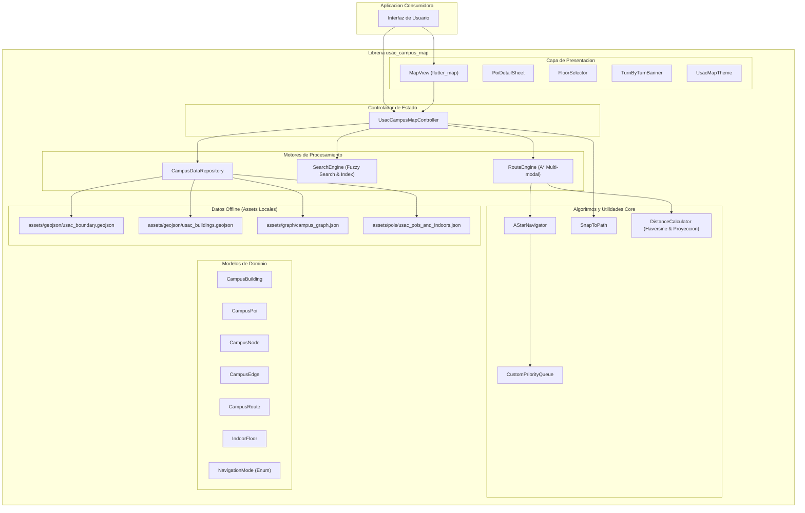

# usac_campus_map

Libreria modular en Flutter para la visualizacion interactiva del Campus Central de la Universidad de San Carlos de Guatemala (USAC), renderizado de huellas edilicias autovaciadas de OpenStreetMap, calculo de rutas multi-modal offline (caminando, bicicleta, vehiculo, accesible), busqueda difusa de edificios y puntos de interes (POIs), visualizacion de niveles interiores (indoor mapping) y control centralizado mediante `UsacCampusMapController`.

---

## Caracteristicas Principales

- **Arquitectura Offline Total (Cero Costo Operativo):** Toda la cartografia base vectorial (limites, edificios, parqueos, areas verdes), red de navegacion y catalogo de POIs residen en assets locales GeoJSON y JSON sin depender de servidores backend pagos ni cuotas por solicitud.
- **Cartografia Verificada desde OpenStreetMap:** Mas de 240 poligonos autovaciados con coordenadas autenticas extraidas directamente de relaciones multipoligono y vias de OSM, incluyendo siluetas exactas de edificios clave (T-1, T-5, T-12, S-1, S-6, S-7, S-11, M-4, M-5, M-6, M-7, Bienestar Estudiantil).
- **Parqueos y Areas Oficiales:** Delimitacion de 27 zonas de estacionamiento oficiales (Ingenieria, Agronomia, Farmacia/CEMA, Rectoria, etc.) e instalaciones deportivas y culturales.
- **Accesos y Garitas Oficiales:** Representacion de las garitas vehiculares y peatonales (Periferico, Avenida Petapa y Las Charcas) como puntos de acceso conectados al grafo vial, evitando cajas geometricas ficticias.
- **Motor de Ruteo A* Multi-modal (`RouteEngine`):** Algoritmo A* heuristico sobre un grafo de 479 nodos y 1,072 aristas internas, con soporte para modos:
  - Peatonal (`NavigationMode.pedestrian`)
  - Bicicleta (`NavigationMode.bicycle`)
  - Vehicular (`NavigationMode.vehicle`)
  - Accesible / Silla de Ruedas (`NavigationMode.accessible`)
- **Alineacion de Trayectoria (`SnapToPath`):** Proyeccion ortogonal de coordenadas GPS al andador o callejon mas proximo con limites de tolerancia angular y metrica.
- **Buscador Indexado y Difuso (`SearchEngine`):** Indexacion por palabras clave, siglas, facultades y normalizacion de cadenas para busqueda instantanea de baja latencia.
- **Niveles Interiores (Indoor Mapping):** Soporte de capas por nivel (`IndoorFloor`) y selector visual (`FloorSelector`) para edificios multinivel.
- **Controlador Centralizado (`UsacCampusMapController`):** Patron de control desacoplado que expone streams reactivos, gestion de camara, ruteo programatico y seleccion de entidades.
- **Componentes Visuales Completos (`MapView`, `PoiDetailSheet`, `TurnByTurnBanner`):** Widgets desacoplados basados en `flutter_map` adaptados al tema institucional azul y dorado de la USAC.

---

## Arquitectura del Sistema



---

## Estructura de Directorios

```text
usac_campus_map/
├── assets/
│   ├── geojson/
│   │   ├── usac_boundary.geojson         # Limite perimetral exterior del campus
│   │   └── usac_buildings.geojson        # 248 entidades (edificios, parqueos, canchas)
│   ├── graph/
│   │   └── campus_graph.json             # Grafo de navegacion (479 nodos, 1072 aristas)
│   └── pois/
│       └── usac_pois_and_indoors.json    # Catalogo de POIs, garitas y planos interiores
├── lib/
│   ├── usac_campus_map.dart              # Archivo barrel con exports publicos
│   └── src/
│       ├── controllers/
│       │   └── usac_campus_map_controller.dart # Controlador principal reactivo
│       ├── core/
│       │   ├── algorithms/
│       │   │   ├── a_star.dart           # Motor A* de busqueda de caminos minimos
│       │   │   ├── priority_queue.dart   # Cola de prioridad basada en min-heap
│       │   │   └── snap_to_path.dart     # Proyeccion ortogonal de coordenadas a aristas
│       │   └── utils/
│       │       └── distance_calculator.dart # Calculos geometricos y formula de Haversine
│       ├── engine/
│       │   ├── campus_data_repository.dart  # Carga y deserializacion de activos offline
│       │   ├── route_engine.dart            # Planificacion de rutas por modo de movilidad
│       │   └── search_engine.dart           # Motor de busqueda indexada en memoria
│       ├── models/
│       │   ├── campus_building.dart         # Entidad de edificio y poligono
│       │   ├── campus_edge.dart             # Segmento de conexion en el grafo
│       │   ├── campus_node.dart             # Vertice de interconexion en el mapa
│       │   ├── campus_poi.dart              # Punto de interes o servicio
│       │   ├── campus_route.dart            # Resultado calculado de trayectoria
│       │   ├── indoor_floor.dart            # Nivel interior de edificio
│       │   └── navigation_mode.dart         # Modos de transporte soportados
│       └── presentation/
│           ├── themes/
│           │   └── usac_map_theme.dart      # Paleta de colores e iconografia USAC
│           └── widgets/
│               ├── floor_selector.dart      # Selector flotante de niveles de edificio
│               ├── map_view.dart            # Lienzo cartografico con FlutterMap
│               ├── poi_detail_sheet.dart    # Modal inferior con ficha tecnica de POI
│               └── turn_by_turn_banner.dart # Banner de instrucciones paso a paso
├── test/
│   ├── controller_and_widgets_test.dart  # Pruebas de widgets y controlador
│   ├── core_algorithms_test.dart        # Pruebas de A*, colas de prioridad y proyeccion
│   ├── engine_test.dart                 # Pruebas de repositorios, busqueda y ruteo
│   └── ground_truth_dataset_test.dart   # Verificacion de integridad de datos OSM
└── pubspec.yaml
```

---

## Conjunto de Datos Geograficos (Ground Truth)

La libreria utiliza informacion procesada de OpenStreetMap para el Campus Central:

### 1. Poligonos Edilicios y Espaciales (`usac_buildings.geojson`)
Contiene **248 entidades vectoriales** con clasificacion estandarizada:
- **Facultades y Docencia (117):** Edificios de Facultades de Ingenieria (T-1, T-2, T-3, T-4, T-5, T-6, T-7, T-12, CII, ERIS), Agronomia (T-8, T-9, UVIGER, CEDA), Farmacia (T-10, T-11, T-13, T-14, T-15), Humanidades y Ciencias Sociales (S-1 a S-13, CALUSAC, EFPEM), Odontologia (M-1, M-2, M-3) y Veterinaria (M-4 a M-8).
- **Parqueos Oficiales (27):** Poligonos exactos correspondientes a los estacionamientos centrales de Ingenieria, Agronomia, Farmacia, Rectoria, Polideportivo y accesos viales.
- **Areas Verdes y Plazas (50):** Plaza de los Martires, jardines de Rectoria, areas boscosas y rotondas.
- **Deportes y Recreacion (38):** Estadio Revolucion, Polideportivo Central, canchas de tenis y canchas auxiliares.
- **Administracion y Cultura (11):** Edificio de Rectoria, Biblioteca Central Cesar Branas, Caja Central, Registro y Estadistica, Auditorio IGLU, Editorial Universitaria y sede AEU.

### 2. Garitas de Acceso
Las garitas son modeladas como nodos POI de acceso vehicular y peatonal para permitir el ruteo directo:
- **Garita Periferico (Entrada y Salida):** Coordenadas `[14.589488, -90.553168]` y `[14.589069, -90.553669]`.
- **Garita Petapa (Entrada y Salida):** Coordenadas `[14.586610, -90.545277]` y `[14.586048, -90.545371]`.
- **Garita Las Charcas / 29 Calle:** Coordenadas `[14.581911, -90.556891]`.

### 3. Red de Andadores y Vias (`campus_graph.json`)
Red topologica con 479 nodos y 1,072 aristas que cubre pasarelas peatonales, andadores techados, calzadas principales y aceras. Cada arista cuenta con atributos de accesibilidad para discriminar rutas con gradas o desniveles.

---

## Modelos Principales

### `CampusBuilding`
Representa un edificio o instalacion dentro del campus:
- `String id`: Identificador unico (ej. `T-3`, `S-2`, `RECT`).
- `String name`: Nombre institucional oficial.
- `String category`: Categoria (`faculty`, `administrative`, `library`, `sports`, `parking`, `green`, `cultural`, `service`).
- `List<LatLng> polygon`: Vértices del perimetro del edificio.
- `LatLng center`: Centroide geografico.
- `int floors`: Cantidad de niveles.
- `List<IndoorFloor>? indoorFloors`: Planos y aulas por nivel.

### `CampusPoi`
Punto de interes o servicio especifico:
- `String id`: Identificador del POI.
- `String name`: Nombre descriptivo.
- `String category`: Tipo de servicio (`academic`, `food`, `library`, `administrative`, `atm`, `health`, `restroom`, `parking`, `access`).
- `LatLng location`: Coordenadas precisas.
- `String? buildingId`: Identificador del edificio contenedor (si aplica).
- `int? floor`: Nivel donde se ubica dentro del edificio.

### `CampusRoute`
Resultado de una consulta de enrutamiento:
- `List<LatLng> points`: Secuencia de coordenadas que conforman el trazado.
- `double totalDistanceMeters`: Longitud total en metros.
- `Duration estimatedDuration`: Tiempo estimado de traslado.
- `List<String> instructions`: Indicaciones de navegacion paso a paso.
- `NavigationMode mode`: Modo de transporte utilizado.

### `NavigationMode`
Enumerador con los medios de transporte permitidos:
- `pedestrian`: Rutas a pie utilizando andadores y aceras.
- `bicycle`: Rutas aptas para ciclo-movilidad.
- `vehicle`: Calles vehiculares y accesos a estacionamientos.
- `accessible`: Rutas sin gradas ni barreras arquitectonicas.

---

## Uso de la Libreria

### 1. Instalacion y Registro de Assets

En el archivo `pubspec.yaml` del proyecto Flutter:

```yaml
dependencies:
  flutter:
    sdk: flutter
  usac_campus_map:
    path: ../usac_campus_map

flutter:
  assets:
    - packages/usac_campus_map/assets/geojson/
    - packages/usac_campus_map/assets/graph/
    - packages/usac_campus_map/assets/pois/
```

### 2. Inicializacion del Repositorio y Motores

```dart
import 'package:flutter/material.dart';
import 'package:latlong2/latlong.dart';
import 'package:usac_campus_map/usac_campus_map.dart';

void main() async {
  WidgetsFlutterBinding.ensureInitialized();
  
  final repository = CampusDataRepository();
  await repository.loadData();
  
  final routeEngine = RouteEngine(repository.campusGraph);
  final searchEngine = SearchEngine(repository.buildings, repository.pois);
  
  runApp(CampusMapApp(
    repository: repository,
    routeEngine: routeEngine,
    searchEngine: searchEngine,
  ));
}
```

### 3. Implementacion con `UsacCampusMapController` y `MapView`

```dart
class CampusMapScreen extends StatefulWidget {
  final CampusDataRepository repository;
  final RouteEngine routeEngine;
  final SearchEngine searchEngine;

  const CampusMapScreen({
    Key? key,
    required this.repository,
    required this.routeEngine,
    required this.searchEngine,
  }) : super(key: key);

  @override
  State<CampusMapScreen> createState() => _CampusMapScreenState();
}

class _CampusMapScreenState extends State<CampusMapScreen> {
  late final UsacCampusMapController _controller;

  @override
  void initState() {
    super.initState();
    _controller = UsacCampusMapController(
      repository: widget.repository,
      routeEngine: widget.routeEngine,
      searchEngine: widget.searchEngine,
    );
  }

  @override
  void dispose() {
    _controller.dispose();
    super.dispose();
  }

  @override
  Widget build(BuildContext context) {
    return Scaffold(
      appBar: AppBar(
        title: const Text('Campus Central USAC'),
        backgroundColor: UsacMapTheme.primaryBlue,
      ),
      body: Stack(
        children: [
          MapView(
            controller: _controller,
            showUserLocation: true,
            theme: UsacMapTheme.standardTheme(),
          ),
          Positioned(
            top: 16,
            left: 16,
            right: 16,
            child: TurnByTurnBanner(controller: _controller),
          ),
          Positioned(
            right: 16,
            bottom: 120,
            child: FloorSelector(controller: _controller),
          ),
          PoiDetailSheet(controller: _controller),
        ],
      ),
    );
  }
}
```

### 4. Calculo Programatico de Rutas

```dart
void planificarRuta(UsacCampusMapController controller) {
  final origen = LatLng(14.589488, -90.553168); // Garita Periferico
  final destino = LatLng(14.582845, -90.552431); // Edificio T-3
  
  controller.calculateRoute(
    origin: origen,
    destination: destino,
    mode: NavigationMode.pedestrian,
  );
}
```

---

## Verificacion y Calidad del Codigo

El paquete cuenta con una cobertura integral de pruebas automatizadas:

```bash
# Ejecutar todas las pruebas unitarias y de widgets
flutter test

# Ejecutar el analisis estatico del codigo
flutter analyze
```

### Restricciones de Calidad Aplicadas
- **Cero comentarios en codigo Dart:** Codigo autodocumentado mediante tipado estricto y nombres representativos.
- **Cero emojis:** Formato limpio y profesional en codigo, pruebas, documentacion y registros.
- **Independencia de red:** 100% operativo sin conexion a internet para busquedas y calculo de rutas.
- **Compatibilidad multiplataforma:** Disenado para Android, iOS, Web y Escritorio.
