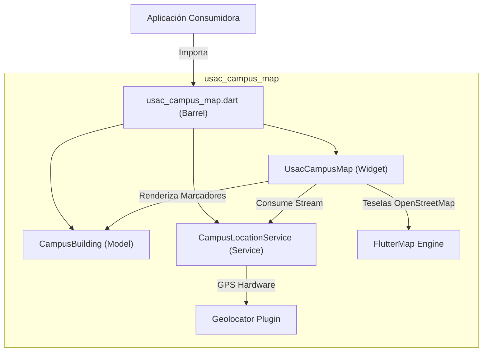

# usac_campus_map

Librería modular y privada en Flutter para la visualización interactiva del mapa del Campus Central de la Universidad de San Carlos de Guatemala (USAC) y el seguimiento de geolocalización en tiempo real de estudiantes y visitantes.

---

## 🏛️ Características

- **Mapa Interactivo Optimizado:** Renderizado de teselas satelitales/vectoriales vía OpenStreetMap centradas en las coordenadas del campus central (`14.5866, -90.5524`).
- **Puntos de Interés (Edificios USAC):** Visualización de marcadores de edificios universitarios con soporte de callbacks interactivos (`onBuildingTap`).
- **Geolocalización en Tiempo Real:** Servicio de rastreo continuo con filtrado de distancia (3 metros) y alta precisión mediante un `Stream<LatLng>`.
- **Arquitectura Modular:** Separación estricta de responsabilidades entre modelos (`src/models`), servicios (`src/services`) y componentes de interfaz (`src/widgets`), accesible mediante un archivo de barril unificado.

---

## 📐 Arquitectura del Sistema



---

## 📊 Diagrama de Clases


---

## 🔄 Flujo de Geolocalización y Actualización


---

## 🚀 Instalación y Configuración

### 1. Dependencia en `pubspec.yaml`
```yaml
dependencies:
  usac_campus_map:
    git:
      url: https://github.com/Trebol4Devop/usac_campus_map.git
      ref: main
```

### 2. Permisos de Plataforma

#### Android (`android/app/src/main/AndroidManifest.xml`)
Agrega los permisos de ubicación dentro de `<manifest>`:
```xml
<uses-permission android:name="android.permission.ACCESS_FINE_LOCATION" />
<uses-permission android:name="android.permission.ACCESS_COARSE_LOCATION" />
```

#### iOS (`ios/Runner/Info.plist`)
Agrega las descripciones de uso de geolocalización:
```xml
<key>NSLocationWhenInUseUsageDescription</key>
<string>Requerimos acceso a tu ubicación para mostrar tu posición dentro del campus universitario.</string>
```

---

## 💻 Ejemplo de Uso

```dart
import 'package:flutter/material.dart';
import 'package:latlong2/latlong.dart';
import 'package:usac_campus_map/usac_campus_map.dart';

void main() {
  runApp(const MyApp());
}

class MyApp extends StatelessWidget {
  const MyApp({super.key});

  @override
  Widget build(BuildContext context) {
    return const MaterialApp(
      home: CampusMapScreen(),
    );
  }
}

class CampusMapScreen extends StatelessWidget {
  const CampusMapScreen({super.key});

  @override
  Widget build(BuildContext context) {
    final buildings = [
      const CampusBuilding(
        id: 't-3',
        name: 'Edificio T-3 (Facultad de Ingeniería)',
        location: LatLng(14.5878, -90.5512),
        description: 'Aulas y laboratorios de Ingeniería Mecánica y Civil.',
      ),
      const CampusBuilding(
        id: 't-1',
        name: 'Edificio T-1 (Facultad de Odontología)',
        location: LatLng(14.5885, -90.5530),
        description: 'Clínicas odontológicas y aulas magnas.',
      ),
      const CampusBuilding(
        id: 'rectoria',
        name: 'Edificio de Rectoría',
        location: LatLng(14.5855, -90.5528),
        description: 'Edificio Administrativo y Rectoría General USAC.',
      ),
    ];

    return Scaffold(
      appBar: AppBar(
        title: const Text('Campus Central USAC'),
        backgroundColor: const Color(0xFF002B49),
      ),
      body: UsacCampusMap(
        buildings: buildings,
        onBuildingTap: (building) {
          showModalBottomSheet(
            context: context,
            builder: (_) => Container(
              padding: const EdgeInsets.all(16),
              child: Column(
                mainAxisSize: MainAxisSize.min,
                crossAxisAlignment: CrossAxisAlignment.start,
                children: [
                  Text(
                    building.name,
                    style: Theme.of(context).textTheme.titleLarge,
                  ),
                  const SizedBox(height: 8),
                  Text(building.description),
                ],
              ),
            ),
          );
        },
      ),
    );
  }
}
```

---

## 🌿 Flujo de Trabajo Git Flow

El proyecto sigue una convención estricta basada en Git Flow:

- **`main`**: Rama protegida de producción. Contiene únicamente versiones estables.
- **`develop`**: Rama base para el desarrollo diario e integración de features.
- **`feature/*`**: Ramas para el desarrollo de módulos y mejoras individuales.
- **`bugfix/*` / `hotfix/*`**: Correcciones controladas de errores.
- **`release/*`**: Preparación y congelamiento de versiones previas a `main`.

Los commits deben respetar el estándar de [Conventional Commits](https://www.conventionalcommits.org/) (`feat:`, `fix:`, `chore:`, `docs:`, `test:`, `refactor:`).
