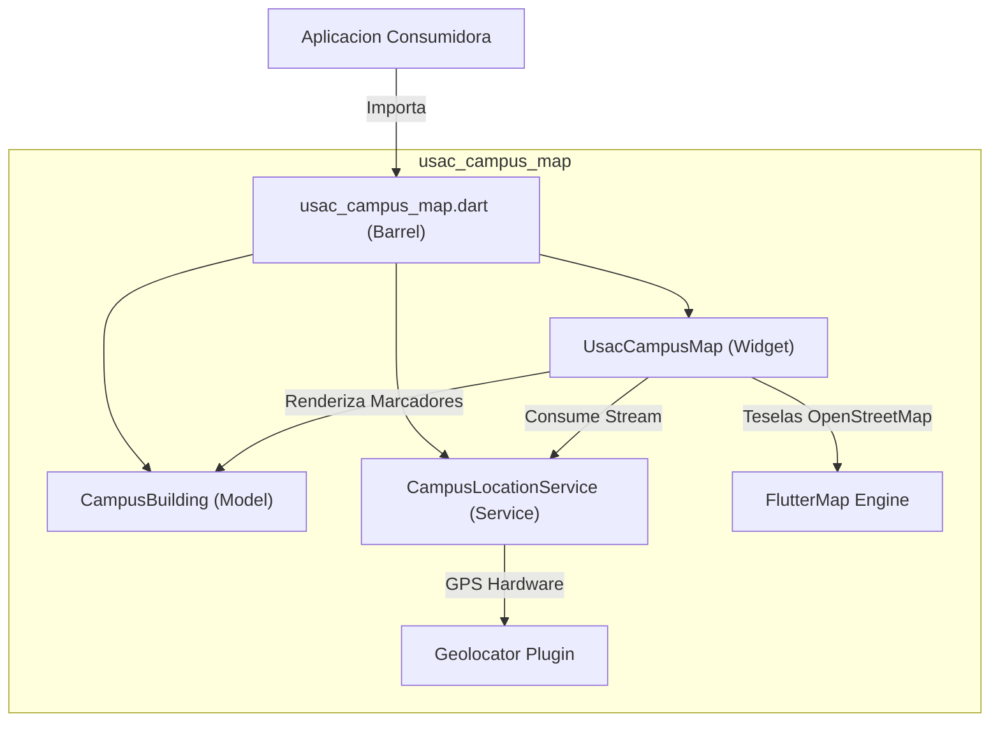
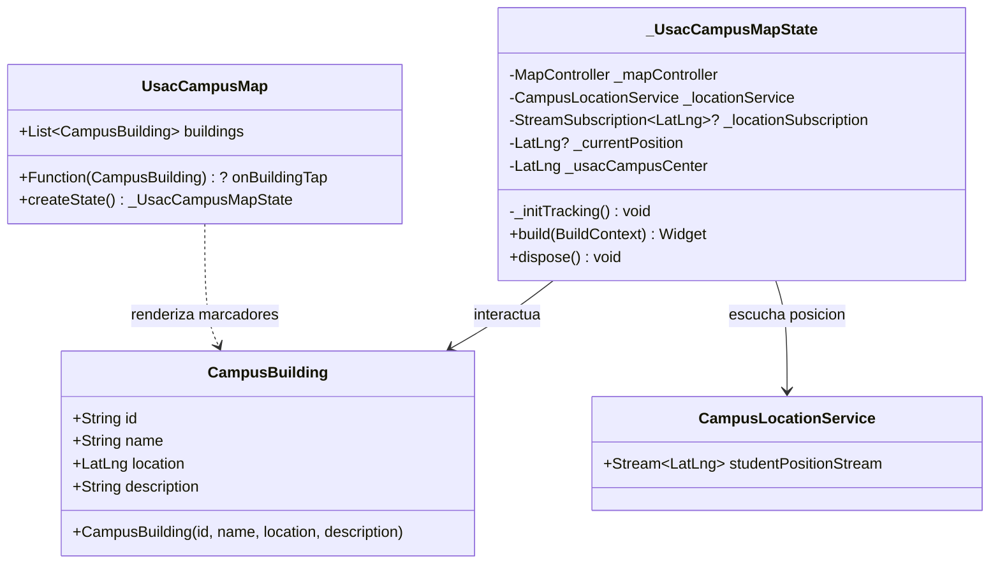
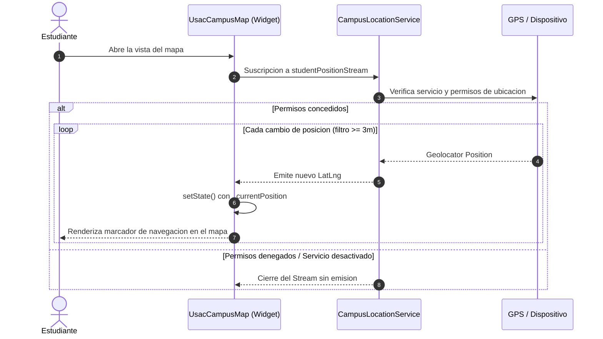

# usac_campus_map

Libreria modular y privada en Flutter para la visualizacion interactiva del mapa del Campus Central de la Universidad de San Carlos de Guatemala (USAC) y el seguimiento de geolocalizacion en tiempo real de estudiantes y visitantes.

---

## Caracteristicas

- **Mapa Interactivo Optimizado:** Renderizado de teselas satelitales y vectoriales via OpenStreetMap centradas en las coordenadas del campus central (`14.5866, -90.5524`).
- **Puntos de Interes (Edificios USAC):** Visualizacion de marcadores de edificios universitarios con soporte de callbacks interactivos (`onBuildingTap`).
- **Geolocalizacion en Tiempo Real:** Servicio de rastreo continuo con filtrado de distancia (3 metros) y alta precision mediante un `Stream<LatLng>`.
- **Arquitectura Modular:** Separacion estricta de responsabilidades entre modelos (`src/models`), servicios (`src/services`) y componentes de interfaz (`src/widgets`), accesible mediante un archivo de barril unificado.

---

## Arquitectura del Sistema



---

## Diagrama de Clases



---

## Flujo de Geolocalizacion y Actualizacion



---

## Instalacion y Configuracion

### 1. Dependencia en `pubspec.yaml`
```yaml
dependencies:
  usac_campus_map:
    git:
      url: https://github.com/Trebol4Devop/usac_campus_map.git
      ref: main
```

### 2. Permisos de Plataforma

#### Android (`android/app/src/main/AndroidManifest.xml`)
Agrega los permisos de ubicacion dentro de la etiqueta `<manifest>`:
```xml
<uses-permission android:name="android.permission.INTERNET" />
<uses-permission android:name="android.permission.ACCESS_FINE_LOCATION" />
<uses-permission android:name="android.permission.ACCESS_COARSE_LOCATION" />
```

#### iOS (`ios/Runner/Info.plist`)
Agrega la descripcion de uso de geolocalizacion dentro del bloque `<dict>`:
```xml
<key>NSLocationWhenInUseUsageDescription</key>
<string>Se requiere acceso a la ubicacion para mostrar tu posicion en el mapa del campus.</string>
```

---

## Ejemplo de Uso

Existe una aplicacion de demostracion funcional en el directorio `example/`. Para ejecutarla:

```bash
cd example
flutter run
```

Codigo de integracion basico:

```dart
import 'package:flutter/material.dart';
import 'package:latlong2/latlong.dart';
import 'package:usac_campus_map/usac_campus_map.dart';

void main() {
  runApp(const MaterialApp(home: CampusMapScreen()));
}

class CampusMapScreen extends StatelessWidget {
  const CampusMapScreen({super.key});

  @override
  Widget build(BuildContext context) {
    final buildings = [
      const CampusBuilding(
        id: 't-3',
        name: 'Edificio T-3 (Facultad de Ingenieria)',
        location: LatLng(14.5878, -90.5512),
        description: 'Aulas y laboratorios de Ingenieria Mecanica y Civil.',
      ),
      const CampusBuilding(
        id: 'rectoria',
        name: 'Edificio de Rectoria',
        location: LatLng(14.5855, -90.5528),
        description: 'Edificio Administrativo y Rectoria General USAC.',
      ),
    ];

    return Scaffold(
      appBar: AppBar(
        title: const Text('Campus Central USAC'),
      ),
      body: UsacCampusMap(
        buildings: buildings,
        onBuildingTap: (building) {
          ScaffoldMessenger.of(context).showSnackBar(
            SnackBar(content: Text('Seleccionado: ${building.name}')),
          );
        },
      ),
    );
  }
}
```

---

## Flujo de Trabajo Git Flow

El repositorio implementa el modelo de ramas Git Flow:

- **`main`**: Rama protegida de produccion. Contiene versiones consolidadas.
- **`develop`**: Rama base para el desarrollo continuo e integracion de funcionalidades.
- **`feature/<nombre>`**: Ramas para desarrollo de modulos individuales nacidas de `develop`.
- **`bugfix/<nombre>`**: Correcciones controladas integradas a `develop`.
- **`release/<version>`**: Estabilizacion previa al despliegue en `main`.
- **`hotfix/<nombre>`**: Correcciones criticas urgentes derivadas de `main`.

Los mensajes de commit se adhieren estrictamente al estandar de Conventional Commits (`feat:`, `fix:`, `chore:`, `docs:`, `test:`, `refactor:`).

---

## Licencia y Confidencialidad

Propiedad privada y confidencial de Trebol4Devop. Todos los derechos reservados. Consulte el archivo `LICENSE` para mas detalles.
