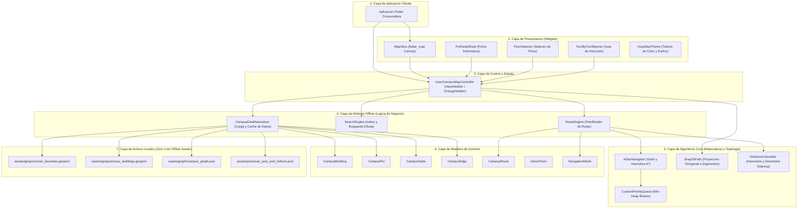
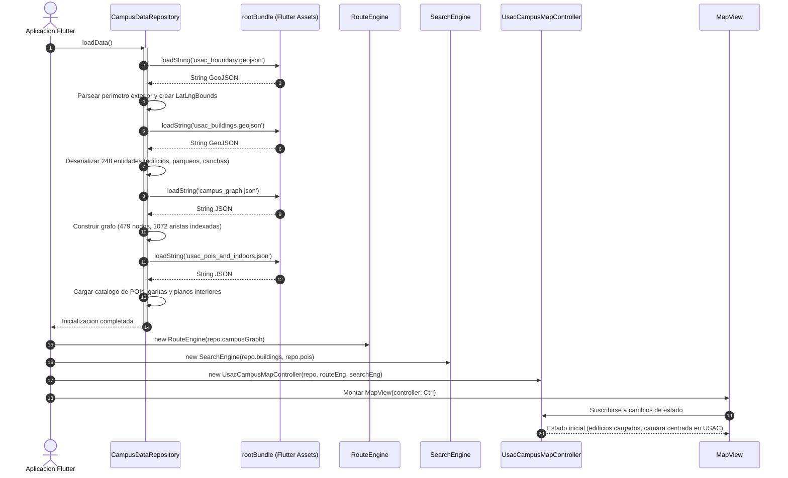
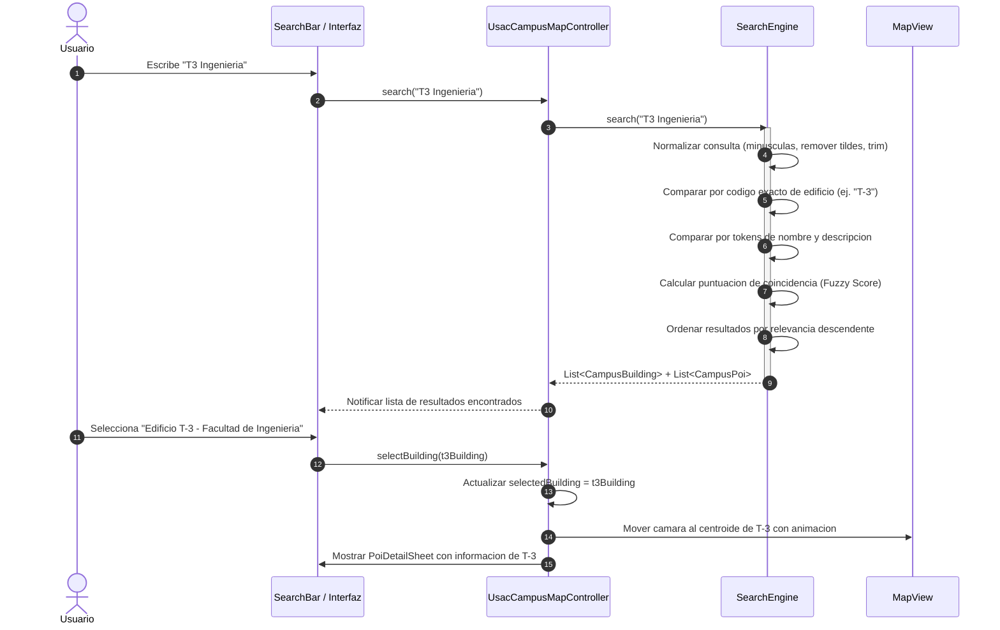
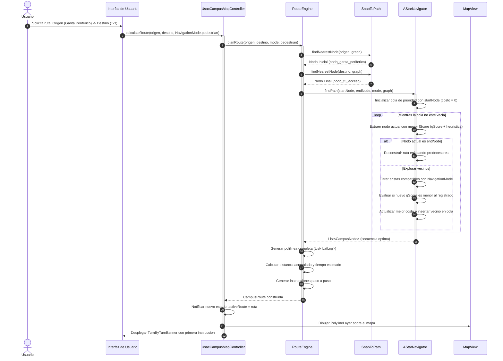
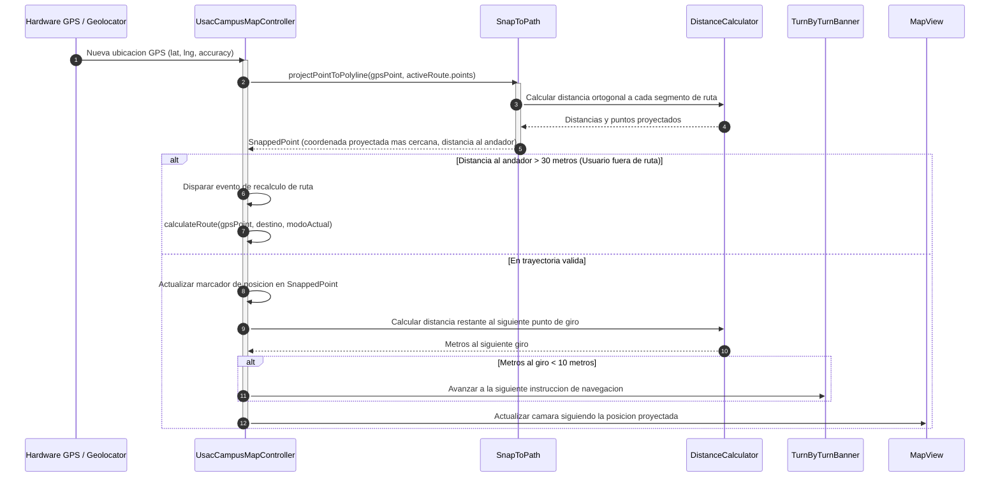
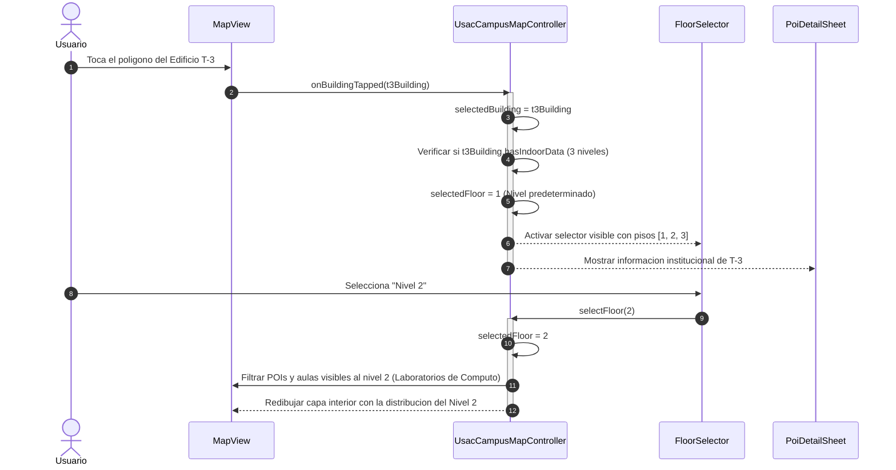
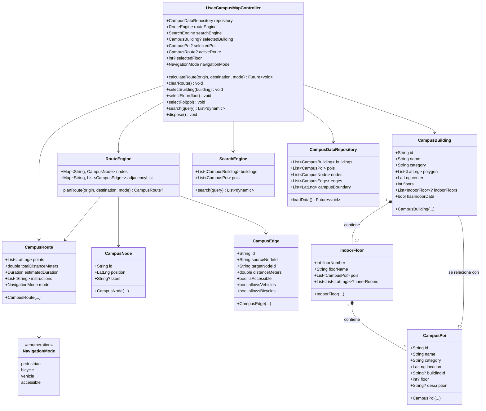
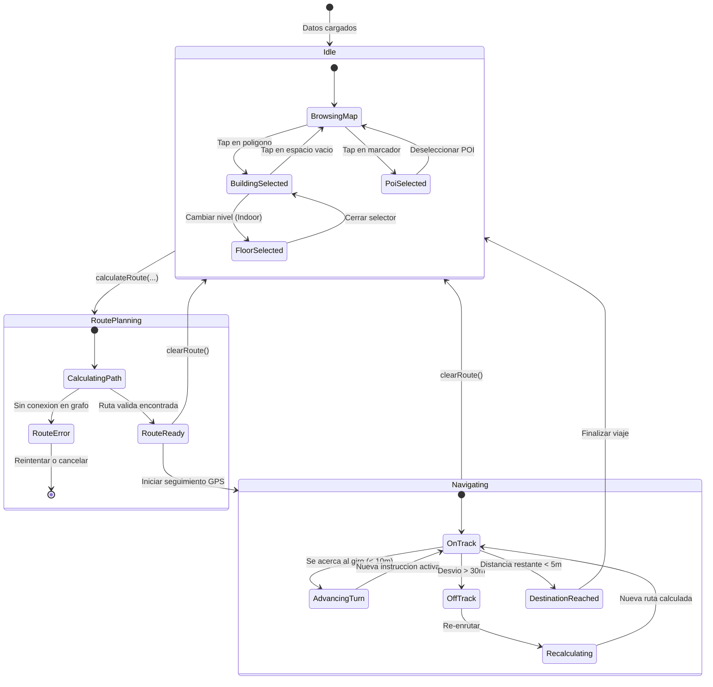

# usac_campus_map

Libreria modular en Flutter para la visualizacion interactiva del Campus Central de la Universidad de San Carlos de Guatemala (USAC), renderizado de huellas edilicias extraidas de OpenStreetMap, calculo de rutas multi-modal offline (caminando, bicicleta, vehiculo, accesible), busqueda difusa de edificios y puntos de interes (POIs), visualizacion de niveles interiores (indoor mapping) y control centralizado mediante `UsacCampusMapController`.

---

## Tabla de Contenidos

1. [Vision General y Filosofia](#vision-general-y-filosofia)
2. [Caracteristicas Principales](#caracteristicas-principales)
3. [Arquitectura del Sistema](#arquitectura-del-sistema)
4. [Diagramas de Flujo y Secuencia](#diagramas-de-flujo-y-secuencia)
   - [Flujo 1: Inicializacion y Arranque en Frio (Cold Boot)](#flujo-1-inicializacion-y-arranque-en-frio-cold-boot)
   - [Flujo 2: Busqueda Difusa e Indexacion](#flujo-2-busqueda-difusa-e-indexacion)
   - [Flujo 3: Planificacion de Rutas Multi-modal (A*)](#flujo-3-planificacion-de-rutas-multi-modal-a)
   - [Flujo 4: Navegacion en Tiempo Real y Snap-to-Path](#flujo-4-navegacion-en-tiempo-real-y-snap-to-path)
   - [Flujo 5: Cartografia de Interiores (Indoor Mapping)](#flujo-5-cartografia-de-interiores-indoor-mapping)
5. [Diagrama de Clases y Dominio](#diagrama-de-clases-y-dominio)
6. [Maquina de Estados del Controlador](#maquina-de-estados-del-controlador)
7. [Estructura de Directorios](#estructura-de-directorios)
8. [Especificacion de Datos Geograficos (Ground Truth)](#especificacion-de-datos-geograficos-ground-truth)
   - [Esquema de Edificios y Poligonos](#esquema-de-edificios-y-poligonos)
   - [Esquema del Grafo Vial y Peatonal](#esquema-del-grafo-vial-y-peatonal)
   - [Esquema de POIs y Planos Interiores](#esquema-de-pois-y-planos-interiores)
9. [Referencia de API y Componentes](#referencia-de-api-y-componentes)
   - [Controlador](#controlador-usaccampusmapcontroller)
   - [Motores de Procesamiento](#motores-de-procesamiento)
   - [Algoritmos del Core](#algoritmos-del-core)
   - [Widgets de Presentacion](#widgets-de-presentacion)
10. [Guia de Integracion y Ejemplos](#guia-de-integracion-y-ejemplos)
11. [Protocolo de Actualizacion y Mantenimiento](#protocolo-de-actualizacion-y-mantenimiento)
12. [Validacion y Cobertura de Pruebas](#validacion-y-cobertura-de-pruebas)

---

## Vision General y Filosofia

El diseno de `usac_campus_map` parte de una premisa estricta: **Cero Costo Operativo ($0 USD)** y **Funcionamiento 100% Offline**.

En entornos universitarios donde la cobertura de red celular puede ser irregular dentro de edificios de concreto armado, depender de APIs comerciales de mapas como Google Maps o Mapbox genera:
- Costos variables imprevistos por cuotas de consumo de API.
- Fallas de disponibilidad y latencia cuando el dispositivo pierde conexion de datos.
- Falta de granularidad en andadores peatonales internos, accesos a nivel de piso y planos de aulas.

Para solucionar esto, `usac_campus_map` empaqueta la cartografia vectorial, la topologia de la red de andadores, los puntos de interes y los planos de planta directamente como activos del paquete. Todo el procesamiento (calculo de distancias, enrutamiento heuristico A*, busqueda textual difusa y proyeccion geometrica) se ejecuta en el procesador del dispositivo cliente.

---

## Caracteristicas Principales

- **Cartografia Autentica y Detallada:** 248 geometrias procesadas directamente desde OpenStreetMap, incluyendo huellas arquitectonicas multiverdice para facultades, escuelas, 27 zonas de parqueo y areas deportivas.
- **Ruteo Multi-modal Inteligente:** Cuatro perfiles de desplazamiento independientes (peatonal, bicicleta, vehiculo y accesible para sillas de ruedas), penalizando o restringiendo tramos con gradas, pasarelas estrechas o calles de sentido unico.
- **Alineacion de Trayectoria GPS (`SnapToPath`):** Proyeccion ortogonal de coordenadas dispersas a los andadores oficiales mas cercanos con verificacion de umbral de desvio.
- **Buscador Instantaneo en Memoria:** Consultas difusas por codigo de edificio (ej. "T-3", "S-12", "M-1"), nombre comun, facultad o servicios disponibles con ponderacion de relevancia.
- **Soporte de Navegacion Interior (Indoor Mapping):** Desglose por niveles (Nivel 1, Nivel 2, Sótano, etc.), permitiendo conmutar la visibilidad de aulas y laboratorios internos.
- **Puntos de Acceso Oficiales (Garitas):** Localizacion y ruteo hacia las garitas principales (Periferico, Avenida Petapa y Las Charcas) como nodos integrados a la red de transporte.
- **Desacoplamiento Visual:** Arquitectura orientada a controlador que separa la logica espacial del arbol de renderizado de Flutter.

---

## Arquitectura del Sistema

La libreria sigue una arquitectura en capas con separacion estricta de responsabilidades:



---

## Diagramas de Flujo y Secuencia

### Flujo 1: Inicializacion y Arranque en Frio (Cold Boot)

Muestra la secuencia de deserializacion de archivos GeoJSON/JSON locales y construccion de los indices espaciales y de busqueda en memoria:



---

### Flujo 2: Busqueda Difusa e Indexacion

Describe como las consultas del usuario son procesadas contra el catalogo de edificios y puntos de interes:



---

### Flujo 3: Planificacion de Rutas Multi-modal (A*)

Detalla el calculo de ruta minima utilizando el algoritmo A* con discriminacion por medio de transporte:



---

### Flujo 4: Navegacion en Tiempo Real y Snap-to-Path

Muestra el procesamiento de las actualizaciones satelitales del dispositivo y su proyeccion a la red geometrica:



---

### Flujo 5: Cartografia de Interiores (Indoor Mapping)

Explica como se gestiona la conmutacion de niveles en edificios de multiples pisos:



---

## Diagrama de Clases y Dominio

Estructura de entidades y tipos de datos del paquete:



---

## Maquina de Estados del Controlador

El `UsacCampusMapController` gestiona el ciclo de vida del mapa y las transiciones entre modos de exploracion y navegacion:



---

## Estructura de Directorios

```text
usac_campus_map/
├── assets/
│   ├── geojson/
│   │   ├── usac_boundary.geojson         # Limite perimetral exterior oficial
│   │   └── usac_buildings.geojson        # 248 entidades espaciales verificadas
│   ├── graph/
│   │   └── campus_graph.json             # Grafo de navegacion (479 nodos, 1072 aristas)
│   └── pois/
│       └── usac_pois_and_indoors.json    # Catalogo de POIs, garitas y planos interiores
├── lib/
│   ├── usac_campus_map.dart              # Barrel export de la libreria
│   └── src/
│       ├── controllers/
│       │   └── usac_campus_map_controller.dart # Controlador reactivo principal
│       ├── core/
│       │   ├── algorithms/
│       │   │   ├── a_star.dart           # Motor A* de caminos minimos
│       │   │   ├── priority_queue.dart   # Min-heap para seleccion eficiente
│       │   │   └── snap_to_path.dart     # Proyeccion ortogonal a aristas
│       │   └── utils/
│       │       └── distance_calculator.dart # Formulas trigonometricas y Haversine
│       ├── engine/
│       │   ├── campus_data_repository.dart  # Deserializacion de datos locales
│       │   ├── route_engine.dart            # Ruteo multi-modal y giros
│       │   └── search_engine.dart           # Motor de busqueda difusa
│       ├── models/
│       │   ├── campus_building.dart         # Entidad de edificio y silueta
│       │   ├── campus_edge.dart             # Conexion entre nodos del grafo
│       │   ├── campus_node.dart             # Vertice de navegacion
│       │   ├── campus_poi.dart              # Punto de interes o servicio
│       │   ├── campus_route.dart            # Trayectoria de navegacion calculada
│       │   ├── indoor_floor.dart            # Plano de nivel interior
│       │   └── navigation_mode.dart         # Enumerador de modos de transporte
│       └── presentation/
│           ├── themes/
│           │   └── usac_map_theme.dart      # Paleta oficial azul (#002B49) y oro
│           └── widgets/
│               ├── floor_selector.dart      # Selector flotante de pisos
│               ├── map_view.dart            # Lienzo cartografico con FlutterMap
│               ├── poi_detail_sheet.dart    # Modal inferior con ficha tecnica
│               └── turn_by_turn_banner.dart # Banner de instrucciones de giro
├── test/
│   ├── controller_and_widgets_test.dart  # Pruebas de widgets y controlador
│   ├── core_algorithms_test.dart        # Pruebas de algoritmos matematicos
│   ├── engine_test.dart                 # Pruebas de motores de ruteo y busqueda
│   └── ground_truth_dataset_test.dart   # Validacion de integridad de datos OSM
└── pubspec.yaml
```

---

## Especificacion de Datos Geograficos (Ground Truth)

### Esquema de Edificios y Poligonos (`usac_buildings.geojson`)

Estructura GeoJSON estandarizada (`FeatureCollection`) donde cada `Feature` representa un poligono perimetral:

```json
{
  "type": "FeatureCollection",
  "features": [
    {
      "type": "Feature",
      "id": "T-3",
      "properties": {
        "id": "T-3",
        "name": "Edificio T-3 - Facultad de Ingenieria",
        "category": "faculty",
        "floors": 3,
        "description": "Decanatura de Ingenieria, Escuelas de Ingenieria Civil y Mecanica."
      },
      "geometry": {
        "type": "Polygon",
        "coordinates": [
          [
            [-90.552680, 14.583120],
            [-90.552150, 14.583120],
            [-90.552150, 14.582570],
            [-90.552680, 14.582570],
            [-90.552680, 14.583120]
          ]
        ]
      }
    }
  ]
}
```

#### Categorias de Entidades Soportadas
- `faculty`: Modulos academicos, facultades, escuelas y laboratorios docentes.
- `parking`: Zonas de estacionamiento de automoviles y motocicletas.
- `green`: Areas verdes, jardines protegidos y plazas civicas.
- `sports`: Canchas polideportivas, estadio y gimnasios.
- `administrative`: Dependencias del gobierno universitario y servicios estudiantiles.
- `cultural`: Teatros, museos y centros comunitarios.
- `library`: Biblioteca central y bibliotecas especializadas.
- `service`: Centros de atencion medica, bancos y cafeterias.

---

### Esquema del Grafo Vial y Peatonal (`campus_graph.json`)

Define los nodos y aristas de la red de transporte:

```json
{
  "nodes": [
    {
      "id": "node_t3_entrance",
      "lat": 14.582845,
      "lng": -90.552431,
      "label": "Entrada Principal T-3"
    }
  ],
  "edges": [
    {
      "id": "edge_t3_walkway",
      "source": "node_t3_entrance",
      "target": "node_t4_entrance",
      "distance": 45.2,
      "isAccessible": true,
      "allowsVehicles": false,
      "allowsBicycles": true
    }
  ]
}
```

---

### Esquema de POIs y Planos Interiores (`usac_pois_and_indoors.json`)

```json
{
  "pois": [
    {
      "id": "garita-periferico-entrada",
      "name": "Garita Periferico (Ingreso Vehicular)",
      "category": "access",
      "lat": 14.589488,
      "lng": -90.553168,
      "description": "Acceso poniente al campus desde el Anillo Periferico."
    }
  ],
  "indoors": [
    {
      "buildingId": "T-3",
      "floors": [
        {
          "floorNumber": 1,
          "floorName": "Nivel 1",
          "pois": [
            {
              "id": "t3-aula-101",
              "name": "Salon 101",
              "category": "academic",
              "lat": 14.582845,
              "lng": -90.552431
            }
          ]
        }
      ]
    }
  ]
}
```

---

## Referencia de API y Componentes

### Controlador: `UsacCampusMapController`

Es el orquestador central del mapa. Extiende `ChangeNotifier`:

| Metodo | Descripcion |
| :--- | :--- |
| `calculateRoute({origin, destination, mode})` | Calcula y traza la ruta optima en el mapa entre dos puntos utilizando el modo de movilidad indicado. |
| `clearRoute()` | Limpia la ruta activa, elimina la polilinea del mapa y oculta el banner paso a paso. |
| `selectBuilding(CampusBuilding? building)` | Establece el edificio activo, resalta su silueta perimetral y abre la ficha de detalles. |
| `selectFloor(int? floor)` | Conmuta el nivel interior visible para el edificio seleccionado. |
| `selectPoi(CampusPoi? poi)` | Enfoca un punto de interes en el mapa y despliega su informacion. |
| `search(String query)` | Ejecuta una consulta difusa instantanea sobre edificios y POIs en memoria. |
| `dispose()` | Libera los recursos y listeners activos del controlador. |

---

### Motores de Procesamiento

#### 1. `RouteEngine`
- Algoritmo A* heuristico con distancia euclidiana esferica.
- Filtrado de aristas en tiempo real segun `NavigationMode`.
- Ensamblado de indicaciones giro a giro (ej. "En 30 metros, gire a la derecha hacia Edificio T-4").

#### 2. `SearchEngine`
- Normalizacion de texto: eliminacion de diacriticos, acentos y conversion a minusculas.
- Indice de coincidencia invertido para nombres, codigos de edificio y descripciones.
- Ordenamiento ponderado: coincidencia exacta de codigo > coincidencia de nombre > descripcion.

#### 3. `CampusDataRepository`
- Carga asincrona paralela de los activos GeoJSON y JSON.
- Cache en memoria inmutable para consultas rapidas.

---

### Algoritmos del Core

#### 1. `AStarNavigator`
- Utiliza una cola de prioridad basada en monticulo binario (`CustomPriorityQueue`) logrando complejidad `O(E log V)`.

#### 2. `SnapToPath`
- Proyecta un punto `P(lat, lng)` sobre un segmento de recta `AB` en coordenadas cartesianas locales.
- Valida si el pie de la perpendicular cae dentro del segmento; en caso contrario, toma el vertice mas cercano.

#### 3. `DistanceCalculator`
- Implementacion estricta de la formula de Haversine con radio terrestre promedio `R = 6,371,000 m`.
- Estimacion de tiempos de traslado:
  - Peatonal: 1.2 m/s (~4.3 km/h).
  - Bicicleta: 3.5 m/s (~12.6 km/h).
  - Vehiculo: 5.5 m/s (~20 km/h, limite campus).

---

### Widgets de Presentacion

#### `MapView`
Lienzo interactivo construido sobre `flutter_map`. Renderiza:
- Capa base de teselas OpenStreetMap locales o en linea con proteccion de limites (`exactCampusBounds`).
- Capa de poligonos (`PolygonLayer`) con colores clasificados segun el tipo de instalacion.
- Capa de polilinea (`PolylineLayer`) con estilo distintivo para la ruta activa.
- Capa de marcadores (`MarkerLayer`) para POIs, accesos y ubicacion del usuario.

#### `TurnByTurnBanner`
Banner superior flotante con animaciones que muestra la instruccion inmediata, distancia restante al proximo giro e icono de maniobra.

#### `FloorSelector`
Botonera vertical flotante que se activa automaticamente cuando el usuario enfoca un edificio con planos interiores, permitiendo alternar pisos (ej. S, 1, 2, 3).

#### `PoiDetailSheet`
Panel modal deslizable (BottomSheet) con el nombre del edificio, fotografia o silueta, facultades residentes, cantidad de niveles y boton directo de "Como llegar".

---

## Guia de Integracion y Ejemplos

### Ejemplo Completo de Pantalla de Mapa

```dart
import 'package:flutter/material.dart';
import 'package:latlong2/latlong.dart';
import 'package:usac_campus_map/usac_campus_map.dart';

class UsacMapScreen extends StatefulWidget {
  const UsacMapScreen({Key? key}) : super(key: key);

  @override
  State<UsacMapScreen> createState() => _UsacMapScreenState();
}

class _UsacMapScreenState extends State<UsacMapScreen> {
  UsacCampusMapController? _controller;
  bool _isLoading = true;

  @override
  void initState() {
    super.initState();
    _initializeCampusMap();
  }

  Future<void> _initializeCampusMap() async {
    final repository = CampusDataRepository();
    await repository.loadData();

    final routeEngine = RouteEngine(repository.campusGraph);
    final searchEngine = SearchEngine(repository.buildings, repository.pois);

    final controller = UsacCampusMapController(
      repository: repository,
      routeEngine: routeEngine,
      searchEngine: searchEngine,
    );

    setState(() {
      _controller = controller;
      _isLoading = false;
    });
  }

  @override
  void dispose() {
    _controller?.dispose();
    super.dispose();
  }

  @override
  Widget build(BuildContext context) {
    if (_isLoading || _controller == null) {
      return const Scaffold(
        body: Center(
          child: CircularProgressIndicator(color: UsacMapTheme.primaryBlue),
        ),
      );
    }

    return Scaffold(
      appBar: AppBar(
        title: const Text('Campus Central USAC'),
        backgroundColor: UsacMapTheme.primaryBlue,
        foregroundColor: Colors.white,
      ),
      body: Stack(
        children: [
          MapView(
            controller: _controller!,
            showUserLocation: true,
            theme: UsacMapTheme.standardTheme(),
          ),
          Positioned(
            top: 16,
            left: 16,
            right: 16,
            child: TurnByTurnBanner(controller: _controller!),
          ),
          Positioned(
            right: 16,
            bottom: 120,
            child: FloorSelector(controller: _controller!),
          ),
          PoiDetailSheet(controller: _controller!),
        ],
      ),
    );
  }
}
```

---

## Protocolo de Actualizacion y Mantenimiento

Para asegurar que cualquier cambio futuro mantenga la integridad del proyecto, siga este protocolo:

### 1. Agregar o Modificar Edificios
- Modifique unicamente `assets/geojson/usac_buildings.geojson`.
- Si el edificio proviene de OpenStreetMap, verifique si es un `way` o una `relation` (multipoligono) para asegurar que todos los vertices del anillo exterior esten incluidos.
- Asigne siempre un `id` unico y normalizado (ej. `T-1`, `S-2`, `PRK-ING`).

### 2. Actualizar la Red de Caminos
- Edite `assets/graph/campus_graph.json`.
- Cada nodo debe tener coordenadas reales sobre andadores existentes.
- Cada arista debe ser bidireccional si el andador no tiene restriccion de sentido.
- Configure `isAccessible: false` si el tramo contiene gradas o escalinatas.

### 3. Agregar Nuevos Niveles Interiores (Indoor)
- Modifique `assets/pois/usac_pois_and_indoors.json`.
- Especifique el `buildingId` exacto, el `floorNumber` y el listado de aulas o laboratorios correspondientes.

### 4. Reglas Estrictas de Desarrollo
- **Cero comentarios en codigo Dart:** No utilizar `//`, `/* */` ni `///`. El codigo debe ser autoexplicativo mediante nombres claros y tipado riguroso.
- **Cero emojis:** No usar emojis en codigo, mensajes de commit, archivos markdown ni registros de consola.
- **Compatibilidad Offline:** No introducir llamadas HTTP externas requeridas para el funcionamiento basico.

---

## Validacion y Cobertura de Pruebas

El repositorio cuenta con 27 pruebas automatizadas organizadas por subsistema:

```bash
# Ejecutar todas las pruebas unitarias y de widgets
flutter test

# Ejecutar validacion estatica del codigo
flutter analyze
```

### Detalle de Suites de Pruebas
1. `test/ground_truth_dataset_test.dart`: Verifica que los archivos GeoJSON y JSON contengan las 248 entidades, los edificios clave (T-1, T-5, T-12, S-1, M-4, etc.), los 27 parqueos y las garitas oficiales.
2. `test/core_algorithms_test.dart`: Prueba unitaria de `AStarNavigator`, `CustomPriorityQueue`, `SnapToPath` y `DistanceCalculator`.
3. `test/engine_test.dart`: Valida la planificacion de rutas multi-modal y las consultas difusas del buscador.
4. `test/controller_and_widgets_test.dart`: Valida el montaje de `MapView`, `FloorSelector`, `PoiDetailSheet` y las emisiones reactivas del `UsacCampusMapController`.
