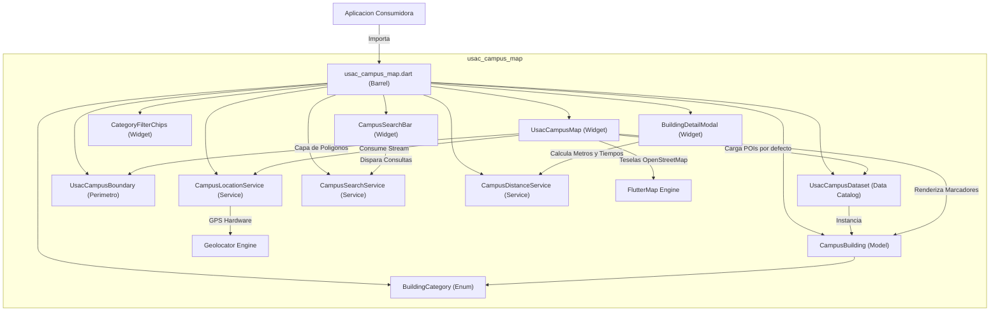
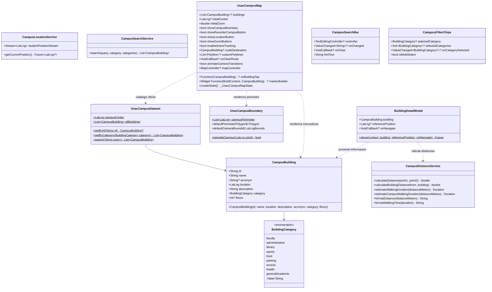
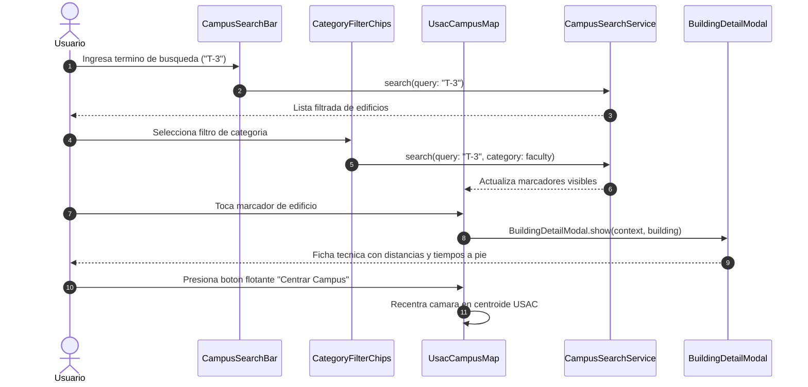

# usac_campus_map

Libreria modular y privada en Flutter para la visualizacion interactiva del mapa del Campus Central de la Universidad de San Carlos de Guatemala (USAC), delimitacion perimetral, consulta de puntos de interes (POIs) y seguimiento de geolocalizacion en tiempo real.

---

## Inventario Oficial de Edificios y Puntos Georreferenciados

Actualmente la libreria cuenta con mas de 45 puntos de interes georreferenciados con exactitud de centroide sobre OpenStreetMap:

### 1. Facultad de Arquitectura (FARUSAC)
- **`T-1` (Talleres de Arquitectura):** Talleres de diseno arquitectonico, salones de dibujo tecnico, modelado y maquetas.
- **`T-2` (Sede Central FARUSAC):** Decanatura de Arquitectura, Direccion de la Escuela de Diseno Grafico, coordinacion academica y administracion.
- **`PRK-ARQ` (Estacionamiento Arquitectura):** Area de parqueo vehicular contigua a los edificios T-1 y T-2.

### 2. Facultad de Ingenieria (FIUSAC)
- **`T-3` (Sede Central FIUSAC):** Decanatura de Ingenieria, Escuelas de Ingenieria Civil e Ingenieria Mecanica, Centro de Computo y oficinas administrativas.
- **`T-4` (Ingenieria Quimica e Industrial):** Escuelas de Ingenieria Quimica e Industrial, coordinacion de Ejercicio Profesional Supervisado (EPS).
- **`T-6` (Aulas de Ingenieria):** Modulo de catedra, salones docentes y aulas para ciclos intermedios.
- **`T-7` (Talleres de Mecanica):** Talleres de manufactura, soldadura, metrologia, maquinas herramientas y fundicion.
- **`CII` (Centro de Investigaciones de Ingenieria):** Ensayos estructurales, sismologia, investigacion aplicada y desarrollo tecnologico.
- **`ERIS` (Escuela Regional de Ingenieria Sanitaria):** Posgrados en recursos hidricos, tratamiento de aguas y saneamiento ambiental.
- **`CANCHA-ING` (Cancha de Ingenieria):** Area recreativa polideportiva adyacente a T-3 y T-4.
- **`PRK-ING` (Estacionamiento Ingenieria):** Area de parqueo vehicular y de motocicletas del sector tecnologico.

### 3. Facultad de Odontologia
- **`M-1` (Sede Central Odontologia):** Decanatura de Odontologia, aulas magnas y auditorios de docencia.
- **`M-2` (Clinicas Integrales Odontologicas):** Modulo de clinicas dentales abiertas a atencion estudiantil y del publico general.
- **`M-3` (Laboratorios Odontologicos):** Laboratorios de protesis dental, radiologia, biomateriales y ortodoncia.

### 4. Facultad de Ciencias Quimicas y Farmacia
- **`T-15` (Sede Central Farmacia):** Decanatura de Ciencias Quimicas y Farmacia y Auditorio Principal.
- **`T-10` (Escuela de Biologia):** Aulas docentes, herbarios y laboratorios de investigacion biologica.
- **`T-11` (Escuela de Nutricion):** Laboratorios de bromatologia, evaluacion nutricional y aulas docentes.
- **`T-13` (Planta Piloto):** Planta de procesamiento farmaceutico, industrializacion de medicamentos y control microbiologico.
- **`T-14` (Laboratorios Especializados):** Laboratorios de analisis instrumental y control de calidad quimico.

### 5. Facultad de Agronomia (FAUSAC)
- **`T-8` (Docencia Agronomia):** Secretaria Academica de Agronomia, aulas tecnicas y coordinaciones docentes.
- **`T-9` (Sede Central FAUSAC):** Decanatura de Agronomia, administracion central y departamentos tecnicos.
- **`UVIGER` (Laboratorios Tecnicos):** Unidad de Vinculacion y Laboratorios de Suelos, Fitopatologia y Biotecnologia.
- **`CEDA` (Centro Experimental Docente):** Campos de cultivo, invernaderos, viveros y parcelas demostrativas.
- **`PRK-AGRO` (Estacionamiento Agronomia):** Aparcamiento docente y estudiantil de ciencias agropecuarias.

### 6. Facultad de Medicina Veterinaria y Zootecnia (FMVZ)
- **`M-8` (Hospital Veterinario Universitario):** Hospital Veterinario (HVAC) con atencion a especies menores y mayores, quirofanos y clinicas.

### 7. Area de Ciencias Sociales y Humanidades
- **`S-2` (Facultad de Ciencias Juridicas y Sociales):** Decanatura de Derecho, bufete popular y salas de juicios orales simulados.
- **`S-3` (Facultad de Ciencias Economicas):** Decanatura de Economicas, Escuelas de Auditoria, Economia y Administracion de Empresas.
- **`S-4` (Escuela de Ciencias de la Comunicacion):** Sede de la ECC, cabinas de grabacion de audio, radio universitaria y set de television.
- **`S-5` (Escuela de Trabajo Social):** Docencia e investigacion social comunitaria.
- **`S-8` (Posgrados Sociales):** Escuela de Estudios de Posgrado de las areas economica y social.
- **`S-9` (Escuela de Historia):** Antropologia, arqueologia, historia y archivo documental de investigaciones.
- **`S-10` (Facultad de Humanidades):** Decanatura de Humanidades, Departamentos de Pedagogia, Letras, Filosofia y Arte.
- **`S-12` y `ANEXO-S12` (EFPEM):** Escuela de Formacion de Profesores de Ensenanza Media y profesorados tecnicos.
- **`S-13` (CALUSAC):** Escuela de Ciencias Linguisticas y Centro de Aprendizaje de Lenguas.

### 8. Area Administrativa, Institucional y Cultural
- **`RECT` (Edificio de Rectoria):** Sede central del gobierno universitario y Consejo Superior Universitario (CSU).
- **`PLAZA` (Plaza de los Martires):** Plaza civica e historica de concentracion de la comunidad universitaria.
- **`BIBLIO` (Biblioteca Central Cesar Branas):** Acervo bibliografico general, hemeroteca, salas de tesis y repositorio digital.
- **`CAJA` (Caja Central):** Tesoreria, departamento de caja y gestion financiera universitaria.
- **`RyE` (Registro y Estadistica):** Matricula estudiantil, equivalencias, certificaciones de cursos y tramites de graduacion.
- **`IGLU` (Auditorio IGLU):** Auditorio de asambleas magistrales, congresos y actos de graduacion.
- **`BCIE` (Edificio USAC-BCIE):** Modulo de gestion institucional y cooperacion universitaria.
- **`EDITORIAL` (Editorial Universitaria):** Editorial, produccion y venta de textos y libros universitarios.
- **`AEU` (Sede AEU):** Asociacion de Estudiantes Universitarios Oliverio Castaneda de Leon.
- **`REY-CARLOS` (Colegio Rey Carlos II):** Centro educativo infantil para hijos de trabajadores y estudiantes USAC.
- **`CULTURA` (Casa de la Cultura de Agronomia):** Espacio cultural y extension comunitaria.

### 9. Salud y Asistencia Universitaria
- **`SALUD` (Centro de Salud y Farmacia Universitaria):** Atencion medica ambulatoria, farmacia social y atencion preventiva.
- **`M-2` (Clinicas Odontologicas):** Clinicas de atencion dental general y especializada.
- **`M-8` (Hospital Veterinario Universitario):** Atencion medica y quirurgica veterinaria.

### 10. Infraestructura Deportiva
- **`ESTADIO` (Estadio Revolucion):** Cancha de futbol reglamentaria, graderias principales y pista de atletismo.
- **`POLI` (Polideportivo Central):** Gimnasio cerrado para baloncesto, voleibol, futsal y entrenamientos.
- **`TENIS` (Canchas de Tenis USAC):** Canchas reglamentarias de tenis universitario.
- **`CANCHA-ING` (Cancha de Ingenieria):** Cancha polideportiva del sector T.

### 11. Movilidad, Garitas y Accesos Oficiales
- **`GAR-PER` (Garita Periferico):** Ingreso y egreso vehicular y peatonal del poniente (Anillo Periferico).
- **`GAR-PET` (Garita Petapa):** Acceso vehicular y pasarela peatonal del oriente (Avenida Petapa).
- **`GAR-SMR` (Garita San Marcos):** Control y acceso peatonal del sector norte.
- **`PRK-PER` (Estacionamiento Periferico):** Parqueo amplio del sector poniente.
- **`PRK-PET` (Estacionamiento Petapa):** Parqueo del sector oriente.

---

## Delimitacion Perimetral del Campus (`UsacCampusBoundary`)

La libreria incorpora la delimitacion espacial del terreno de la universidad mediante un poligono de 74 vertices extraidos de los limites oficiales:

- **Propiedad `campusPerimeter`:** Lista inmutable `List<LatLng>` con el trazado perimetral completo del campus.
- **Metodo `isInsideCampus(LatLng point)`:** Algoritmo de punto en poligono (Ray Casting) para determinar si las coordenadas de un dispositivo o punto estan dentro de los limites de la USAC.
- **Propiedad `defaultPerimeterPolygon`:** Poligono estilizado con los colores institucionales para su renderizado directo en `flutter_map`.

---

## Arquitectura del Sistema



---

## Diagrama de Clases



---

## Diagrama de Secuencia y Flujo de Datos



---

## Ejemplo de Uso

```dart
import 'package:flutter/material.dart';
import 'package:usac_campus_map/usac_campus_map.dart';

void main() {
  runApp(const MaterialApp(home: CampusScreen()));
}

class CampusScreen extends StatelessWidget {
  const CampusScreen({super.key});

  @override
  Widget build(BuildContext context) {
    return Scaffold(
      appBar: AppBar(
        title: const Text('Campus Central USAC'),
        bottom: PreferredSize(
          preferredSize: const Size.fromHeight(56),
          child: CampusSearchBar(
            hintText: 'Buscar edificio o facultad...',
            onChanged: (query) {
              // Actualizar estado de busqueda
            },
          ),
        ),
      ),
      body: UsacCampusMap(
        showCampusBoundary: true,
        showRecenterCampusButton: true,
        showLocationButton: true,
        showZoomButtons: true,
        onBuildingTap: (building) {
          BuildingDetailModal.show(
            context: context,
            building: building,
          );
        },
      ),
    );
  }
}
```

---

## Aplicacion de Demostracion (`example/`)

El subproyecto en `example/` integra todos los componentes de la libreria:
- `CampusSearchBar`: Buscador interactivo por nombre, acronimo y facultades asociadas.
- `CategoryFilterChips`: Barra horizontal de seleccion de categorias tematicas.
- `UsacCampusMap`: Mapa reactivo con controles flotantes de recentrado, ubicacion GPS y zoom.
- `BuildingDetailModal`: Ficha tecnica desplegable con calculo automatico de distancias Haversine y tiempos de caminata estimados por andadores peatonales.
- **Navegacion Visual de Ruta (`PolylineLayer`):** Trazado de ruta activa entre la posicion del usuario y el edificio seleccionado con panel flotante de navegacion.
- **Transiciones Cinematograficas de Camara:** Movimientos fluidos y amortiguados (`CurvedAnimation`) al enfocar destinos o recentrar el campus.

Para ejecutarla en su dispositivo:
```bash
cd example
flutter run
```

---

## Licencia y Confidencialidad

Propiedad privada y confidencial de Trebol4Devop. Todos los derechos reservados.
Consulte el archivo `LICENSE` para mas detalles.
