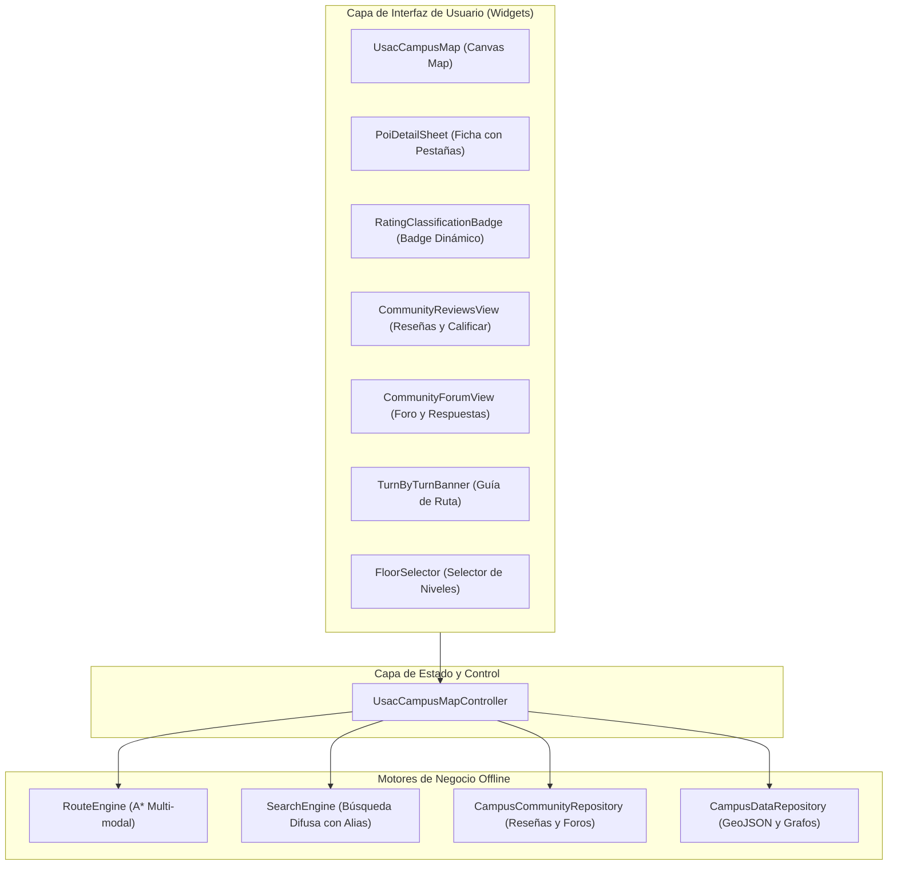

# Guía de Implementación del Paquete `usac_campus_map` en la Aplicación Cliente
## Manual de Integración, Arquitectura y Uso para Apps Móviles y Web de Estudiantes USAC

---

## 1. Introducción y Requisitos Previos

El paquete `usac_campus_map` proporciona un motor cartográfico autónomo, de **cero costo operativo ($0 USD)** y **funcionamiento 100% offline**, diseñado específicamente para el Campus Central de la Universidad de San Carlos de Guatemala (USAC).

### Requisitos de Entorno
- **Flutter SDK:** `>= 3.10.0`
- **Dart SDK:** `>= 3.0.0 < 4.0.0`
- **Plataformas Soportadas:** Android, iOS, Web, Windows, macOS, Linux.

---

## 2. Configuración en la Aplicación Cliente (`pubspec.yaml`)

Para consumir la librería desde tu aplicación cliente (por ejemplo, `PEMTREE-client` o app de estudiantes), agrega la dependencia en tu archivo `pubspec.yaml`:

```yaml
dependencies:
  flutter:
    sdk: flutter
  
  # Dependencia del paquete local o repositorio git
  usac_campus_map:
    path: ../usac_campus_map # o url de tu repositorio privado
```

### Declaración de Activos (Assets)
`usac_campus_map` incluye la cartografía vectorial oficial, grafos de andadores y POIs. Asegúrate de que los activos del paquete queden registrados en el `pubspec.yaml` de tu aplicación consumidora:

```yaml
flutter:
  assets:
    - packages/usac_campus_map/assets/geojson/usac_boundary.geojson
    - packages/usac_campus_map/assets/geojson/usac_buildings.geojson
    - packages/usac_campus_map/assets/graph/campus_graph.json
    - packages/usac_campus_map/assets/pois/usac_pois_and_indoors.json
```

---

## 3. Arquitectura y Componentes Principales



---

## 4. Inicialización Básica del Mapa

La forma recomendada de inicializar y renderizar el mapa es utilizando `UsacCampusMapController` en un `StatefulWidget`:

```dart
import 'package:flutter/material.dart';
import 'package:usac_campus_map/usac_campus_map.dart';

class CampusMapScreen extends StatefulWidget {
  const CampusMapScreen({super.key});

  @override
  State<CampusMapScreen> createState() => _CampusMapScreenState();
}

class _CampusMapScreenState extends State<CampusMapScreen> {
  late final UsacCampusMapController _controller;

  @override
  void initState() {
    super.initState();
    _controller = UsacCampusMapController();
    _initMapData();
  }

  Future<void> _initMapData() async {
    // Carga los polígonos, grafos y POIs en memoria
    await _controller.loadData();
    if (mounted) setState(() {});
  }

  @override
  void dispose() {
    _controller.dispose();
    super.dispose();
  }

  @override
  Widget build(BuildContext context) {
    if (_controller.isLoading) {
      return const Scaffold(
        body: Center(child: CircularProgressIndicator()),
      );
    }

    return Scaffold(
      appBar: AppBar(
        title: const Text('Campus Central USAC'),
        backgroundColor: const Color(0xFF002B49), // Azul Sancarlista
      ),
      body: UsacCampusMap(
        controller: _controller,
        theme: const UsacMapTheme(
          primaryColor: Color(0xFF002B49),
          accentColor: Color(0xFFF59E0B),
        ),
      ),
    );
  }
}
```

---

## 5. Búsqueda Difusa de Edificios y Alias Sancarlistas

El motor `SearchEngine` reconoce nombres formales, códigos y alias populares del campus:
- `"El Iglú"` $\rightarrow$ Plaza de los Mártires / Iglú
- `"T-3"` $\rightarrow$ Edificio T-3 (Facultad de Ingeniería)
- `"5B"` $\rightarrow$ Aula Magna / Edificio S-5

```dart
// Ejecutar una búsqueda en el controlador
_controller.search('Iglu');

// Obtener los resultados
final List<SearchResult> results = _controller.searchResults;
for (final item in results) {
  print('${item.title} (${item.subtitle}) - Alias: ${item.matchedAlias}');
}
```

---

## 6. Ruteo Multi-Modal y Navegación Paso a Paso

El motor de ruteo ejecuta el algoritmo **A\*** sobre el grafo topológico peatonal y vial de la universidad, soportando tres perfiles de navegación:

| Perfil (`NavigationMode`) | Descripción | Criterio de Selección de Aristas |
| :--- | :--- | :--- |
| `NavigationMode.pedestrian` | Ruta peatonal estándar | Andadores, plazas y senderos óptimos. |
| `NavigationMode.accessible` | Sin gradas (Sillas de ruedas) | Evita escalinatas y desniveles abruptos. |
| `NavigationMode.covered` | Ruta techada (Temporada de lluvia) | Prioriza pasillos cubiertos entre edificios. |

### Trazar Ruta entre Edificios:
```dart
final origin = _controller.buildings.firstWhere((b) => b.id == 't-3');
final destination = _controller.buildings.firstWhere((b) => b.id == 'biblio-central');

_controller.startRouteBetweenBuildings(
  origin: origin,
  destination: destination,
  mode: NavigationMode.pedestrian,
);
```

El widget `TurnByTurnBanner` se despliega automáticamente en la parte superior cuando existe una ruta activa, indicando metros restantes, instrucciones y el siguiente giro.

---

## 7. Módulo de Calificaciones y Reseñas Personalizables

El paquete incluye una arquitectura abierta que permite a la aplicación cliente **definir sus propios esquemas de clasificación** (niveles, emojis, umbrales de puntuación, colores, descripciones y etiquetas de verificación).

### 7.1. Registro de un Esquema Personalizado
Puedes registrar clasificaciones a través de `CampusCommunityRepository.instance`:

```dart
final repo = CampusCommunityRepository.instance;

// Esquema personalizado para Cafeterías del Campus
repo.registerClassification(
  const RatingClassificationConfig(
    category: 'cafeterias',
    title: 'Evaluación Gastronómica',
    tiers: [
      RatingTierItem(
        code: 'excelente',
        label: 'Exquisito',
        emoji: '🍽️',
        colorHex: 0xFF10B981,
        description: 'Calidad superior, higiene óptima y rapidez.',
        minRating: 4.5,
      ),
      RatingTierItem(
        code: 'bueno',
        label: 'Recomendable',
        emoji: '🥪',
        colorHex: 0xFF3B82F6,
        description: 'Buen sabor, porciones generosas y precio justo.',
        minRating: 3.5,
      ),
      RatingTierItem(
        code: 'regular',
        label: 'Económico',
        emoji: '🥤',
        colorHex: 0xFFF59E0B,
        description: 'Comida básica y rápida.',
        minRating: 2.5,
      ),
      RatingTierItem(
        code: 'deficiente',
        label: 'No Recomendado',
        emoji: '⚠️',
        colorHex: 0xFFEF4444,
        description: 'Servicio lento o higiene deficiente.',
        minRating: 0.0,
      ),
    ],
    availableTags: [
      'fast_service',
      'clean_tables',
      'card_payment',
      'affordable_combos',
    ],
    tagLabels: {
      'fast_service': '⚡ Servicio Rápido',
      'clean_tables': '✨ Mesas Limpias',
      'card_payment': '💳 Acepta Tarjeta',
      'affordable_combos': '💰 Combos Económicos',
    },
  ),
);
```

### 7.2. Esquemas Predeterminados Incluidos
Si no se registra un esquema custom, la librería incluye por defecto configuraciones profesionales y completas para:
1. **`sanitarios`**: Con tags (`💧 Agua corriente`, `🧻 Papel higiénico`, `🧼 Jabón de manos`, `🔒 Pestillo seguro`, `✨ Limpio`) y niveles desde *Excelente* hasta *Deficiente*.
2. **`general`**: Para edificios, aulas y facultades, con tags (`📶 Buen WiFi`, `🔌 Tomacorrientes`, `💡 Buena iluminación`, `🤫 Área silenciosa`, `♿ Accesible`).

### 7.3. Renderizado del Badge de Clasificación (`RatingClassificationBadge`)
```dart
RatingClassificationBadge(
  averageRating: 4.6,
  config: repo.getClassification('cafeterias'),
  tagsSummary: const {'fast_service': 12, 'card_payment': 8},
  compact: false, // true para vista chip en barras
)
```

---

## 8. Módulo de Foro Comunitario y Comentarios en Vivo

Permite a los estudiantes debatir, reportar objetos perdidos o pedir información sobre aulas y laboratorios en tiempo real:

- **Hilos Anidados:** Soporta comentarios principales y respuestas subordinadas mediante `parentId`.
- **Protección de Identidad:** Muestra pseudónimo elegido por el estudiante y carné verificado si aplica.
- **Soporte Tombstone:** Si un moderador elimina un comentario, este se renderiza automáticamente en gris atenuado (*"Este comentario ha sido retirado por infringir las normas de convivencia."*) preservando legibles las respuestas subordinadas.

```dart
// Widget autónomo del foro para un lugar específico
CommunityForumView(
  targetId: 't-3',
  targetName: 'Edificio T-3',
  theme: const UsacMapTheme(),
)
```

---

## 9. Ficha de Detalle Todo-en-Uno (`PoiDetailSheet`)

`PoiDetailSheet` es la interfaz integral que unifica:
1. **Pestaña Detalles:** Pisos, accesos peatonales y botones de trazado de ruta multimodal.
2. **Pestaña Reseñas:** Badge dinámico de la categoría, desglose de calificaciones, listado de opiniones y botón interactivo para calificar.
3. **Pestaña Foro:** Hilo de discusión en vivo con caja de texto para enviar comentarios.

### Modo de Invocación Recomendado:
```dart
PoiDetailSheet.show(
  context: context,
  building: selectedBuilding, // o poi: selectedPoi
  currentFloor: _controller.selectedFloor,
  userLocation: _controller.userLocation,
  theme: const UsacMapTheme(primaryColor: Color(0xFF002B49)),
  initialTabIndex: 0, // 0: Detalles, 1: Reseñas, 2: Foro
  onNavigate: (mode) {
    // Trazar ruta hacia este lugar
  },
);
```

---

## 10. Resumen de Clases y Exportaciones de la API

| Símbolo Exportado | Tipo | Descripción |
| :--- | :--- | :--- |
| `UsacCampusMap` | Widget | Componente principal de mapa interactivo en Flutter. |
| `UsacCampusMapController` | Clase | Controlador de estado, ruteo, pisos y geolocalización. |
| `PoiDetailSheet` | Widget | Ficha inferior modal con pestañas de info, reseñas y debate. |
| `RatingClassificationConfig` | Modelo | Configuración de niveles, emojis, colores y tags por categoría. |
| `RatingTierItem` | Modelo | Definición de un nivel de calificación con umbral numérico. |
| `RatingClassificationBadge`| Widget | Badge visual para mostrar promedios y tags evaluados. |
| `CommunityReviewsView` | Widget | Listado de reseñas con formulario modal interactivo. |
| `CommunityForumView` | Widget | Foro con respuestas anidadas y soporte tombstone. |
| `CampusCommunityRepository`| Servicio | Repositorio de reseñas y debates (aislado o singleton). |
| `FloorSelector` | Widget | Selector flotante de niveles interiores (Sótano, 1, 2, ...). |
| `TurnByTurnBanner` | Widget | Banner superior con guía direccional paso a paso. |
| `NavigationMode` | Enum | Modos de ruteo: `pedestrian`, `accessible`, `covered`. |
